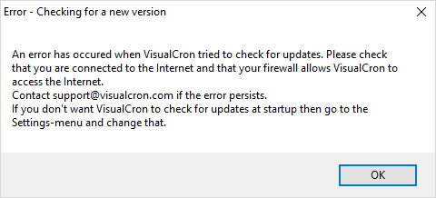

## Updates - Check for Updates

The ***File*** -> ***Updates*** -> ***Check for updates*** option asks the VisualCron web site whether a newer version than the connected Server is available.

If the Server already runs the latest version, a message says so.

If the Client runs a newer version than the official release, for example a test version, a message says that no newer official version is available.

### When the check fails

If the Client cannot reach the web site, for example because the computer is offline or a firewall blocks the Client, the error is shown as a Client event pop-up when the Client is connected to a Server, and as a message box when it is not. The same can happen when the Client starts and _Check for updates at startup_ is on. See [Client Events](../client-events).

The check uses the proxy set on the ***Proxy*** tab of [Client settings](client-settings).

### When a new version is available

The ***Checking for a new version*** window opens. It shows the _Server name_, the _Server version_ and the _Client version_, a status line, and the release notes for each newer version.

To download the new version:

1. Click ***Download new version***.
2. If a prompt says that the latest version is not covered by the license, click ***Yes*** to download it anyway, or ***No*** to stop.
3. Select the folder to save the installer in, and click ***OK***.
4. When the download is complete, click ***Yes*** to start the installer now, or ***No*** to run it later.

The installer is saved as `VisualCron<version>.exe` in the folder you selected. If you start it, the Client closes.

### Turn off the check at startup

When _Check for updates at startup_ is on, the Client checks about 40 seconds after it starts, and shows something only when a new version is available or the check fails.

1. Click ***File*** -> ***Settings*** -> ***Client settings***.
2. On the ***Main settings*** tab, clear _Check for updates at startup_.
3. Click ***Apply settings***.
