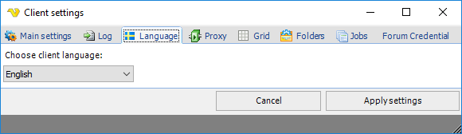
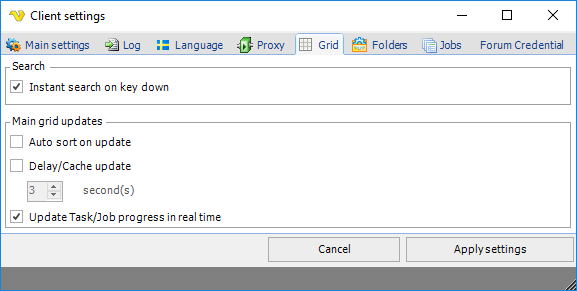

## Settings - Client Settings

The ***File*** -> ***Settings*** -> ***Client settings*** window holds the settings of the Client on this computer. They do not change the Server; Server settings are in [Main - Settings](../server/main-settings).

The window has the tabs ***Main settings***, ***Log***, ***Language***, ***Proxy***, ***Grid***, ***Folders***, ***Jobs***, ***Forum Credential***, ***Client events*** and ***Features***. Click ***Apply settings*** to save your changes, or ***Cancel*** to close without saving.

### Main settings tab

- _Show tooltips_: shows a tip with more information when the mouse pointer rests on a setting
- _Check for updates at startup_: checks the VisualCron web site for a newer version shortly after the Client starts; see [Updates - Check for Updates](check-for-updates)
- _Auto translate to UNC path_: when you select a file on a mapped drive, for example `Z:`, the Client enters the UNC path, for example `\\servername\folder\file`
- _Show Server message boxes_: shows alerts from the Server as message boxes; when cleared, they are written to the log window only
- _Show Server Stop confirmation dialog_: asks for confirmation before the Server is stopped
- _Start Tray Client on startup_: when checked, ***Apply settings*** sets the Tray Client to start each time any user logs on to this computer, and starts it if it is not running; when cleared, ***Apply settings*** removes it from startup. This is the same setting as _Start Tray Client on startup_ in the [Tray Client](../../using-visualcron/visualcron-tray-client) settings, and it applies to all users of the computer. The Client can show and change it only when it runs with administrator rights. Without them, the check box always shows as cleared, even when the Tray Client is set to start at logon, and changes are not saved
- _Auto scan for new servers in Manage servers_: the ***Manage servers*** window scans the network for Servers when it opens
- _Allow multiple Client instances at the same time_: lets more than one Client run on this computer
- _Do not show Trial tutorial wizard on startup_: does not show the tutorial wizard when the Client starts during a trial
- _Font_: the font used in the Client. Default "Roboto"

### Log tab

- _Filters in log window_: the event types shown in the log window: "Debug", "Information", "Error" and "Communication"
- _Log to file_: _Client events_ writes the Client events to the Client log file, in the _Log folder_ on the ***Folders*** tab

### Language tab

- _Choose client language_: the language of the Client. Restart the Client for the change to take effect

:::note

The documentation, the web site, and log and debug entries are in English whatever the language setting. Text that users enter, such as a Job description, stays in the language it was entered in.

:::

### Proxy tab

This tab sets the proxy that the Client uses for its own web requests, such as [Check for updates](check-for-updates). Select the _Proxy type_, normally "HTTP Proxy", then enter the _Address_ and _Port_ and, if the proxy needs them, the credentials. The fields are the same as in the Server proxy settings; see [Settings - Proxy](../server/settings-proxy).

### Grid tab

- _Show Job folders_: shows the Job folders pane next to the main grid; see [Job Folders](../job-folders)
- _Group Connections_: groups the rows in the Connections grid
- _Auto sort on update_: sorts all Jobs again each time an update is received. This slows the Client down. Default off
- _Delay/Cache update_: delays row updates in the main grid by the number of seconds you set, to improve performance. Default off
- _Update Task/Job progress in real time_: updates Task and Job progress in the grid as it happens
- _Instant search on key down_: the grid filter applies as you type; see [Filter - Grid Filter](../interface/filter-grid-filter)

### Folders tab

The folders the Client uses on this computer: _Backup folder_, _Settings folder_ and _Log folder_. Each has a browse button to change it and an ***Open*** button to open it. ***Reset to default*** restores the default paths. The Server folders are set in the Server settings; see [Settings - Folders](../server/settings-folders).

### Jobs tab

- _Days to track failed Jobs_: the number of days for which failed Jobs are tracked

### Forum Credential tab

The VisualCron forum account the Client uses to access the Task repository. Enter your forum _Username_ and _Password_. The links ***Register an account here*** and ***Reset password here*** open the forum.

### Client events tab

Check the Client events you want pop-ups for; see [Client Events](../client-events).

### Features tab

Clear a feature to hide it from the Client user interface on this computer. This changes only what this Client shows; it does not change user permissions on the Server.
