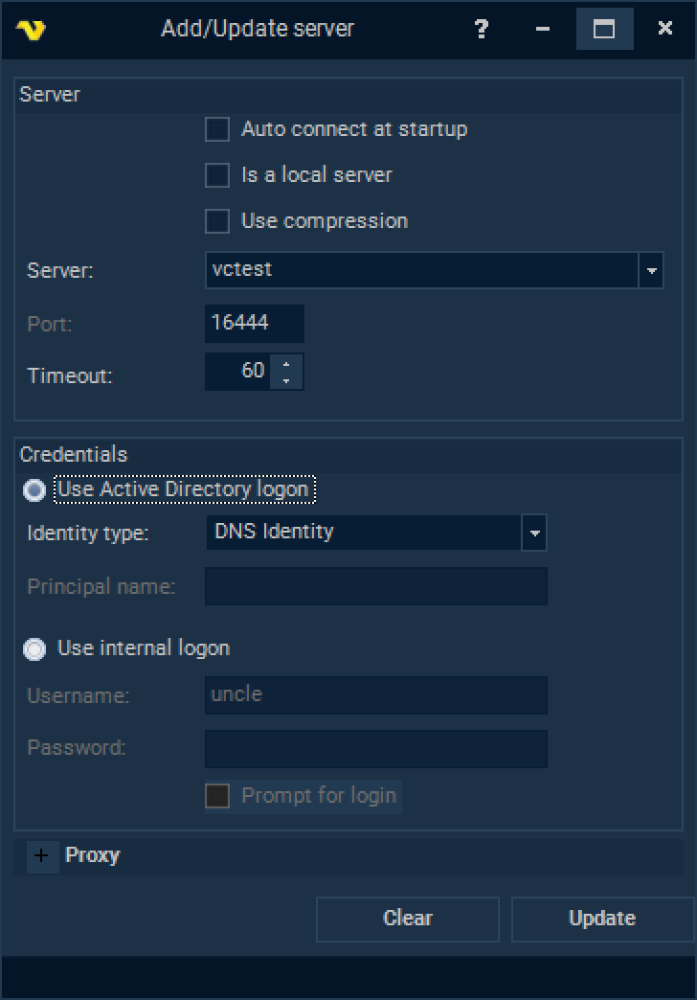

## Servers - Manage Servers

The ***File*** -> ***Servers*** -> ***Manage Servers*** option opens the ***Manage servers*** window, where you add, edit and delete the Server connections that this Client uses.

By default, the Server is installed and started on the same computer as the Client. You can add any number of connections to other Servers, and connect to them manually or automatically when the Client starts. When the Client starts, it connects to each connection that has _Auto connect at startup_ checked. The login window opens only when the connection has _Prompt for login_ checked or, for an Active Directory logon, when the Server no longer accepts the saved logon. Other logon failures, such as a wrong password, show a message; see [Login](../../using-visualcron/login). The connected Server's name is shown on the main menu ***Server*** tab as `Server [<server name>]`, and its address is shown in the status bar.

### Manage servers window

- ***Add***, ***Edit*** and ***Delete***: add a connection, change the selected connection, or remove it. ***Delete***, or the Delete key in the list, removes the connection from this Client at once, without a confirmation; it does not change the Server
- _Scanning for unassigned servers_: the lower list shows Windows computers and VisualCron Servers found on the network. Right-click one and click ***Add to Client Connections*** to add it

Right-click a connection in the upper list for more options: ***Edit***, ***Delete***, ***Upgrade VisualCron***, ***Uninstall VisualCron*** and ***Create connection***. In the lower list, ***Install VisualCron*** installs VisualCron on that computer, from the official web site or from an installation file you select, as "Client and Server" or "Client only". The install, upgrade and uninstall options ask for Windows credentials for that computer.

:::warning

***Delete*** and the Delete key remove the selected connection, with its saved credentials, without a confirmation. ***Uninstall VisualCron*** removes VisualCron from the remote computer after you enter the credentials. There is no other confirmation.

:::

### Switching between servers

The Client can be connected to several Servers at the same time. Each connected Server has its own row in the main grid, with its Jobs below it, and the ribbon commands and settings apply to the current Server. To change the current Server, click a Server row in the main grid, or select a Server in the Server selection combo box at the left of the toolbar.

When the icon next to a connection shows it as disconnected, most main menu options are unavailable. Click ***Connect*** in the toolbar to connect to the selected Server. While the Client connects, the combo box and ***Connect*** are unavailable. The Client then shows the Server's name and its Jobs and Tasks. See [Server Selection](../toolbar/server-selection).

### Add or edit a connection

To edit a connection:

1. Select it in the list.
2. Click ***Edit***.
3. Change the values.
4. Click ***Update***.

To add a connection:

1. Click ***Add***, or click ***Clear*** if you are editing a connection.
2. Enter the values.
3. Click ***Add***.

#### Server

- _Auto connect at startup_: connects to this Server when the Client starts
- _Is a local server_: the Server runs on the same computer as the Client. Logon to a local Server is much faster
- _Use compression_: compresses the data sent between the Client and this Server
- _Server_: the computer name or IP address of the Server. Default "localhost". For an Active Directory logon that must use Kerberos, enter the host name, not the IP address
- _Port_: the port the Server listens on. Default "16444". It must match the port set in the Server settings; see [Main settings](../server/main-settings). If a firewall is used, the port must be open for incoming traffic on the Server computer
- _Timeout_: how long the Client waits for the Server. Default "60"; see [Client timeouts](../../troubleshooting/client-timeouts)

#### Credentials

VisualCron has two ways to log on: internal VisualCron users, and Active Directory. Active Directory logon must first be allowed on the Server; see [Settings - Users/Logon](../server/settings-users-logon).

- _Use Active Directory logon_: logs on with your Windows account. Uses _Identity type_ and _Principal name_
- _Use internal logon_: logs on with a VisualCron user. Uses _Username_ and _Password_
- _Identity type_: how the Client authenticates the Server. It is available only with _Use Active Directory logon_, and applies only to a remote Server; if _Is a local server_ is checked, it is ignored. With _Use internal logon_ the field is unavailable and "DNS Identity" is used. See below
- _Principal name_: the principal name of the Server, for "UPN identity" and "SPN identity". See below
- _Username_: the VisualCron user name. Default "admin". Change the default password after the first logon
- _Password_: the password of the user. Blank by default. Change it after the first logon
- _Prompt for login_: asks for the user name and password each time you connect

#### Identity type

Select the _Identity type_ that matches the account the VisualCron Service runs under on the Server computer. To find it, open the Windows Services console on the Server, right-click **VisualCron Service**, click **Properties** and look at the **Log On** tab. The values the Server reports for itself are shown on the ***Users/Logon*** tab of ***Server*** -> ***Main settings*** -> ***Settings***.

| VisualCron Service runs as | Identity type | Principal name |
|---|---|---|
| Local System | "SPN identity" | `HOST/<server FQDN>`, for example `HOST/vcserver.contoso.com` |
| A domain user account, for example `DOMAIN\username` | "UPN identity" | `<user name>@<domain>`, for example `svc-vc@contoso.com` |

:::warning

"SPN identity" and "UPN identity" are mutually exclusive. The Server publishes only one of the two, depending on the account the service runs under. Selecting the wrong one stops the Client from connecting, with a message that names the identity type to switch to. See [Troubleshooting](#troubleshooting).

:::

- "DNS Identity": the default for new connections, and the value used with _Use internal logon_. All messages between the Client and the Server are protected by VisualCron certificate encryption. This identity type carries no Windows credentials to a remote Server, so an Active Directory logon over it is refused
- "Windows Default": not supported for connections to a remote Server. Select "SPN identity" or "UPN identity" instead
- "UPN identity": for a VisualCron Service that runs as a domain user account. Enter the account's UPN in _Principal name_
- "SPN identity": for a VisualCron Service that runs as Local System. Enter the SPN in _Principal name_

#### Filling in the identity from the connected Server

When the Client is connected to the Server a connection points at, the _Add/Update server_ window can fill in _Identity type_ and _Principal name_ with the values that Server reports for itself:

- "UPN identity" and the service account's UPN, when the service runs as a domain user account
- "SPN identity" and `HOST/<server FQDN>`, when the service runs as Local System

The window fills in the fields only when all of the following are true:

- _Use Active Directory logon_ is selected and _Is a local server_ is cleared
- _Identity type_ is still "DNS Identity" and _Principal name_ is empty. A value you entered or selected is never replaced
- The Client is connected to the Server named in the _Server_ field. For a new connection, that is the current Server. For a connection you edit, it is that connection's own Server. The names must match, or resolve to the same host name
- The Server reports a usable value. Nothing is filled in when the service runs as Network Service or Local Service, or as Local System on a Windows installation in a language other than English

The fields are filled in when you select _Use Active Directory logon_ and when you open a connection with _Edit_. For a new connection, they are also filled in when you leave the _Server_ field or change _Is a local server_. The filled-in values stay editable, and nothing is saved until you click ***Add*** or ***Update***. When the Client is not connected to that Server, select the _Identity type_ and enter the _Principal name_ yourself, using the table above.

#### Principal name

_Principal name_ is the explicit principal name used during Active Directory authentication, for "UPN identity" and "SPN identity" only. A value is required for both, and the Client checks its form when you click ***Add*** or ***Update***:

- "UPN identity": `<user name>@<domain>`. Otherwise saving is refused with "Principal Name should be in username@domain format."
- "SPN identity": `<service>/<host>`, for example `HOST/vcserver.contoso.com`. Otherwise saving is refused with "Principal Name should be in service/host format, for example HOST/server.domain.com."

A bare host name such as `vcserver.contoso.com` is not an SPN. Windows cannot issue a Kerberos ticket for it, so authentication falls back to NTLM, which a domain that enforces Kerberos refuses. A connection saved with a bare host name in an earlier release still connects where NTLM is allowed, but it cannot be saved again until you correct the value. To list the SPN values of a computer, run `setspn -l <server DNS name>` in a Windows command prompt.

#### Proxy

The proxy used for the web requests the Client makes for this Server, such as license activation. It does not apply to the connection between the Client and the Server. Select the _Proxy type_ and enter the proxy details. If you use a proxy to reach the Internet and cannot connect, check these settings with your network administrator.

### Troubleshooting

_The client and server cannot communicate, because they do not possess a common algorithm_

TLS 1.2 may be turned off on the computer. Install .NET 4.7 or later and restart the computer.

_Connection failed to '...'. The Server is running but does not offer the Windows-authentication endpoint this connection asked for._

The connection uses _Use Active Directory logon_, and its _Identity type_ does not match how the VisualCron Service is started on the Server. The message names the identity type to switch to: "UPN identity" with the service account's UPN for a Server that runs as a domain user account, or "SPN identity" with `HOST/<server FQDN>` for a Server that runs as Local System. Both values are shown on the ***Users/Logon*** tab of ***Server*** -> ***Main settings*** -> ***Settings***. The original error, _The requested upgrade is not supported by 'net.tcp://..._, follows the explanation.

To reach the Server while you fix this, add a connection that uses _Use internal logon_ with an internal VisualCron user.

_Connection failed to '...'. This may indicate that the Server has not been fully started ... If the Server is running, it did not offer the Windows-authentication endpoint this connection asked for._

Either the Server is still starting, or it is running and publishes the other Windows-authentication endpoint. Wait a few seconds and try again. If the message persists, switch the identity type as the message describes.

_Connection failed ... The Server rejected the Windows authentication handshake before login was attempted._

Windows could not obtain a Kerberos ticket for the principal name in use, and the Server refused the NTLM fallback. A domain that enforces Kerberos does this, for example for members of the _Protected Users_ group. The message names what to check for the _Identity type_ in use:

- "SPN identity": the _Principal name_ is a complete SPN in `<service>/<host>` form, and it is registered in Active Directory
- "UPN identity": the _Principal name_ is the UPN of the service account, and _Server_ is a host name rather than an IP address
- "DNS Identity": this identity type gives Kerberos no service principal, so Windows can only use NTLM. Set _Identity type_ to "SPN identity" or "UPN identity"

_Login failed, reason: the Server did not receive a Windows identity from this connection, so Active Directory logon cannot proceed._

The connection reached the Server, but its _Identity type_ is "DNS Identity", which carries no Windows credentials to a remote Server. Edit the connection and set _Identity type_ to "SPN identity" or "UPN identity" with the matching _Principal name_. In earlier releases this failure was not reported, and the Client appeared connected although no logon had taken place.

### Related topics

- [Kerberos-Only Authentication and AD Protected Users](../../using-visualcron/kerberos-protected-users)
- [Settings - Users/Logon](../server/settings-users-logon)
- [Login](../../using-visualcron/login)
