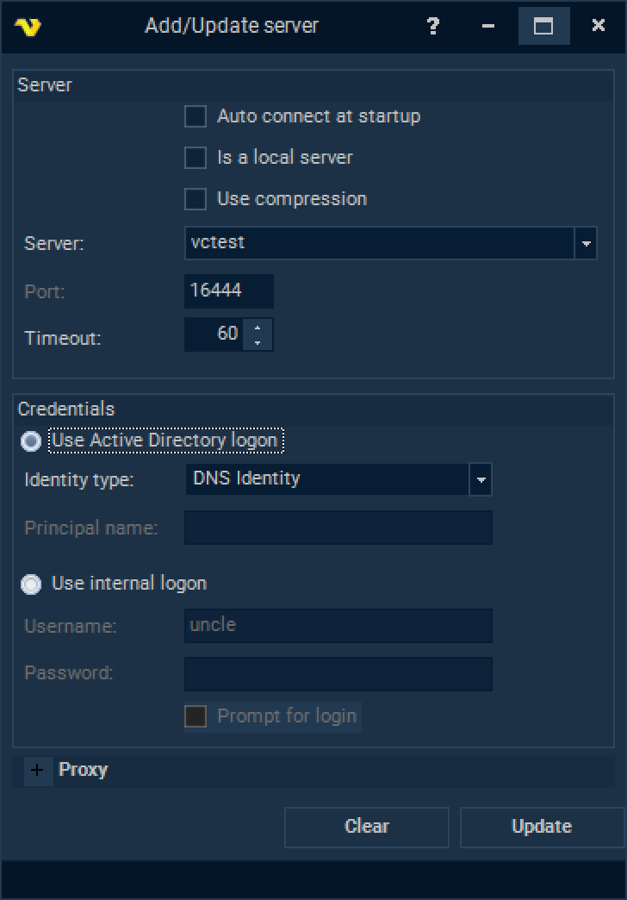

## Servers - Manage Servers

The ***File*** -> ***Servers*** -> ***Manage Servers*** option opens the ***Manage servers*** window, where you add, edit and delete the Server connections that this Client uses.

By default, the Server is installed and started on the same computer as the Client. You can add any number of connections to other Servers, and connect to them manually or automatically when the Client starts. When the Client starts, it connects to each connection that has _Auto connect at startup_ checked. The login window opens only when the connection has _Prompt for login_ checked or, for an Active Directory logon, when the Server no longer accepts the saved logon. Other logon failures, such as a wrong password, show a message; see [Login](../../using-visualcron/login). The connected Server's name is shown on the main menu ***Server*** tab as `Server [<server name>]`, and its address is shown in the status bar.

### Manage servers window

- ***Add***, ***Edit*** and ***Delete***: add a connection, change the selected connection, or remove it. ***Delete***, or the Delete key in the list, removes the connection from this Client at once, without a confirmation; it does not change the Server
- _Scanning for unassigned servers_: the lower list shows Windows computers and VisualCron Servers found on the network. Right-click one and click ***Add to Client Connections*** to add it

Right-click a connection in the upper list for more options: ***Edit***, ***Delete***, ***Upgrade VisualCron***, ***Uninstall VisualCron*** and ***Create connection***. In the lower list, ***Install VisualCron*** installs VisualCron on that computer, from the official web site or from an installation file you select, as "Client and Server" or "Client only". The install, upgrade and uninstall options ask for Windows credentials for that computer.

:::warning

***Delete*** and the Delete key remove the selected connection, with its saved credentials, without a confirmation. ***Uninstall VisualCron*** removes VisualCron from the remote computer after you enter the credentials. There is no other confirmation.

:::

### Switching between servers

The Client can be connected to several Servers at the same time. Each connected Server has its own row in the main grid, with its Jobs below it, and the ribbon commands and settings apply to the current Server. To change the current Server, click a Server row in the main grid, or select a Server in the Server selection combo box at the left of the toolbar.

When the icon next to a connection shows it as disconnected, most main menu options are unavailable. Click ***Connect*** in the toolbar to connect to the selected Server. While the Client connects, the combo box and ***Connect*** are unavailable. The Client then shows the Server's name and its Jobs and Tasks. See [Server Selection](../toolbar/server-selection).

### Add or edit a connection

To edit a connection:

1. Select it in the list.
2. Click ***Edit***.
3. Change the values.
4. Click ***Update***.

To add a connection:

1. Click ***Add***, or click ***Clear*** if you are editing a connection.
2. Enter the values.
3. Click ***Add***.

#### Server

- _Auto connect at startup_: connects to this Server when the Client starts
- _Is a local server_: the Server runs on the same computer as the Client. Logon to a local Server is much faster
- _Use compression_: compresses the data sent between the Client and this Server
- _Server_: the computer name or IP address of the Server. Default "localhost"
- _Port_: the port the Server listens on. Default "16444". It must match the port set in the Server settings; see [Main settings](../server/main-settings). If a firewall is used, the port must be open for incoming traffic on the Server computer
- _Timeout_: how long the Client waits for the Server. Default "60"; see [Client timeouts](../../troubleshooting/client-timeouts)

#### Credentials

VisualCron has two ways to log on: internal VisualCron users, and Active Directory. Active Directory logon must first be allowed on the Server; see [Settings - Users/Logon](../server/settings-users-logon).

- _Use Active Directory logon_: logs on with your Windows account. Uses _Identity type_ and _Principal name_
- _Use internal logon_: logs on with a VisualCron user. Uses _Username_ and _Password_
- _Identity type_: how the Client authenticates the Server. It is available only with _Use Active Directory logon_, and applies only to a remote Server; if _Is a local server_ is checked, it is ignored. With _Use internal logon_ the field is unavailable and "DNS Identity" is used. See below
- _Principal name_: the principal name of the Server, for "UPN identity" and "SPN identity". See below
- _Username_: the VisualCron user name. Default "admin". Change the default password after the first logon
- _Password_: the password of the user. Blank by default. Change it after the first logon
- _Prompt for login_: asks for the user name and password each time you connect

#### Identity type

Select the _Identity type_ that matches the account the VisualCron Service runs under on the Server computer. To find it, open the Windows Services console on the Server, right-click **VisualCron Service**, click **Properties** and look at the **Log On** tab.

| VisualCron Service runs as | Identity type | Principal name |
|---|---|---|
| Local System, Network Service or Local Service | "SPN identity" | Required |
| A domain user account, for example `DOMAIN\username` | "UPN identity" | Required |

:::warning

"SPN identity" and "UPN identity" are mutually exclusive. The Server publishes only one of the two, depending on the account the service runs under. Selecting the wrong one, or leaving _Principal name_ empty, stops the Client from connecting. See [Troubleshooting](#troubleshooting).

:::

- "DNS Identity": kept for backwards compatibility, and the value used with _Use internal logon_. All messages between the Client and the Server are protected by VisualCron certificate encryption. This identity type cannot complete an Active Directory logon to a remote Server
- "Windows Default": not supported for connections to a remote Server. Select "SPN identity" or "UPN identity" instead
- "UPN identity": for a VisualCron Service that runs as a domain user account. Enter the _Principal name_
- "SPN identity": for a VisualCron Service that runs as Local System, Local Service or Network Service. Enter the _Principal name_

#### Principal name

_Principal name_ is the explicit principal name used during Active Directory authentication, for "UPN identity" and "SPN identity" only. A value is required for both. If it is left empty, the connection fails, although the Client lets you save the connection.

- "UPN identity": the value looks like `username@FQDN`
- "SPN identity": the value looks like `HOST/serverDNSname.FQDN` or `serverDNSname.FQDN`. To list the SPN values of a computer, run `setspn -l serverDNSname` in a Windows command prompt

The UPN and SPN values that the Server detects are shown on the ***Users/Logon*** tab of ***Server*** -> ***Main settings*** -> ***Settings***; copy the matching value from there. See [Settings - Users/Logon](../server/settings-users-logon).

#### Proxy

The proxy used for the web requests the Client makes for this Server, such as license activation. It does not apply to the connection between the Client and the Server. Select the _Proxy type_ and enter the proxy details. If you use a proxy to reach the Internet and cannot connect, check these settings with your network administrator.

### Troubleshooting

_The client and server cannot communicate, because they do not possess a common algorithm_

TLS 1.2 may be turned off on the computer. Install .NET 4.7 or later and restart the computer.

_The requested upgrade is not supported by 'net.tcp://servername:16444/'. This could be due to mismatched bindings (for example security enabled on the client and not on the server)._

The _Identity type_ of the connection does not match how the VisualCron Service is started on the Server. Check the following in order:

1. On the Server computer, open the Windows Services console and check the account under **VisualCron Service** -> **Properties** -> **Log On**.
2. Set _Identity type_ to "SPN identity" if that account is Local System, Network Service or Local Service, or to "UPN identity" if it is a domain user account.
3. Make sure _Principal name_ is not empty. Copy the matching value from the ***Users/Logon*** tab of ***Server*** -> ***Main settings*** -> ***Settings***.
4. Make sure _Identity type_ is not "Windows Default", which cannot be used for a connection to a remote Server.

To reach the Server while you fix this, add a connection that uses _Use internal logon_ with an internal VisualCron user.

_Login failed, reason: Failed to obtain security context from client. Switch identity type(?)_

The Client reached the Server, but no Active Directory security context was negotiated. This happens when _Use Active Directory logon_ is combined with "DNS Identity" on a connection to a remote Server. Change _Identity type_ to "SPN identity" or "UPN identity" as described above.
