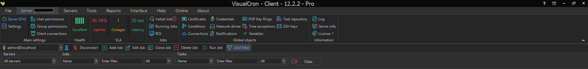

## Main Menu

The main menu is the ribbon at the top of the Client window. It has these tabs:

- [File](file/file.md): import and export, updates, Client settings, Manage Servers and translation
- [Server](server/server.md): the connected Server's status, settings, permissions, health, SLA, Jobs and global objects. The tab shows the Server's name, as `Server [<server name>]`
- [Servers](servers/servers.md): sync settings, failover, MFT, cloud and execution distribution
- [Tools](tools/overview): explore, objects, schedule, flow chart and Gantt chart
- [Reports](reports): reports on Jobs, Tasks, logs, Notifications, Connections and the Server
- [Interface](interface/overview): column, filter and theme options for the main grid
- [Help](help/overview): the documentation, the forum, contact and tutorials
- ***Online***: links to pages on the VisualCron web site
- [About](about/overview): version information and feature suggestions

