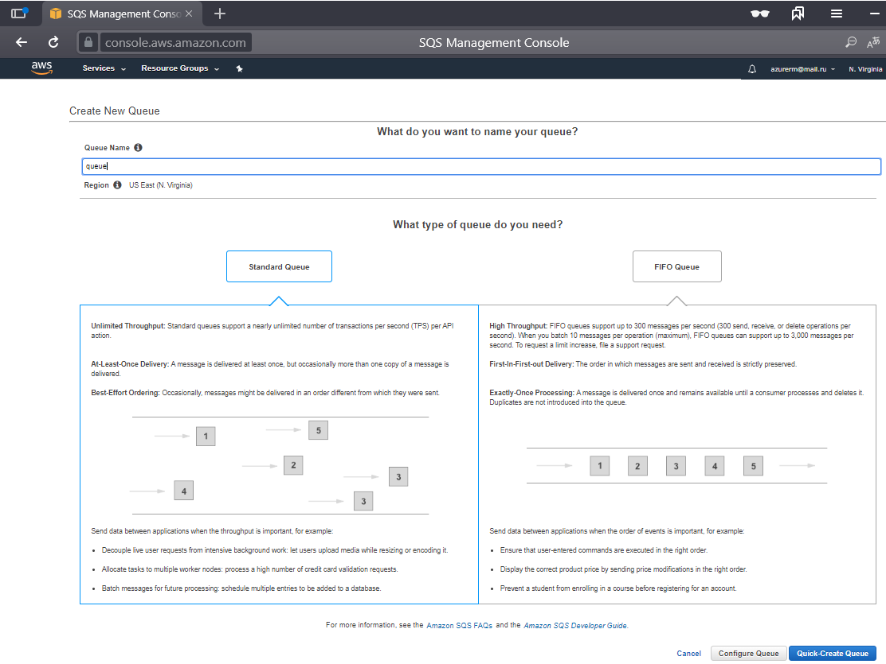
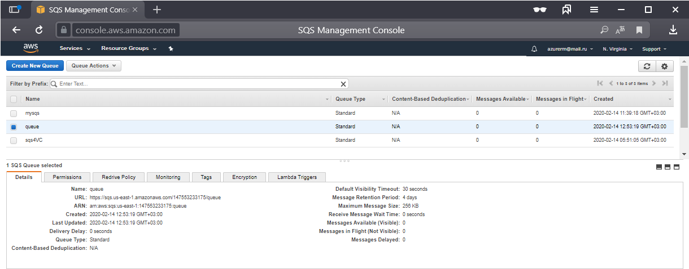

## Connection - Amazon

The Amazon Connection stores the address, sign-in and security settings that these Tasks and Triggers use to connect to Amazon S3, other Amazon Web Services and S3-compatible storage services:

- [Cloud - Upload file(s)](job-tasks/cloud-transfer-tasks/upload-file)
- [Cloud - Download file(s)](job-tasks/cloud-transfer-tasks/download-file)
- [Cloud - List item(s)](job-tasks/cloud-transfer-tasks/list-item)
- Cloud - List folder(s)
- [Cloud - Create folder](job-tasks/cloud-transfer-tasks/create-folder)
- [Cloud - Delete item(s)](job-tasks/cloud-transfer-tasks/delete-item)
- [Cloud - Copy/move item(s)](job-tasks/cloud-transfer-tasks/copy-move)
- [Cloud - Sync file(s)](job-tasks/cloud-transfer-tasks/sync)
- [Amazon SNS - Publish message](job-tasks/messaging-tasks/sns-publish-message)
- [The Amazon EC2 Tasks](job-tasks/amazon-ec2-tasks/overview)
- The Amazon DynamoDB Tasks
- The Amazon SimpleDB Tasks
- [The Cloud file Trigger](event-trigger-cloud-file)
- [The Amazon SQS Trigger](event-trigger-sqs)

### Common settings

The ***Common settings*** and ***Proxy*** tabs are the same for every Connection type that has them; see [Common settings](global-connections#common-settings) and [Proxy](global-connections#proxy).

_Test_ asks the Server to connect with the current settings. For an Amazon Connection, the Server lists the objects in _Default bucket_. When _Default bucket_ is empty, it lists the buckets of the account instead, so the AWS user needs permission to list buckets for the test to pass. When the test fails, the message refers to the Server log for details.

### Main settings

These fields are on ***Connection settings*** -> ***Main settings***.

_Address_

The endpoint address of an S3-compatible storage service. Leave it empty to connect to Amazon S3.

_Authentication type_

- "Password": signs requests with _Access Key ID_ and _Secret Access Key_
- "Public key": hides _Access Key ID_ and _Secret Access Key_ and shows a certificate selector instead. The Server presents the selected [Certificate](global-certificates) as a TLS client certificate

_Access Key ID_ and _Secret Access Key_

The access key of the AWS user. Shown for "Password".

_Region_

The region of the buckets, for example `us-east-1`. When _Region_ is empty, the default region is used. When _Address_ is set, the region is sent to the S3-compatible service as a custom region.

_Use version 4 signatures_

Selected by default. Requests are signed with AWS Signature Version 4. Leave it selected for Amazon S3. Clear it only for an S3-compatible service that requires Signature Version 2.

_Use HEAD requests_

Selected by default. The Server requests only the headers of an object when it reads object details. The Server uses HEAD requests whether or not the box is selected.

_Auto-accept server certificates_

Selected by default.

:::warning

Amazon Connections accept any server certificate, whether or not _Auto-accept server certificates_ is selected. The Server does not check the server certificate when it connects, so it cannot tell the real server from another server that answers at the same address. In addition, when a list, download or upload request fails with a connection-shutdown error whose message contains "75782", the Server repeats that request once without SSL, so the repeated request and its data travel unencrypted; requests that create folders are not repeated this way. Connect to Amazon S3, or to the S3-compatible service, only over a network path that you trust.

:::

_Use URL encoding_

Selected by default. URL-encodes object keys. It applies only when _Address_ is set, that is, to S3-compatible services.

_Default bucket_

The bucket that Tasks use when they name no bucket. _Test_ also uses it.

_Multipart upload threshold_

The file size in bytes above which uploads use multipart upload. Default: "104857600" (100 MB).

### Amazon SQS

The [Amazon SQS Trigger](event-trigger-sqs) uses this Connection to read messages from an SQS queue. Create the queue in the Amazon SQS console. The two images show the console when a queue is created and when queues are listed.

### Troubleshooting

#### General

Click _Test_ and check the Server log, or open the Connection in the Connection Explorer, to see the error that Amazon returns.

#### HTTP request failed with code 403 (Forbidden)

The AWS user does not have permission to list the buckets, or the objects in the bucket. Add the missing permission to the user. Tasks do not work without it.

#### SignatureDoesNotMatch

Select or clear _Use version 4 signatures_ to change the signature version.

#### Connection lost (error code is 100353)

This is most likely a proxy error. Set the proxy on the ***Proxy*** tab of the Connection.

#### The hostname could not be parsed

Select an Amazon region in _Region_.

#### HTTP request failed with code 400 (Bad Request). Error code: AuthorizationHeaderMalformed

The selected region does not match the region of the bucket. Select the bucket's region in _Region_.
