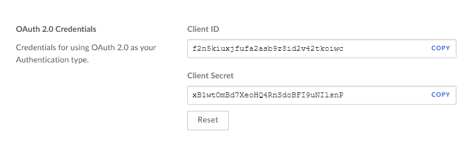
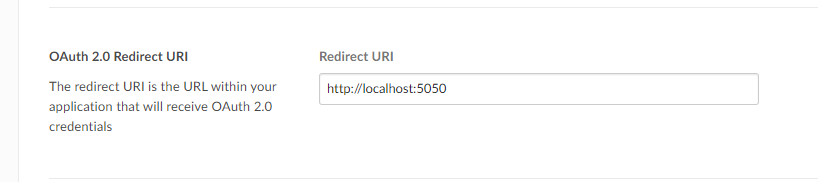

## Connection - Box

The Box Connection stores the sign-in and security settings that these Tasks and Triggers use to connect to Box:

- [Cloud - Upload file(s)](job-tasks/cloud-transfer-tasks/upload-file)
- [Cloud - Download file(s)](job-tasks/cloud-transfer-tasks/download-file)
- [Cloud - List item(s)](job-tasks/cloud-transfer-tasks/list-item)
- Cloud - List folder(s)
- [Cloud - Create folder](job-tasks/cloud-transfer-tasks/create-folder)
- [Cloud - Delete item(s)](job-tasks/cloud-transfer-tasks/delete-item)
- [Cloud - Copy/move item(s)](job-tasks/cloud-transfer-tasks/copy-move)
- [Cloud - Sync file(s)](job-tasks/cloud-transfer-tasks/sync)
- The [Cloud file Trigger](event-trigger-cloud-file)

Use it to transfer files between Box and a local folder, or between Box and another cloud service.

### Common settings

The ***Common settings*** and ***Proxy*** tabs are the same for every Connection type that has them; see [Common settings](global-connections#common-settings) and [Proxy](global-connections#proxy).

_Test_ asks the Server to refresh the stored sign-in and read the root folder of the Box account.

### Main settings

These fields are on ***Connection settings*** -> ***Main settings***.

_Client ID_

The client ID of your Box app, from the _Configuration_ page of the app in the Box Developer Console. Required.

_Client Secret_

The client secret of your Box app.

_Redirect URI_

The address that Box sends the sign-in result to. Default: "http://localhost:5050". Enter the same address as the redirect URI of the Box app.

_Auto-accept server certificates_

Selected by default.

:::warning

Box Connections accept any server certificate, whether or not _Auto-accept server certificates_ is selected. The Server does not check the server certificate when it connects to Box, so it cannot tell the real server from another server that answers at the same address. Connect to Box only over a network path that you trust.

:::

_Create an account_

Opens the Box developer pages. The Box Developer Console is at [https://app.box.com/developers/console](https://app.box.com/developers/console).

_Authenticate_

Starts the Box sign-in. See [How to create a Box Connection](#how-to-create-a-box-connection).

### Proxy

:::warning

Cloud Tasks and the Cloud file Trigger do not use the ***Proxy*** tab of a Box Connection. Only _Authenticate_ in the Client uses it. On a network where the Server reaches the Internet only through a proxy, Jobs that use a Box Connection fail.

:::

### How to create a Box Connection

To create a Box Connection, complete the following steps:

1. Open the Box Developer Console.
2. Create a Custom App that uses User Authentication (OAuth 2.0).
3. On the _Configuration_ page of the app, enter the value of _Redirect URI_, by default "http://localhost:5050", as the redirect URI.
4. Copy the client ID into _Client ID_.
5. Copy the client secret into _Client Secret_.
6. Click _Authenticate_.
7. Sign in with the Box account.
8. Grant access to VisualCron.
9. Click _OK_ to save the Connection.
10. Click _Test_ on the ***Common settings*** tab.

The test reports that it was successful.

### Authentication and token expiry

- _Authenticate_ runs on the computer where the Client runs. The browser opens there, and the Client listens for the sign-in result on the port of _Redirect URI_, so that port must be free on that computer
- At run time, the Server refreshes the sign-in and stores the new refresh token in the Connection
- Box no longer accepts a refresh token that has not been used for 60 days. The Server then marks the Connection as expired, and the Client shows the message "Connection session expired". Open the Connection and click _Authenticate_ again
