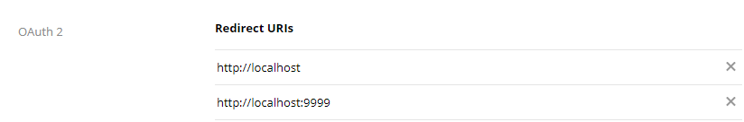
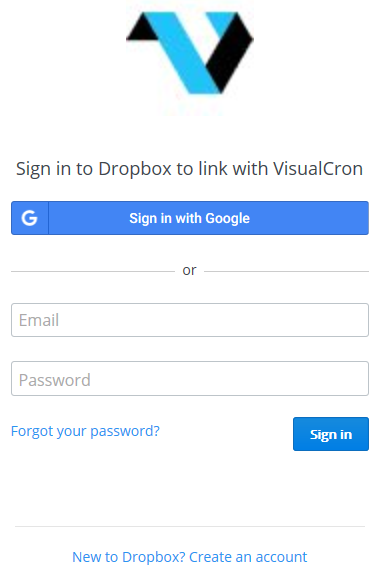

## Connection - Dropbox

The Dropbox Connection stores the sign-in and security settings that these Tasks and Triggers use to connect to Dropbox:

- [Cloud - Upload file(s)](job-tasks/cloud-transfer-tasks/upload-file)
- [Cloud - Download file(s)](job-tasks/cloud-transfer-tasks/download-file)
- [Cloud - List item(s)](job-tasks/cloud-transfer-tasks/list-item)
- Cloud - List folder(s)
- [Cloud - Create folder](job-tasks/cloud-transfer-tasks/create-folder)
- [Cloud - Delete item(s)](job-tasks/cloud-transfer-tasks/delete-item)
- [Cloud - Copy/move item(s)](job-tasks/cloud-transfer-tasks/copy-move)
- [Cloud - Sync file(s)](job-tasks/cloud-transfer-tasks/sync)
- The [Cloud file Trigger](event-trigger-cloud-file)

A Dropbox Connection needs a Dropbox app that you create.

### Common settings

The ***Common settings*** and ***Proxy*** tabs are the same for every Connection type that has them; see [Common settings](global-connections#common-settings) and [Proxy](global-connections#proxy).

_Test_ asks the Server to connect with the stored sign-in and list the root folder of the Dropbox.

### Main settings

These fields are on ***Connection settings*** -> ***Main settings***.

_App Key_

The app key of your Dropbox app. Required.

_App Secret_

The app secret of your Dropbox app.

_Redirect Url_

The address that Dropbox sends the sign-in result to. Default: "http://localhost:9999". Add the same address as a redirect URI of the Dropbox app.

_Auto-accept server certificates_

Selected by default.

:::warning

Dropbox Connections accept any server certificate, whether or not _Auto-accept server certificates_ is selected. The Server does not check the server certificate when it connects to Dropbox, so it cannot tell the real server from another server that answers at the same address. Connect to Dropbox only over a network path that you trust.

Each time the Server refreshes the Dropbox sign-in, for example when a Task runs, it also sets the whole Server process to accept any server certificate and to allow SSL 3.0. After that, other HTTPS connections from the Server, not only those to Dropbox, accept any server certificate.

:::

_Create an account_

Opens the Dropbox App Console.

_Authenticate_

Starts the Dropbox sign-in. See [Authentication and token expiry](#authentication-and-token-expiry).

### How to create a Dropbox Connection

To create a Dropbox Connection, complete the following steps:

1. Open the Dropbox App Console at [https://www.dropbox.com/developers/apps](https://www.dropbox.com/developers/apps), or click _Create an account_.
2. Create an app.
3. On the _Permissions_ tab of the app, enable the permissions to read and write file content and file metadata.
4. Submit the permission change.
5. On the _Settings_ tab of the app, add the value of _Redirect Url_, by default "http://localhost:9999", as a redirect URI.

   

6. Copy the app key into _App Key_.
7. Copy the app secret into _App Secret_.
8. Click _Authenticate_.
9. Sign in to Dropbox.

   

10. Allow the app to access the Dropbox account.
11. Click _OK_ to save the Connection.
12. Click _Test_ on the ***Common settings*** tab.

The test reports that it was successful.

### Authentication and token expiry

- _Authenticate_ runs on the computer where the Client runs. The browser opens there, and the Client listens for the sign-in result on the port of _Redirect Url_, so that port must be free on that computer
- After the sign-in, the Connection stores the refresh token encrypted. At run time, the Server uses it to get a short-lived access token
- When Dropbox no longer accepts the refresh token, the Server marks the Connection as expired, and the Client shows the message "Connection session expired". Open the Connection and click _Authenticate_ again

### Proxy

:::warning

Cloud Tasks and the Cloud file Trigger do not use the ***Proxy*** tab of a Dropbox Connection. Only _Authenticate_ in the Client uses it. On a network where the Server reaches the Internet only through a proxy, Jobs that use a Dropbox Connection fail.

:::

### Troubleshooting

#### 400 Invalid Redirect URI

The redirect URI is not registered on the Dropbox app. Add the exact value of _Redirect Url_, by default "http://localhost:9999", as a redirect URI of the app.

#### Token is empty, please check your connection details. Wrong redirect url?

The sign-in did not return a token. Check _App Key_, _App Secret_ and _Redirect Url_, and check that no other program uses the port of _Redirect Url_ on the Client computer.
