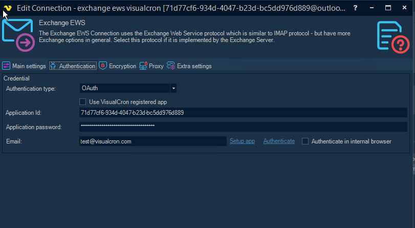
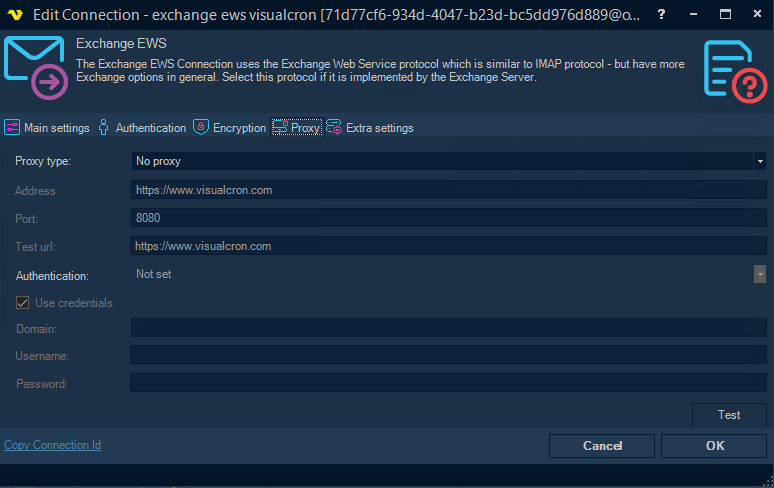
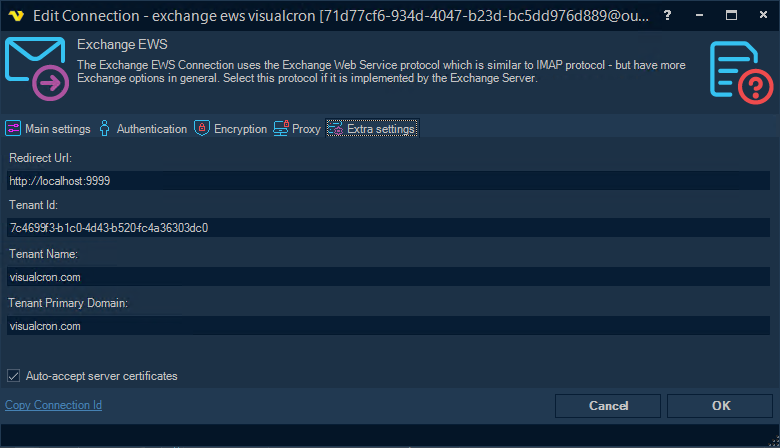
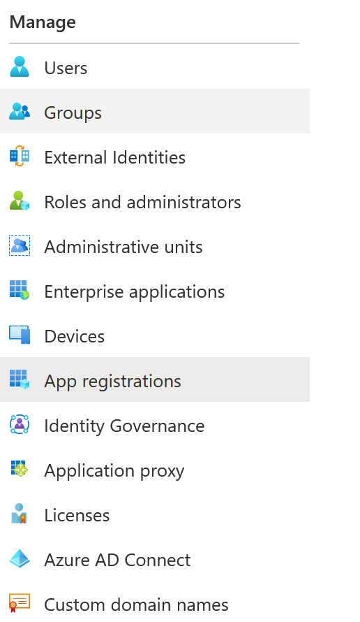
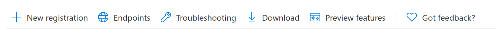
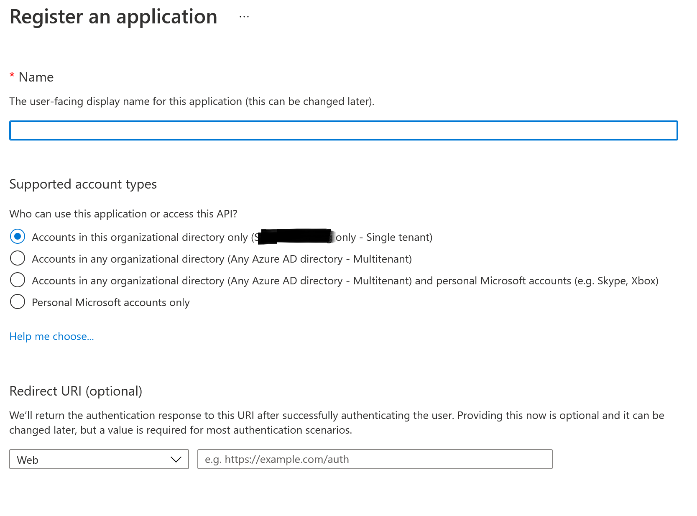
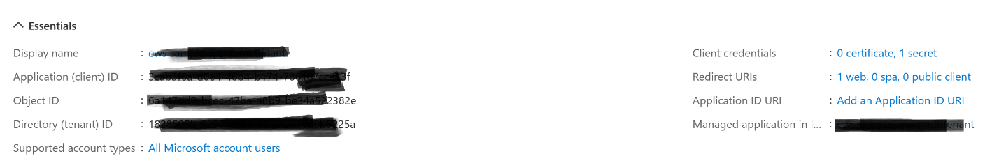
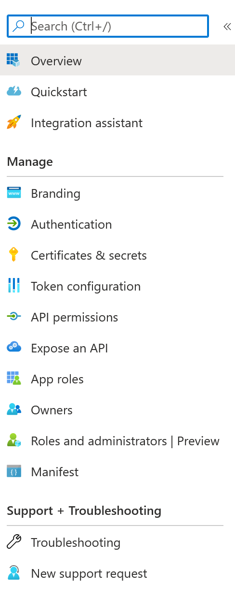
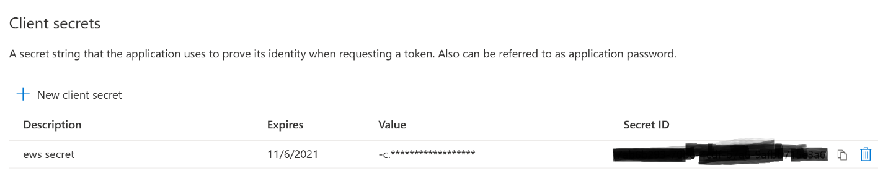
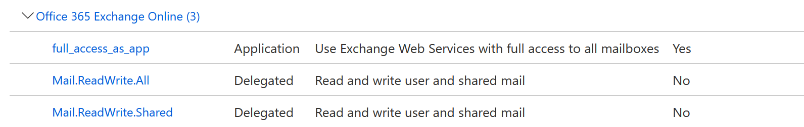

**Please note that Microsoft will be turning off EWS access for all non-Microsoft apps starting October 1st, 2026. For more information see here: [Retirement of EWS](https://devblogs.microsoft.com/microsoft365dev/retirement-of-exchange-web-services-in-exchange-online/)**

## Connection - Exchange EWS

The Exchange EWS Connection stores the address, sign-in and security settings that the [Email - Send](job-tasks/messaging-tasks/email) Task, the [Email - Get Messages](job-tasks/messaging-tasks/email-get-messages), [Email - Get Single Message](job-tasks/messaging-tasks/email-get-single-message), [Email - Get Headers](job-tasks/messaging-tasks/email-get-headers), [Email - Delete Messages](job-tasks/messaging-tasks/email-delete-messages), [Email - Delete Single Message](job-tasks/messaging-tasks/email-delete-single-message) and Email - Move Messages Tasks and the [Email Trigger](event-trigger-mail) use to connect to Microsoft Exchange.

The email receiving Tasks and the Email Trigger read email through Exchange Web Services (EWS). The Email - Send Task sends email, and the Email Trigger forwards matching email, through this Connection.

To read and send Exchange Online email through Microsoft Graph, see [Connection - Microsoft Graph API](connection-microsoft-graph-api).
 
### Common settings


The ***Common settings*** and ***Proxy*** tabs are the same for every Connection type that has them; see [Common settings](global-connections#common-settings) and [Proxy](global-connections#proxy).

_Test_

Opens the _Test SMTP Connection_ window. Enter an address in _From email_ and in _To email_, then click _Test_. The Server sends a real message through this Connection, with the subject "Test subject (from VisualCron)", to the _To email_ address. _Test_ checks sending only; it does not read the mailbox.
 
### Main settings

These fields are on ***Connection settings*** -> ***Main settings***.

The ***Connection settings*** tab holds three tabs: ***Main settings***, ***Encryption*** and ***Proxy***. The fields on ***Main settings*** depend on _Authentication type_: "Default", "OAuth" or "Certificate". _Address_, _Port_ and the first credential field must be filled in for every type.

#### Default


_Address_

The URL of the EWS service. Here is how you can obtain it:
 
**For Microsoft Exchange Online / Office 365**

* Access your journaling mailbox account using Outlook Web App (OWA)
* Click Options > See All Options > Account > My Account > Settings for POP, IMAP, and SMTP access
* In the list of entries, locate the server name. The URL of exchange web service for the mailbox is the URL: `https://<ONLINE_URL>/EWS/Exchange.asmx`
 
**For Microsoft Exchange Server (on-premises)**

The URL has the form `https://<Exchange server host name>/EWS/Exchange.asmx`. To read it in the Exchange Management Shell, run this command:

```powershell
Get-WebServicesVirtualDirectory | Select name, *url* | fl
```

The output is similar to this:

```text
Name                 : EWS (Default Web Site)
InternalNLBBypassUrl : https://<server name>/ews/exchange.asmx
InternalUrl          : https://<server name>/EWS/Exchange.asmx
ExternalUrl          : https://<external host name>/ews/exchange.asmx
```

_Port_

The port of the EWS service. A new Connection opens with "21" in _Port_. Change it to the port of the Exchange server, usually "443". _Port_ cannot be "0". For an "https" address, select "SSL" or "TLS" on the ***Encryption*** tab. With "No encryption", the Server reads email without encryption.

_Authentication type_

- "Default": the user name and password of the mailbox account
- "OAuth": an app registration with a client secret, for Exchange Online
- "Certificate": an app registration with a certificate, for Exchange Online

_Anonymous_

Shown only with "Default". When selected, _Username_ and _Password_ are unavailable, and the Email - Send Task sends email without logging on. The email receiving Tasks and the Email Trigger do not use _Anonymous_. They always log on with _Username_ and _Password_.

_Username_

The user name of the mailbox account. Required.

_Password_

The password of the mailbox account.

_Alias_

The mailbox to open when it is not the mailbox of _Username_, for example a shared mailbox. The email receiving Tasks and the Email Trigger use it.
 
#### OAuth



The screenshot shows an earlier layout of the window. In the current Client, the OAuth fields are on ***Main settings***, and the _App settings_ group replaces the ***Extra settings*** tab.

With "OAuth" and "Certificate", the Server connects to Exchange Online. It does not use _Address_ or _Port_, but both fields must still be filled in. Both types need an app registration in Microsoft Entra ID (Azure Active Directory); see [Set up the EWS app in Microsoft Entra ID](#set-up-the-ews-app-in-microsoft-entra-id).

_Application Id_

The Application (client) ID of the app registration.

_Client secret_

A client secret of the app registration.

_Email_

The address of the mailbox to work with.

_Setup app_

Opens the App registrations page of the Azure portal in the web browser.

_Authenticate_

Opens the Microsoft sign-in page in the web browser. Click _Authenticate_ once before you use the Connection: the email receiving Tasks and the Email Trigger need the saved sign-in.

When a Task or the Email Trigger runs, the Server signs in as the app itself, with _Application Id_, _Client secret_ and the _Tenant Id_ in _App settings_. To read email, the app therefore needs the _full_access_as_app_ application permission with admin consent. To send email, the Email - Send Task connects to the Exchange Online host "smtp.office365.com" on port "587", signed in as the app, and the app also needs permission to send as the mailbox.

#### Certificate

The same as "OAuth", except that the app signs in with a certificate instead of a client secret:

- _Application Id_: the Application (client) ID of the app registration
- _Certificate Id_: not used by the Server; the Server uses the certificate selected in _Certificate_
- _Email_: the address of the mailbox to work with
- _Certificate_: the certificate, with its private key, from [Certificates](global-certificates); upload its public key to the app registration

Click _Authenticate_ once before you use the Connection.
 
### Encryption


The settings on this tab are used with "Default" authentication. With "OAuth" and "Certificate", the mail connection does not use them, but the Email Trigger still sets the SSL and TLS versions for the whole Server process from them, as described under _Allowed SSL/TLS versions_.

_Cryptographic protocol_

- "No encryption": the connection is not encrypted; the _Allowed SSL/TLS versions_ group is unavailable
- "SSL": SSL encryption; selects _SSL version 2_ and _SSL version 3_ in _Allowed SSL/TLS versions_
- "TLS": TLS encryption; selects _TLS version 1_ to _TLS version 1.3_ in _Allowed SSL/TLS versions_

The email receiving Tasks and the Email Trigger use _Cryptographic protocol_ when they read email. The Email - Send Task and _Test_ do not use _Cryptographic protocol_ or _Allowed SSL/TLS versions_ when they send email.

_Allowed SSL/TLS versions_

The available versions are _SSL version 2_, _SSL version 3_, _TLS version 1_, _TLS version 1.1_, _TLS version 1.2_ and _TLS version 1.3_. The email receiving Tasks do not read these boxes. When the Email Trigger checks the mailbox, the Server first sets the SSL and TLS versions for the whole Server process from them:

- "TLS": the selected boxes among _TLS version 1_, _TLS version 1.1_ and _TLS version 1.2_, or all three when none of them is selected; never _TLS version 1.3_
- "SSL" with _SSL version 3_ selected: the system default versions
- "SSL" with _SSL version 3_ cleared: _SSL version 3_ only

With "SSL" and _SSL version 3_ cleared, the whole Server process is limited to SSL 3, and other Tasks that connect over HTTPS can then fail.

:::note

Each time you open an existing Exchange EWS Connection, the version boxes reset to the defaults of the selected protocol. Check them before you click _OK_.

:::

_SASL Mechanisms_

Used by the Email - Send Task when it sends email with "Default" authentication and _Anonymous_ cleared. The Email - Send Task uses one mechanism: _NTLM_ when it is selected, otherwise _CRAM-MD5_ when it is selected. When both are cleared, the Email - Send Task does not set a mechanism, and one is chosen automatically. All three boxes are selected on a new Connection, so a new Connection sends with _NTLM_. _DIGEST-MD5_ is not used on its own.
 
### Proxy



When the Server reads email, it uses _Proxy type_, _Address_ and _Port_ and, when _Use credentials_ is selected, _Username_ and _Password_. It does not use _Authentication_ or _Domain_. When the Server sends email, from the Email - Send Task, the Email Trigger forward action or _Test_, it does not use the settings on this tab.
 
### App settings



The _App settings_ group is shown on ***Main settings*** with "OAuth" and "Certificate". The screenshot shows it on the former ***Extra settings*** tab.

_Tenant Id_

The Directory (tenant) ID of the app registration. Required: the Server uses it to sign in as the app.

_Tenant Primary Domain_

The primary domain of the tenant. When it is filled in, _Authenticate_ signs in through this tenant instead of the common Microsoft sign-in page.

_Tenant Name_

Not used by the Exchange EWS Connection.

_Redirect Url_

The redirect URI of the app registration, for example "http://localhost:9999". _Authenticate_ receives the sign-in reply at this address on the computer that runs the Client. Required for _Authenticate_.

_Auto-accept server certificates_

Not used by the Exchange EWS Connection.

### Set up the EWS app in Microsoft Entra ID

"OAuth" and "Certificate" need an app registration in Microsoft Entra ID (Azure Active Directory). To create it, complete the following steps:

1. Sign in to the Azure portal.
2. Open _Microsoft Entra ID_.
3. Select _App registrations_.

   

4. Select _New registration_.

   

5. In _Name_, enter a name for the app.

   

6. Under _Supported account types_, select the option that covers the directory of the mailboxes, usually _Accounts in this organizational directory only_.
7. Under _Redirect URI_, select _Web_.
8. In the redirect URI box, enter the _Redirect Url_ value of the Connection, for example "http://localhost:9999".
9. Click _Register_.
10. On the _Overview_ page of the app, copy _Application (client) ID_ into _Application Id_ in the Connection.

    

11. Copy _Directory (tenant) ID_ into _Tenant Id_ in the Connection.
12. Select _Certificates & secrets_.

    

13. For "OAuth", add a new client secret.

    

14. For "OAuth", copy the _Value_ of the new secret into _Client secret_ in the Connection. The portal shows the value only once, right after you add the secret.
15. For "Certificate", upload the public key of the certificate.
16. Select _API permissions_.
17. Add the _full_access_as_app_ application permission of _Office 365 Exchange Online_.

    

18. Add the _EWS.AccessAsUser.All_ delegated permission of _Office 365 Exchange Online_, which _Authenticate_ requests.
19. Select _Grant admin consent_ for your directory.

The app registration can now read email through the Connection. Fill in the Connection, then click _Authenticate_. Microsoft Graph permissions are not used by this Connection.
