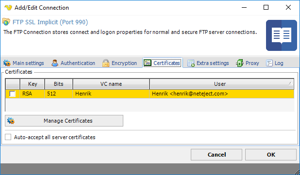
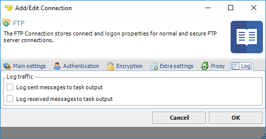

## Connection - FTP

The FTP Connection stores the address, sign-in and security settings that the [Net - FTP/FTPS/SFTP/SCP](job-tasks/net-tasks/ftp) Task, the [Cloud - Sync file(s)](job-tasks/cloud-transfer-tasks/sync) Task and the [Event Trigger - Remote File](event-trigger-remote-file) Trigger use to connect to an FTP or FTPS server. You can also browse the server with the [Connection Explorer](../tools/explore-connection-explorer).

### FTP and FTPS

Plain FTP sends the user name, the password, the commands and the files unencrypted. FTPS is FTP protected with SSL or TLS. One Connection type covers both: to use FTPS, choose a _Cryptographic protocol_ on the ***Encryption*** tab. The separate FTP SSL and FTP TLS types of earlier versions are no longer offered.

FTPS has two modes, which you choose in _Security mode_:

- "Explicit": the connection starts unencrypted, usually on port "21", and switches to SSL or TLS before the logon
- "Implicit": the connection is encrypted from the start, usually on port "990"

### Common settings

The ***Common settings*** and ***Proxy*** tabs are the same for every Connection type that has them; see [Common settings](global-connections#common-settings) and [Proxy](global-connections#proxy). For FTP Connections:

- _Test_: the Server connects and logs on with the settings in the window, and lists the root folder of the server
- _Brute force test_: tries combinations of encryption, port and proxy settings from the Client computer
- _Timeout_: how long, in seconds, the Server waits for the server while it connects, lists and transfers. "60" on a new Connection
- _Code page_: the character set of file and folder names on the server

### Main settings

These fields are on ***Connection settings*** -> ***Main settings***.

- _Address_: the host name or IP address of the FTP server. A leading "ftp://" is removed when you save
- _Port_: "21" on a new Connection. Choosing "Implicit" in _Security mode_ on a new Connection changes it to "990"
- _Anonymous_: log on as an anonymous user. _Username_, _Password_ and _ACCT_ are then unavailable
- _Username_ and _Password_: the FTP account. _Username_ is required unless _Anonymous_ is selected
- _ACCT_: only for servers or proxies that ask for an ACCT value
- _Maximum number of threads (download)_: from "1" to "8". The Server does not use this value
- _Maximum number of threads (upload)_: from "1" to "8", "1" on a new Connection. An upload uses the lower of this value and the number of threads set in the Task

### Encryption

- _Cryptographic protocol_: "No encryption" (plain FTP), "SSL" or "TLS". With "No encryption", the other settings on this tab are unavailable and the ***Certificates*** tab is hidden
- _Security mode_: "Explicit" or "Implicit", as described in [FTP and FTPS](#ftp-and-ftps)
- _Use data channel encryption (PROT P)_: encrypt file contents and folder listings. Cleared on a new Connection
- _Use command channel encryption_: keep the commands encrypted after the logon. Selected on a new Connection. When it is cleared, the Server switches the command channel back to unencrypted after the logon
- _Use SSL session resumption_: lets the data connections reuse the SSL or TLS session of the command connection. Some servers require it
- _Auto adjust ciphers_: selected on a new Connection, so that the cipher suites are negotiated automatically. Clear it to choose the allowed cipher suites in the list, with _Select all_ and _Deselect all_. The list starts with every suite selected, including the anonymous suites whose names start with "DH_ANON", which do not authenticate the server; clear those
- _Allowed SSL/TLS versions_: the versions the Server may use. Choosing "SSL" in _Cryptographic protocol_ selects _SSL version 2_ and _SSL version 3_. Choosing "TLS" selects _TLS version 1_ to _TLS version 1.3_. You can then change the selection

When a Task runs, the Server uses the versions that the chosen protocol selects instead of yours if no version is selected, if exactly five versions are selected, or if none of the selected versions belongs to the chosen protocol.

:::warning

_Use data channel encryption (PROT P)_ is cleared by default. While it is cleared, the Server encrypts only the logon and the commands, and sends file contents and folder listings unencrypted, even with "SSL" or "TLS" selected. Select it to encrypt the files as well.

:::

:::tip

SSL version 2 and SSL version 3 are obsolete and not secure. Choose "TLS" and select only _TLS version 1.2_ and _TLS version 1.3_, unless the server cannot use them.

:::

### Certificates

The ***Certificates*** tab is shown when _Cryptographic protocol_ is "SSL" or "TLS". The screenshot shows an earlier version of the tab.

- Certificate list: select a certificate to send when the FTP server asks for a client certificate. To create or import certificates, click _Manage Certificates_ (see [Global - Certificates](global-certificates))
- _Auto-accept server certificates_: selected on a new Connection

:::warning

_Auto-accept server certificates_ is selected by default. While it is selected, the Server does not check the server certificate and accepts any certificate, so it cannot tell the real server from another server that answers at the same address. Clear it, and approve the server's certificate once as described below.

:::

When _Auto-accept server certificates_ is cleared, the Server accepts a server certificate that has been approved before. Approval is stored per certificate serial number and applies to every FTP Connection on the Server. For a certificate that has not been approved, the Server sends it to the Clients that are connected to the Server, and the Task waits up to 5 minutes for an answer:

- _Accept_ approves and stores the certificate, and the Task continues
- _Deny_ rejects the certificate, and the connection fails

If no Client is connected, or nobody answers within 5 minutes, the Server writes an error to the log and does not approve the certificate. Whether the connection then fails depends on whether the certificate passes the Server's standard certificate checks.

To approve a server certificate before you schedule the Job, complete the following steps:

1. Connect a Client to the Server.
2. Run the Task.
3. In the _Certificate approval_ window, click _Accept_.

The Server stores the certificate as approved and accepts it without asking on later runs.

### Extra settings

- _Transfer type_: "Binary", the default, or "ASCII"
- _Sync data channel_: select it if the Task stops responding while it opens a data connection, for example when it lists, uploads or downloads. Available with or without encryption
- _KeepAlive_: not used by FTP Connections
- _Data connection type_: "PASV", the default, or "PORT". With "PASV", the Server opens each data connection to a port that the FTP server offers. With "PORT", the FTP server opens the data connection to the Server
- _Automatically adjust passive mode address for NAT'ed servers_: selected on a new Connection. In passive mode, the Server connects data connections to the address of the command connection instead of the address that the FTP server reports. This helps with servers behind NAT that report an internal address
- _Override date format_: when the Task cannot read the dates in a server's file listing, the log shows the date format the server sent. Select this option and enter that format so that VisualCron reads the dates with it. The default text is `yy-MM-dd HH.mm.ss`
- _Log sent messages to task output_: writes the commands that the Server sends to the FTP server into the Task output. Passwords are masked
- _Log received messages to task output_: writes the replies from the FTP server into the Task output

:::tip

If you cannot connect, or cannot send or receive files, try "PASV" in _Data connection type_.

:::

### Proxy

FTP Connections can use "HTTP Proxy", "SOCKS4" and "SOCKS5" proxies, use _Authentication_, and are the only type that uses _Use proxy for data channel_.

:::warning

A new Connection has _Authentication_ "Not set" and _Use credentials_ selected. With "HTTP Proxy" and those settings, the Server sends the FTP _Username_ and _Password_ to the proxy instead of the proxy account. Set _Authentication_ to "Basic", "Digest" or "NTLM" to send the proxy _Username_ and _Password_.

:::

### Log options in earlier versions

Earlier versions of the Client had a separate ***Log*** tab for the two log options that are now on ***Extra settings***.

### Troubleshooting

#### Control channel transfer error (error code 10053)

If _Auto-accept server certificates_ is cleared, check that the server's certificate has been approved, as described in [Certificates](#certificates). Selecting _Auto-accept server certificates_ also avoids the error, but the Server then accepts any certificate. If the error happens on upload, try selecting _Use SSL session resumption_.

#### Server cannot perform SSL/TLS negotiation

The server may support only TLS or only SSL. Try the other value in _Cryptographic protocol_.

#### 10035, 114690 or 425 error, the file list is empty, or the connection times out after MLSD is sent

On ***Extra settings***, clear _Automatically adjust passive mode address for NAT'ed servers_.

#### 534 Protection level negotiation failed

On ***Encryption***, select _Use data channel encryption (PROT P)_.

#### SSL Error: 73732

Check _Allowed SSL/TLS versions_. Select the versions the server supports, preferably only _TLS version 1.2_ and _TLS version 1.3_.

#### Error: 75796

Clear _Auto adjust ciphers_ and select the cipher suites the server supports.
