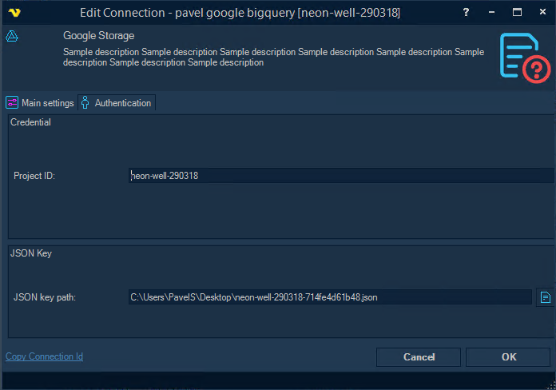
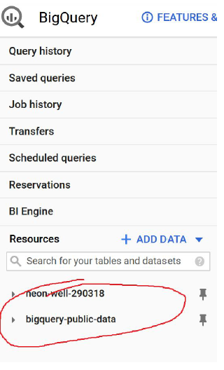
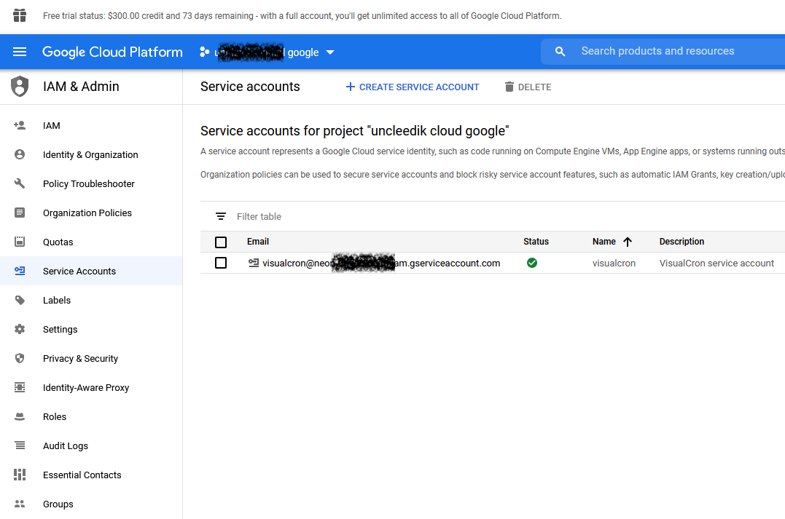
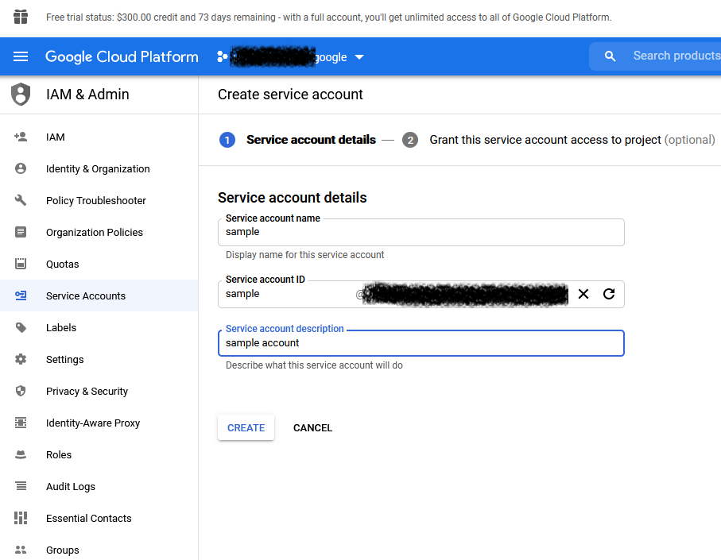
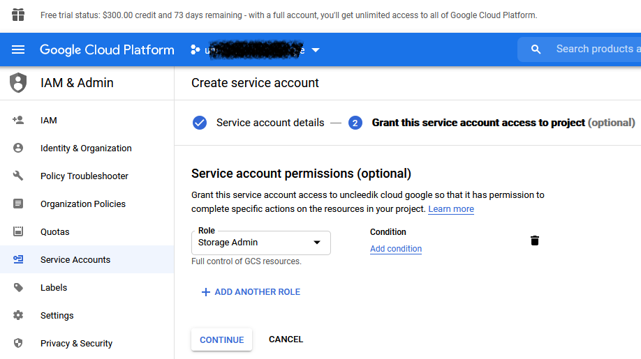
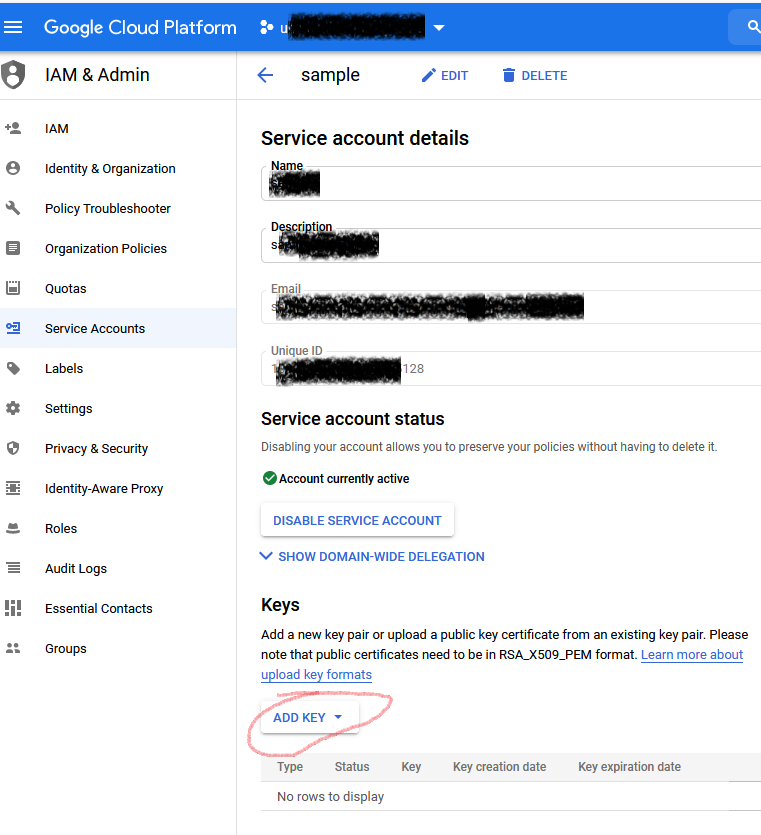

## Connection - Google Cloud

The Google Cloud Connection stores the project and sign-in settings that these Tasks and Triggers use to connect to Google BigQuery and Google Cloud Storage:

- [BigQuery - Run query](job-tasks/database-tasks/big-query-run-query)
- [BigQuery - Fill table](job-tasks/database-tasks/big-query-fill-table)
- The Cloud Tasks, for Google Cloud Storage:
  - [Cloud - Upload file(s)](job-tasks/cloud-transfer-tasks/upload-file)
  - [Cloud - Download file(s)](job-tasks/cloud-transfer-tasks/download-file)
  - [Cloud - List item(s)](job-tasks/cloud-transfer-tasks/list-item)
  - Cloud - List folder(s)
  - [Cloud - Create folder](job-tasks/cloud-transfer-tasks/create-folder)
  - [Cloud - Delete item(s)](job-tasks/cloud-transfer-tasks/delete-item)
  - [Cloud - Copy/move item(s)](job-tasks/cloud-transfer-tasks/copy-move)
  - [Cloud - Sync file(s)](job-tasks/cloud-transfer-tasks/sync)
- The [Cloud file Trigger](event-trigger-cloud-file)

It signs in with a service account JSON key file, not with a user sign-in.

### Common settings

The ***Common settings*** tab is the same for every Connection type that has it; see [Common settings](global-connections#common-settings). A Google Cloud Connection has no _Test_ button, and its Tasks do not use _Timeout_ or _Code page_.

### Connection settings

The ***Connection settings*** tab has no sub-tabs and no ***Proxy*** tab. Google Cloud Connections do not use a proxy.

_Project ID_

The ID of the Google Cloud project. BigQuery Tasks run their queries as jobs in this project, so use a project in which the service account may run jobs, usually your own. To query a public dataset, keep your own project here and name the public tables in the query, for example tables in the "bigquery-public-data" project. The project ID is shown in the Google Cloud console and in BigQuery.

_JSON key path_

The path of the service account JSON key file. The Server reads the file when the Connection is saved, and stores its content with the Connection on the Server. So:

- Enter a path that exists on the computer that runs the VisualCron Server
- After you replace the key file, open the Connection and save it again

See [How to create a JSON key file](#how-to-create-a-json-key-file).

:::warning

Google Cloud does not let you download a key file again after it is created. If the file is lost, disable the key and create a new one.

:::

:::warning

The content of the service account key file is stored with the Connection on the Server. Protect access to the Server's settings folder, and give the service account only the roles that the Tasks need.

:::

### How to create a JSON key file

An organization policy can block the creation of service account keys. If key creation is not offered, ask the administrator of the Google Cloud organization to allow key creation for the project.

To create a JSON key file, complete the following steps:

1. In the Google Cloud console, open _IAM & Admin_ -> _Service Accounts_ for the project.

   

2. Click _Create service account_.
3. Fill in the account details.

   

4. Grant the service account a role that allows what the Tasks do. For Google Cloud Storage, select a role in the _Cloud Storage_ group.

   

5. Open the service account.
6. Open the _Keys_ tab.
7. Click _Add key_ -> _Create new key_.

   

8. Select "JSON".
9. Click _Create_.
10. Save the JSON key file that downloads to a folder on the VisualCron Server computer.
11. Enter the path of the file in _JSON key path_.
12. Click _OK_ to save the Connection.

The Connection now signs in with the service account.
