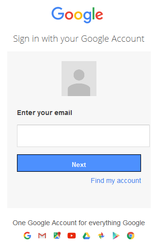
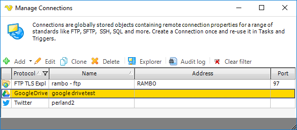
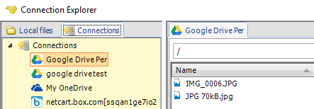

## Connection - Google Drive

The Google Drive Connection stores the sign-in and security settings that these Tasks and Triggers use to connect to Google Drive:

- [Cloud - Upload file(s)](job-tasks/cloud-transfer-tasks/upload-file)
- [Cloud - Download file(s)](job-tasks/cloud-transfer-tasks/download-file)
- [Cloud - List item(s)](job-tasks/cloud-transfer-tasks/list-item)
- Cloud - List folder(s)
- [Cloud - Create folder](job-tasks/cloud-transfer-tasks/create-folder)
- [Cloud - Delete item(s)](job-tasks/cloud-transfer-tasks/delete-item)
- [Cloud - Copy/move item(s)](job-tasks/cloud-transfer-tasks/copy-move)
- [Cloud - Sync file(s)](job-tasks/cloud-transfer-tasks/sync)
- The [Cloud file Trigger](event-trigger-cloud-file)

Use it to transfer files between Google Drive and a local folder, or between Google Drive and another cloud service.

### Common settings

The ***Common settings*** and ***Proxy*** tabs are the same for every Connection type that has them; see [Common settings](global-connections#common-settings) and [Proxy](global-connections#proxy).

_Test_ asks the Server to connect with the stored sign-in and read the root folder of the Google Drive.

### Main settings

These fields are on ***Connection settings*** -> ***Main settings***.

_App Key_

The client ID of the OAuth client that you create in the Google Cloud console. Required.

_App Secret_

The client secret of that OAuth client.

_Redirect Url_

The address that Google sends the sign-in result to. Default: "http://localhost:9999". Add the same address as an authorized redirect URI of the OAuth client.

_Auto-accept server certificates_

Selected by default.

:::warning

Google Drive Connections accept any server certificate, whether or not _Auto-accept server certificates_ is selected. The Server does not check the server certificate when it connects to Google, so it cannot tell the real server from another server that answers at the same address. Connect to Google only over a network path that you trust.

:::

_Create an account_

Opens the APIs page of the Google Cloud console.

_Authenticate_

Starts the Google sign-in. See [Authentication and token expiry](#authentication-and-token-expiry).

### How to create a Google Drive Connection

To create a Google Drive Connection, complete the following steps:

1. Open the Google Cloud console at [https://console.cloud.google.com/apis](https://console.cloud.google.com/apis), or click _Create an account_.
2. Select or create a project.
3. Enable the Google Drive API for the project.
4. Set up the OAuth consent screen of the project.
5. Publish the app, or select the "Internal" user type if the Google accounts belong to your Google Workspace organization. While an app with the "External" user type is in "Testing" status, Google ends its sign-ins after 7 days, and Jobs that use the Connection then fail.
6. Create an OAuth client ID of the type "Web application".
7. Add the value of _Redirect Url_, by default "http://localhost:9999", as an authorized redirect URI of the client.
8. Copy the client ID into _App Key_.
9. Copy the client secret into _App Secret_.
10. Click _Authenticate_.
11. Sign in with the Google account.

    

12. Allow VisualCron to access the Google Drive of the account.
13. Click _OK_ to save the Connection.
14. Click _Test_ on the ***Common settings*** tab.

The test reports that it was successful. You can also browse the files of the Connection in the Connection Explorer.

### Authentication and token expiry

- _Authenticate_ runs on the computer where the Client runs. The browser opens there, and the Client listens for the sign-in result on the port of _Redirect Url_, so that port must be free on that computer
- After the sign-in, the Connection stores the refresh token encrypted, and the Server uses it at run time
- When Google no longer accepts the refresh token, the Server marks the Connection as expired, and the Client shows the message "Connection session expired". Open the Connection and click _Authenticate_ again

### Proxy

The Cloud Tasks and the Cloud file Trigger send their Google Drive requests through the proxy on this tab.
