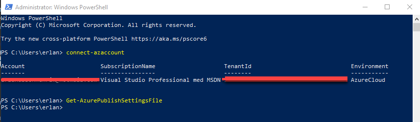
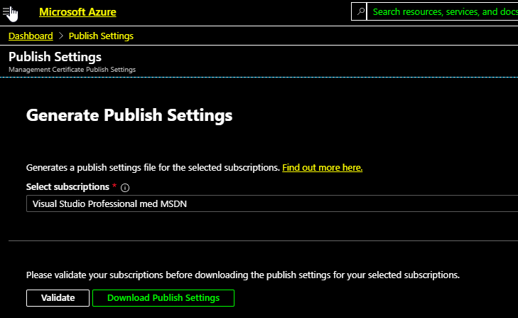
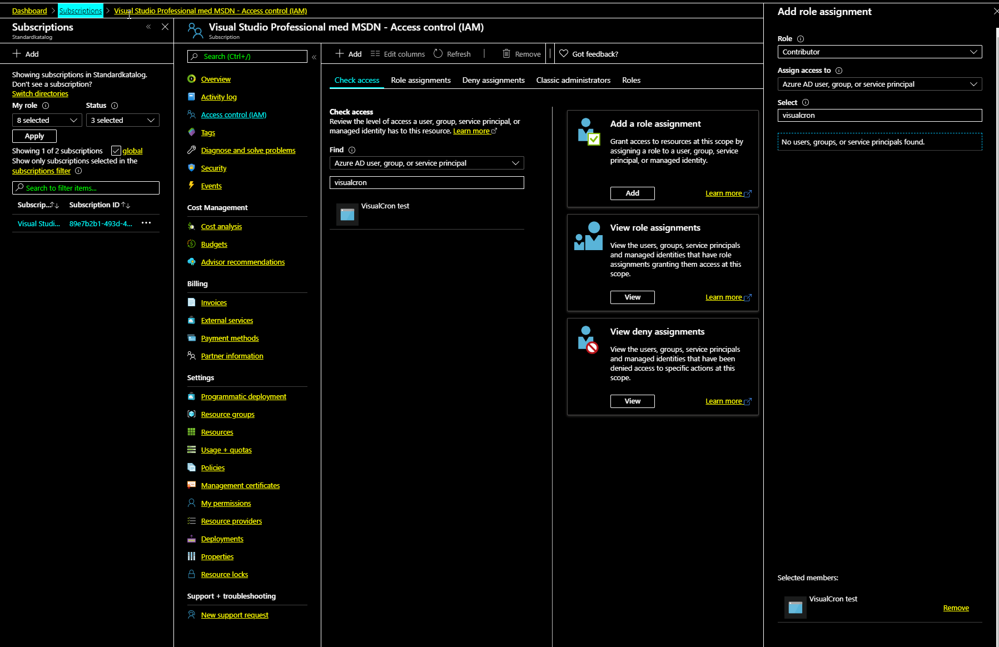

## Connection - Microsoft Azure

The Microsoft Azure Connection stores the address, sign-in and security settings that these Tasks and Triggers use to connect to Azure Storage, Azure Data Lake Storage, Azure management and Form Recognizer:

- The Cloud Tasks, with every _Connection type_ except "Management" and "Form Recognizer":
  - [Cloud - Upload file(s)](job-tasks/cloud-transfer-tasks/upload-file)
  - [Cloud - Download file(s)](job-tasks/cloud-transfer-tasks/download-file)
  - [Cloud - List item(s)](job-tasks/cloud-transfer-tasks/list-item)
  - Cloud - List folder(s)
  - [Cloud - Create folder](job-tasks/cloud-transfer-tasks/create-folder)
  - [Cloud - Delete item(s)](job-tasks/cloud-transfer-tasks/delete-item)
  - [Cloud - Copy/move item(s)](job-tasks/cloud-transfer-tasks/copy-move)
  - [Cloud - Sync file(s)](job-tasks/cloud-transfer-tasks/sync)
- The [Cloud file Trigger](event-trigger-cloud-file), with the same Connection types as the Cloud Tasks
- The [Azure Queue Storage Trigger](event-trigger-azure-queue-storage), which signs in with the _Storage Account_ and _Key_ of the Connection
- The [Azure Tasks](job-tasks/azure-tasks/overview), with the "Management" _Connection type_ only:
  - [Azure - Start VM](job-tasks/azure-tasks/start-vm)
  - [Azure - Stop VM](job-tasks/azure-tasks/stop-vm)
  - [Azure - Restart VM](job-tasks/azure-tasks/restart-vm)
  - [Azure - Update VM](job-tasks/azure-tasks/update-vm)
  - [Azure - Create VM](job-tasks/azure-tasks/create-vm)
  - [Azure - Start web site](job-tasks/azure-tasks/start-web-site)
  - [Azure - Stop web site](job-tasks/azure-tasks/stop-web-site)
  - [Azure - Restart web site](job-tasks/azure-tasks/restart-web-site)
  - [Azure - Remove web site](job-tasks/azure-tasks/remove-web-site)
  - [Azure - Create web site](job-tasks/azure-tasks/create-web-site)
- [Scan document (cloud)](job-tasks/image-tasks/scan-document-cloud), with the "Form Recognizer" _Connection type_

The _Connection type_ on the ***Common settings*** tab decides which service the Connection is for and which settings it shows.

### Common settings

The ***Common settings*** and ***Proxy*** tabs are the same for every Connection type that has them; see [Common settings](global-connections#common-settings) and [Proxy](global-connections#proxy). A Microsoft Azure Connection also has:

_Connection type_

- "Page blob" (default): Azure Blob Storage, page blobs
- "Block blob": Azure Blob Storage, block blobs
- "Data Lake Gen1": Azure Data Lake Storage Gen1
- "Data Lake Gen2": Azure Data Lake Storage Gen2
- "File Shares": Azure Files
- "Management": Azure virtual machines and web sites, for the Azure Tasks
- "Form Recognizer": document analysis, for the Scan document (cloud) Task

_Test_ asks the Server to connect with the current settings. Depending on the _Connection type_, the Server lists the containers (Page blob and Block blob), the file shares (File Shares) or the file systems (Data Lake Gen2), checks the root folder (Data Lake Gen1), or reads the list of regions (Management). For "Form Recognizer", _Test_ reports success without connecting to the service. To check _Endpoint_ and _Key_, run the Scan document (cloud) Task.

### Main settings

These fields are on ***Connection settings*** -> ***Main settings***. They depend on the _Connection type_.

#### Page blob, Block blob and File Shares

_Authentication type_

- "Password" (default): the storage account name and an access key of the account
- "Shared Access Signature": a shared access signature
- "Application": an application registered in Microsoft Entra ID

:::warning

Cloud Tasks connect to Page blob with the _Storage Account_ and _Key_ only, whatever _Authentication type_ is selected. Block blob and File Shares Connections work with "Password" or "Shared Access Signature". With "Application" selected on any of the three types, the Server uses _Application id_ as the account name and _Application key_ as the account key, and the Task fails. Select "Password" for Page blob, and "Password" or "Shared Access Signature" for Block blob and File Shares.

:::

_Storage Account_ and _Key_

The name of the storage account and one of its access keys. Shown for "Password".

_SAS token_ (Page blob and Block blob) or _SAS Uri_ (File Shares)

Shown for "Shared Access Signature". Enter the full service SAS URL, which is the service address of the storage account followed by the SAS token, not the token alone. File Shares Connections accept only a SAS created at the storage account level.

_Application id_, _Application key_, _Tenant Id_ and _Setup app_

Shown for "Application". _Setup app_ opens the App registrations page of the Azure portal.

_Upload BlockBlob block size (bytes)_ (Block blob) or _Upload file block size (bytes)_ (File Shares)

The size in bytes of each block that an upload sends. Minimum "4096", maximum and default "4194304" (4 MB).

_Use SSL_

Selected by default. Page blob Connections always use SSL. On Block blob and File Shares Connections, _Use SSL_ applies to "Password". With "Shared Access Signature", the address in the SAS URL decides whether the Server uses HTTPS.

:::warning

When _Use SSL_ is cleared on a Block blob or File Shares Connection with "Password", the Server connects over HTTP, and the requests and the data travel unencrypted. Leave it selected.

:::

_Auto-accept server certificates_ (Page blob)

Selected by default.

:::warning

Page blob Connections accept any server certificate, whether or not _Auto-accept server certificates_ is selected. The Server does not check the server certificate when it connects, so it cannot tell the real server from another server that answers at the same address. Connect to Azure Storage only over a network path that you trust.

:::

#### Data Lake Gen1 and Data Lake Gen2

- Data Lake Gen1: _Account FQDN_, and _Authentication type_ "SPN with Secret" (default) or "SPN with Certificate", with _Application id_, _Application key_ or a certificate, and _Tenant Id_
- Data Lake Gen2: _Account name_, and _Authentication type_ "Account key" (default), "SPN with Secret" or "SPN with Certificate"
- _Setup app_ opens the App registrations page of the Azure portal
- Data Lake Gen1 also shows _Use SSL_, and Data Lake Gen2 shows _Use SSL_ and _Auto-accept server certificates_. The Server does not use them
- Both types have no ***Proxy*** tab

#### Management

- _Authentication type_: "Publishsettings file" (default) or "Application"
- _PublishSettings file path_: the publish settings file, for "Publishsettings file"
- _App Id_, _App Secret_ and _Tenant Id_, and the _Setup app_ link, for "Application"
- The Management type has no ***Proxy*** tab

**Account key**

The Account key for the account. Please note that when using Azure Tasks (not Cloud) you need to use publish settings file for authentication.
 
**Downloading publish settings file**
1. Open Powershell
2. Type connect-azaccount - logon
3. Type Get-AzurePublishSettingsFile

4. The browser will open. Select the subscription and click Validate and then click "Download Publish settings"

**Application**

In the Azure portal, open the subscription and assign the _Contributor_ role to the application.

#### Form Recognizer

_Endpoint_ and _Key_ of the Form Recognizer resource.

### Proxy

The ***Proxy*** tab is shown only for Page blob, Block blob and Form Recognizer Connections. Block blob Connections always use the proxy as an HTTP proxy, even when _Proxy type_ is "SOCKS4" or "SOCKS5". With _Use credentials_ selected, they send _Domain_, _Username_ and _Password_. See [Proxy](global-connections#proxy).

:::warning

Form Recognizer Connections show the ***Proxy*** tab, but the Scan document (cloud) Task does not use it. Make sure that the Server can reach the Form Recognizer endpoint without a proxy, or the Task fails.

:::

### Troubleshooting

#### HTTP request failed with code 400, message is The value for one of the HTTP headers is not in the correct format

The _Connection type_ does not match the storage. For example, a Page blob Connection cannot read block blobs. Select the _Connection type_ that matches the blobs, for example "Block blob".

**ResourceNotFound: No deployments were found. You need to select the right AzureSubscription.**

[https://stackoverflow.com/questions/35077602/why-does-new-azurereservedip-return-resourcenotfound-no-deployments-were-found](https://stackoverflow.com/questions/35077602/why-does-new-azurereservedip-return-resourcenotfound-no-deployments-were-found)
 
#### No Such Host Is Known

The storage account name is wrong.
