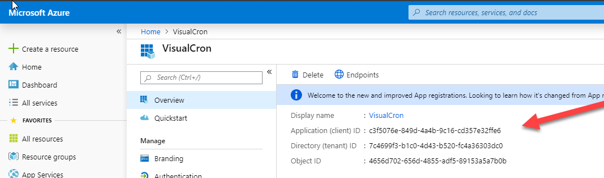
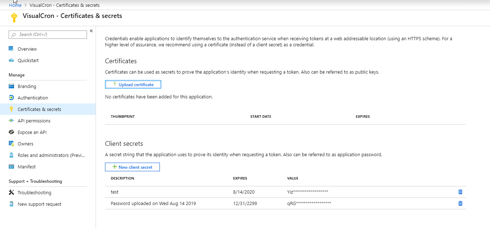
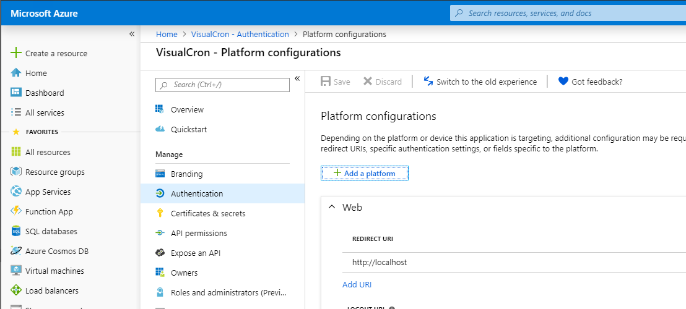
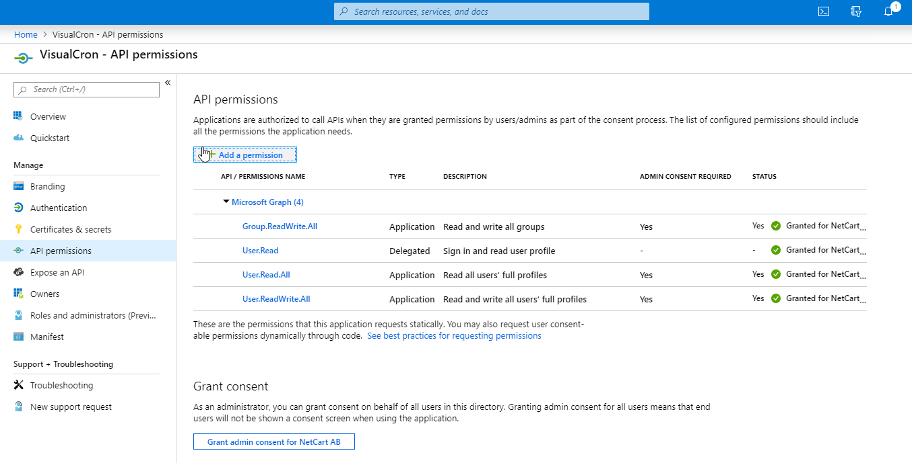
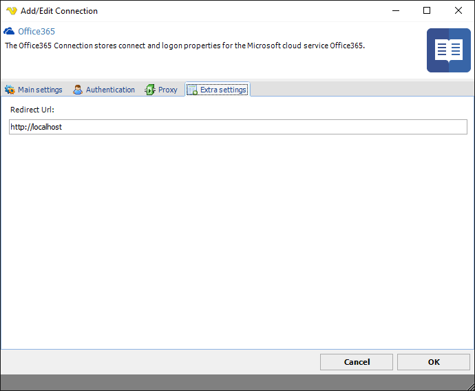
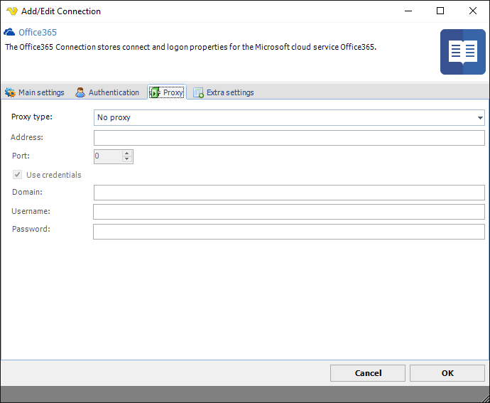

## Connection - Office365

The Office365 Connection stores the sign-in and security settings that these Tasks and Triggers use to connect to Office 365 calendars and Microsoft Teams:

- [Office365 - Add calendar event(s)](job-tasks/office365-tasks/add-calendar-event)
- [Office365 - Delete calendar event(s)](job-tasks/office365-tasks/delete-calendar-event)
- [Office365 - Get calendar event(s)](job-tasks/office365-tasks/get-calendar-events)
- [Office365 - Update calendar event(s)](job-tasks/office365-tasks/update-calendar-event)
- Microsoft Teams - Add channel message
- The MSTeams Trigger

It signs in with OAuth through an application registered in Microsoft Entra ID.

### Common settings

The ***Common settings*** and ***Proxy*** tabs are the same for every Connection type that has them; see [Common settings](global-connections#common-settings) and [Proxy](global-connections#proxy).

An Office365 Connection has no _Test_ button; _Authenticate_ shows whether the sign-in works.

### Main settings

These fields are on ***Connection settings*** -> ***Main settings***, in two groups: _Credentials_ and _App settings_.

#### Credentials

_Client ID_

The _Application (client) ID_ of the application, from its _Overview_ page in the Azure portal.

_Client Secret_

A client secret of the application.

_Redirect URI_

The address that Microsoft sends the sign-in result to. It is the same setting as _Redirect Url_ under _App settings_; see _Redirect Url_. Add the address as a redirect URI of the application.

_Auto-accept server certificates_

The same setting as the box under _App settings_.

_Create an account_

Opens the App registrations page of the Azure portal.

The sign-in asks for these delegated Microsoft Graph permissions: _Calendars.ReadWrite_, _Group.ReadWrite.All_ and _User.ReadWrite.All_. Add them to the application under _API permissions_. _Group.ReadWrite.All_ and _User.ReadWrite.All_ need admin consent and apply to the whole tenant.

_Authenticate_

Starts the Microsoft sign-in. The browser opens on the computer where the Client runs, and the Client listens for the result on the port of the redirect address. After the sign-in, the Connection stores the sign-in, and the Tasks refresh it at run time.

#### App settings

_Redirect Url_

The redirect address of the Connection. _Redirect URI_ under _Credentials_ and _Redirect Url_ are one setting: when they differ, the value in _Redirect Url_ is saved. Enter the same address in both, for example "http://localhost:9999".

_Tenant Id_

Filled in with the tenant of the signed-in account after _Authenticate_.

_Tenant Name_

Not used by the Tasks.

_Tenant Primary Domain_

The primary domain of the tenant, for example `<tenant>.onmicrosoft.com`. The sign-in and the Tasks use it to find the tenant. When it is empty, they use the multi-tenant sign-in address, which an application registered for a single tenant does not accept. Fill it in for a single-tenant application.

_Auto-accept server certificates_

The Office365 Tasks, the Microsoft Teams Task and the MSTeams Trigger do not use this setting.

### Proxy

:::warning

The Office365 Tasks, the Microsoft Teams Task and the MSTeams Trigger do not use the ***Proxy*** tab. Make sure that the Server can reach Microsoft 365 without the proxy on this tab.

:::

### Troubleshooting

#### Token null / empty

Possible causes:

- The redirect address in the Connection does not match a redirect URI of the application in the Azure portal
- Another program already listens on the port of the redirect address on the Client computer, for example a local web server on port 80
- A firewall on the computer that runs the Client blocks the redirect from the browser
- The sign-in failed, for example because of a wrong password or a closed sign-in window
