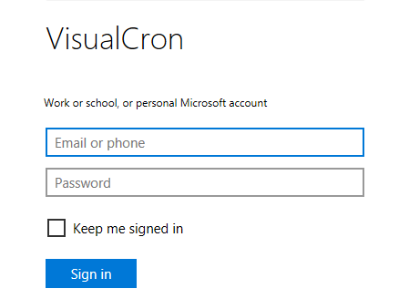

## Connection - OneDrive

The OneDrive Connection stores the sign-in and security settings that these Tasks and Triggers use to connect to Microsoft OneDrive:

- [Cloud - Upload file(s)](job-tasks/cloud-transfer-tasks/upload-file)
- [Cloud - Download file(s)](job-tasks/cloud-transfer-tasks/download-file)
- [Cloud - List item(s)](job-tasks/cloud-transfer-tasks/list-item)
- Cloud - List folder(s)
- [Cloud - Create folder](job-tasks/cloud-transfer-tasks/create-folder)
- [Cloud - Delete item(s)](job-tasks/cloud-transfer-tasks/delete-item)
- [Cloud - Copy/move item(s)](job-tasks/cloud-transfer-tasks/copy-move)
- [Cloud - Sync file(s)](job-tasks/cloud-transfer-tasks/sync)
- The [Cloud file Trigger](event-trigger-cloud-file)

Use it to transfer or sync files between OneDrive and a local folder, or between OneDrive and another cloud service.

### Common settings

The ***Common settings*** and ***Proxy*** tabs are the same for every Connection type that has them; see [Common settings](global-connections#common-settings) and [Proxy](global-connections#proxy).

_Test_ asks the Server to connect with the stored sign-in and read the root folder of the OneDrive.

### Main settings

These fields are on ***Connection settings*** -> ***Main settings***.

_App Key_

The Application (client) ID of the app that you register in Microsoft Entra ID. Required.

_App Secret_

A client secret of that app.

_Redirect Url_

The address that Microsoft sends the sign-in result to. Default: "http://localhost:9999". Add the same address as a redirect URI of the app.

_Auto-accept server certificates_

Selected by default.

:::warning

OneDrive Connections accept any server certificate, whether or not _Auto-accept server certificates_ is selected. The Server does not check the server certificate when it connects to OneDrive, so it cannot tell the real server from another server that answers at the same address. Connect to OneDrive only over a network path that you trust.

:::

_Create an account_

Opens the App registrations page of the Azure portal.

_Authenticate_

Starts the Microsoft sign-in.

### How to create a OneDrive Connection

To create a OneDrive Connection, complete the following steps:

1. Click _Create an account_ to open App registrations in the Azure portal.
2. Click _New registration_.
3. Under _Supported account types_, select a type that includes the accounts that own the OneDrive: personal Microsoft accounts for a personal OneDrive, or your organization's accounts for OneDrive for work or school.
4. Click _Register_.
5. Copy the _Application (client) ID_ into _App Key_.
6. Under _Certificates & secrets_, create a client secret.
7. Copy the value of the client secret into _App Secret_.
8. Under _Authentication_, add the value of _Redirect Url_, by default "http://localhost:9999", as a redirect URI.
9. Click _Authenticate_.
10. Sign in with the Microsoft account.

    

11. Accept the permissions that VisualCron requests.
12. Click _OK_ to save the Connection.
13. Click _Test_ on the ***Common settings*** tab.

The test reports that it was successful.

### Authentication and token expiry

- _Authenticate_ runs on the computer where the Client runs. The browser opens there, and the Client listens for the sign-in result on the port of _Redirect Url_, so that port must be free on that computer
- After the sign-in, the Connection stores the refresh token encrypted, and the Server uses it at run time
- When Microsoft no longer accepts the refresh token, the Server marks the Connection as expired, and the Client shows the message "Connection session expired". Open the Connection and click _Authenticate_ again
