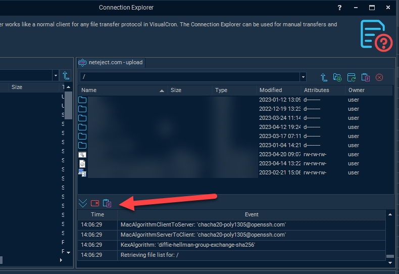
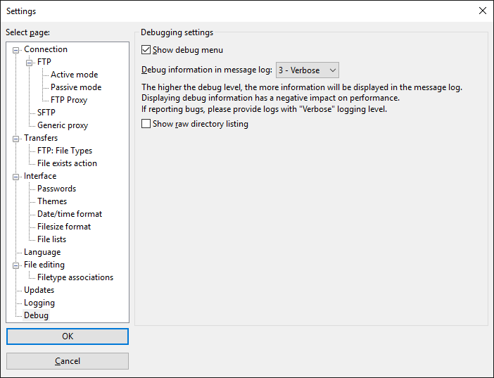

## Connection - SFTP

The SFTP Connection stores the address, sign-in and security settings that the [Net - FTP/FTPS/SFTP/SCP](job-tasks/net-tasks/ftp) Task, the [Cloud - Sync file(s)](job-tasks/cloud-transfer-tasks/sync) Task and the [Event Trigger - Remote File](event-trigger-remote-file) Trigger use to connect to an SFTP server. SFTP (SSH File Transfer Protocol) transfers files over an SSH connection. It is a different protocol from FTP and FTPS. You can also browse the server with the [Connection Explorer](../tools/explore-connection-explorer).

:::warning

SFTP Connections accept any server host key. The Server does not compare the key with a stored key, so it cannot tell the real server from another server that answers at the same address. Confirm the server's host key with its administrator before you use the Connection. With *Log received messages to task output* selected, the Task output shows the MD5 fingerprint of the key that the server sent, as pairs of hexadecimal digits separated by colons. Ask the administrator for the MD5 fingerprint of the key to compare with it.

:::

### Common settings


The ***Common settings*** and ***Proxy*** tabs are the same for every Connection type that has them; see [Common settings](global-connections#common-settings) and [Proxy](global-connections#proxy). For SFTP Connections:

- _Test_: the Server connects and logs on with the settings in the window, and lists the root folder of the server
- _Brute force test_: opens the SFTP tester, which tries combinations of settings from the Client computer
- _Timeout_: how long, in seconds, the Server waits for the server. With "0", commands have no time limit

### Main settings

These fields are on ***Connection settings*** -> ***Main settings***.


- _Address_: the host name or IP address of the SFTP server
- _Port_: "22" on a new Connection
- _Authentication type_: "Password" or "Public key". With "Public key", *SSH key* is shown
- _Username_: the account on the server. Enter it for both authentication types
- _Password_: the account's password, for password and keyboard logons. It is not the passphrase of the SSH key
- _SSH key_: the key to log on with, chosen from the keys stored in [Global - SSH Keys](global-ssh-keys). The key's passphrase is stored with the key
- _Override authentication_: the logon methods the Server tries:
  - _Auto authentication_: try password and keyboard-interactive logon. While it is selected, the two options below are unavailable. Cleared on a new Connection
  - _Password authentication_: selected on a new Connection
  - _Keyboard authentication_: keyboard-interactive logon. Cleared on a new Connection

With "Public key", the Server also tries a public key logon with the *SSH key*.

### Encryption


The ***Encryption*** tab has one list each for *Encryption algorithms*, *Key exchange algorithms*, *MAC algorithms* and *Public key algorithms*. Each list has its own option to choose the algorithms automatically: *Auto adjust ciphers*, *Auto adjust key exchange algorithms*, *Auto adjust MAC algorithms* and *Auto adjust Public key algorithms*. They are selected on a new Connection. Clear one to choose the allowed algorithms in its list, with *Select all* and *Deselect all*.

*Auto adjust by component* is available while *Auto adjust ciphers* is selected, and is selected on a new Connection. When you clear it, the Server offers only the encryption algorithms that the server announces.

The server must support at least one of the algorithms you allow in each list, or the connection fails. To find the algorithms the server uses, see [Set the encryption settings](#set-the-encryption-settings).

### Extra settings


- _Transfer type_: "Binary", the default, or "ASCII"
- _KeepAlive_: the Server sends a keepalive message every 90 seconds, whatever number this field contains. "0" on a new Connection. Keep a number in the field, because other text makes the connection fail
- _Max packet size_: the largest SSH packet in bytes, up to "524288". "262144" on a new Connection
- _Auto adjust transfer block_: selected on a new Connection, so that the Server sizes the transfer blocks itself. Clear it to set *Pipeline length*, *Download block size* and *Upload block size*
- _Pipeline length_: how many requests the Server sends before it waits for the replies, from "1" to "32". "32" on a new Connection. Higher values are faster but use more memory
- _Download block size_: the bytes in each download request, from "1" to "131072". "8192" on a new Connection
- _Upload block size_: the bytes in each upload request, from "1" to "131072". "32768" on a new Connection
- _Use compression_: the Server does not currently apply this setting to SFTP connections
- _SBB debug_: when it is selected, the Server sends its SSH identification string as soon as the connection opens, without waiting for the server's. It does not turn on extra logging. Cleared on a new Connection
- _SFTP version support_: the SFTP protocol versions the Server may use, "0" to "6". Versions "2" to "6" are selected on a new Connection. If a server has problems agreeing on a version, select fewer versions. For background, see [SSH File Transfer Protocol](https://en.wikipedia.org/wiki/SSH_File_Transfer_Protocol) on Wikipedia
- _Log sent messages to task output_: writes the messages that the Server sends to the SFTP server into the Task output
- _Log received messages to task output_: writes the messages from the SFTP server, including the MD5 fingerprint of the host key, into the Task output

### Proxy


SFTP Connections can use "HTTP Proxy", "SOCKS4" and "SOCKS5" proxies, and use *Authentication*.

:::warning

A new Connection has *Authentication* "Not set" and *Use credentials* selected. With "HTTP Proxy" and those settings, the Server sends the SFTP *Username* and *Password* to the proxy instead of the proxy account. Set *Authentication* to "Basic", "Digest" or "NTLM" to send the proxy *Username* and *Password*.

:::

### Troubleshooting

The error messages name the logon methods by number:

- "2": public key
- "4": password
- "16": keyboard-interactive

#### Authentication type 16 failed along with error 114

On ***Main settings***, clear *Auto authentication* and *Keyboard authentication*. Also check the user name and password.

#### Authentication type 4 failed along with error 114

On ***Main settings***, clear *Auto authentication* and *Password authentication*. Also check the user name and password.

#### Authentication type 2 failed along with error 114

The public key logon failed. The selected *SSH key* may not be the key the server expects, or the server may require a password logon.

#### Authentication failed for type 16 and 4 along with error 114

The Server tried password logons, but the server requires a public key logon. Set *Authentication type* to "Public key" and select an *SSH key*.

#### SFTP error 6

The Server has no connection to the server.

#### SFTP error 7 with error 10058

On ***Encryption***, clear *Auto adjust MAC algorithms* and select the MAC algorithms the server supports. See [Set the encryption settings](#set-the-encryption-settings).

#### SFTP error 11 with error 10058

Try these one at a time:

- On ***Main settings***, clear *Auto authentication* and *Keyboard authentication*
- On ***Encryption***, clear *Auto adjust ciphers*

#### SFTP error 96273, or "Failed to retrieve file list: SFTP component not connected"

Possible causes:

- The key exchange algorithm does not match the server. See [Set the encryption settings](#set-the-encryption-settings)
- The SFTP version. On ***Extra settings***, select one version at a time in *SFTP version support*, from "2" to "6"
- *Username* is empty
- The Connection Explorer works but the Task does not. Check the folder paths in the Task, and pick them with the browse button instead of typing them

#### SFTP error 96258

The server requires a public key logon. Set *Authentication type* to "Public key" and select an *SSH key*.

#### SFTP error 102

On ***Extra settings***, clear *Auto adjust transfer block* and set these values:

- *Max packet size*: "8096"
- *Pipeline length*: "16"
- *Download block size*: "2048"
- *Upload block size*: "2048"

#### SFTP error 103

The key exchange or MAC algorithm does not match the server. See [Set the encryption settings](#set-the-encryption-settings).

#### SFTP error 10061

The algorithms may not match the server. See [Set the encryption settings](#set-the-encryption-settings).

#### Only part of a file is transferred, or an upload times out

On ***Extra settings***, clear *Auto adjust transfer block*. For uploads, try *Upload block size* "65536". You can also try *Pipeline length* "1".

#### Public key errors

- "3329" (0x0D01): the public key is invalid, usually because of the file format
- "3330" (0x0D02): the private key is invalid, usually because of the file format
- "3331" (0x0D03): the key file could not be read
- "3332" (0x0D04): the key file could not be written
- "3333" (0x0D05): the key algorithm is not supported
- "3334" (0x0D06): internal error
- "3335" (0x0D07): the buffer is too small
- "3336" (0x0D08): there is no private key
- "3337" (0x0D09): the passphrase of the private key is wrong. Check the passphrase stored with the key in [Global - SSH Keys](global-ssh-keys)
- "3338" (0x0D0A): the PEM algorithm is not supported

### Set the encryption settings

When the connection fails because the algorithms do not match, find out which algorithms the server uses, and then allow them on the ***Encryption*** tab.

#### Send the log to support

To send the connection log to support, complete the following steps:

1. Open the [Connection Explorer](../tools/explore-connection-explorer).
2. Connect with the SFTP Connection.
3. Click the unlabeled copy button in the log toolbar, below the file list. The arrow in this screenshot points to it.

   

4. Paste the log into an email.
5. Send the email to support@visualcron.com.

Support receives the log of the connection, which shows the algorithms that were negotiated.

#### Compare with FileZilla (legacy)

To find the server's algorithms with FileZilla, a free FTP and SFTP client, complete the following steps:

1. Connect to the server with FileZilla.
2. In FileZilla's settings, turn on verbose debug information for the message log.

   

3. Connect again.
4. In the message log, find the lines that name the algorithms, for example:

   ```text
   Trace: Doing Diffie-Hellman group exchange
   Trace: Doing Diffie-Hellman key exchange with hash SHA-256
   Trace: Initialised AES-256 SDCTR client->server encryption
   Trace: Initialised HMAC-SHA-256 client->server MAC algorithm
   ```

   The first two lines show the key exchange algorithm, the third shows the encryption algorithm and the fourth shows the MAC algorithm.

5. Open the Connection in VisualCron.
6. On the ***Encryption*** tab, allow the matching algorithms, as in these examples.


The Connection now allows the algorithms that the server uses.
