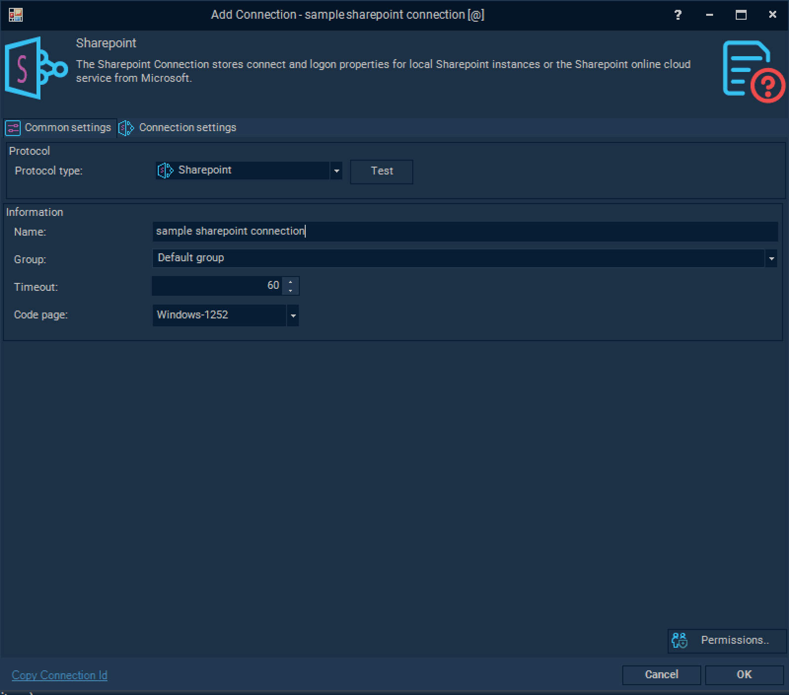
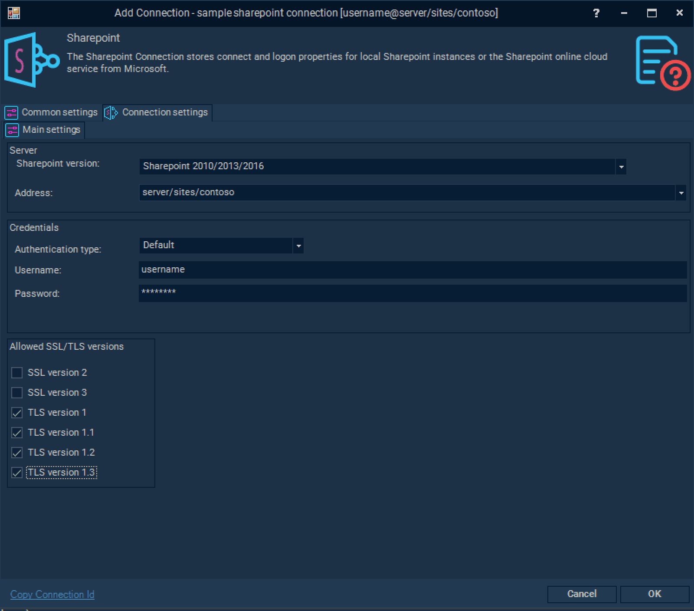
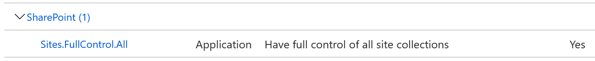
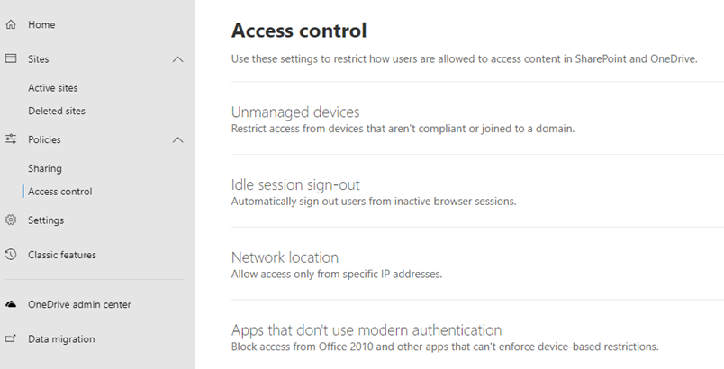

## Connection - SharePoint

The SharePoint Connection stores the address, sign-in and security settings that these Tasks and Triggers use to connect to Microsoft SharePoint, on an on-premises server or in SharePoint Online:

- [SharePoint - Create list](job-tasks/sharepoint-tasks/create-list)
- [SharePoint - Delete list(s)](job-tasks/sharepoint-tasks/delete-list)
- [SharePoint - Describe list](job-tasks/sharepoint-tasks/describe-list)
- [SharePoint - Get list(s)](job-tasks/sharepoint-tasks/get-list)
- [SharePoint - Update list](job-tasks/sharepoint-tasks/update-list)
- [SharePoint - Add list item](job-tasks/sharepoint-tasks/add-list-item)
- [SharePoint - Update list item](job-tasks/sharepoint-tasks/update-list-item)
- [SharePoint - Delete list item(s)](job-tasks/sharepoint-tasks/delete-list-item)
- [SharePoint - Get list item(s)](job-tasks/sharepoint-tasks/get-list-item)
- [SharePoint - Upload file(s)](job-tasks/sharepoint-tasks/upload-file)
- [SharePoint - Download file(s)](job-tasks/sharepoint-tasks/download-file)
- [SharePoint - List file(s)](job-tasks/sharepoint-tasks/list-file)
- [SharePoint - Delete file(s)](job-tasks/sharepoint-tasks/delete-file)
- SharePoint - Create folder
- The Sharepoint file Trigger

The Client offers three types:

- _Sharepoint_: an on-premises server or SharePoint Online. Select the server with _Sharepoint version_
- _Sharepoint Online_: SharePoint Online in Microsoft 365
- _Sharepoint 2010_: the older on-premises editor. For an on-premises server, use the _Sharepoint_ type with _Sharepoint version_ "Sharepoint 2010/2013/2016" instead

### Sharepoint type

#### Common settings



The ***Common settings*** tab is the same for every Connection type that has it; see [Common settings](global-connections#common-settings).

_Test_ asks the Server to sign in to the site in _Address_ with the current settings.

#### Connection settings



_Sharepoint version_

- "Sharepoint Online": SharePoint Online
- "Sharepoint 2010/2013/2016": an on-premises SharePoint server

_Address_

The address of the SharePoint site, for example `https://<tenant>.sharepoint.com/sites/<site>` for SharePoint Online. Use the site address, not the address of the SharePoint admin center.

_Authentication type_

- "Default": with _Sharepoint version_ "Sharepoint 2010/2013/2016", Windows authentication. When _Username_ is the account that runs the Server, the Server's own credentials are used; otherwise _Username_ and _Password_ are used
- "Basic": user name and password
- "Form": forms-based sign-in with user name and password
- "Anonymous": no credentials
- "ADFS": Active Directory Federation Services, with _Username_, _Password_ and the address in _STS:_
- **AppOnly** — App-only client credentials using an Azure AD-registered application.
  The **Username** field is the **Client Id** and the **Password** field is the
  **Client Secret**. Requires a Tenant Id.
- "Azure AD Application (Certificate)": a Microsoft Entra ID application that signs in with a certificate. _Username_ is relabeled _App ID_. Needs a certificate and _Tenant Id_

"AppOnly" and "Azure AD Application (Certificate)" work only with _Sharepoint version_ "Sharepoint Online". With "Sharepoint 2010/2013/2016" they do not sign in. With "Sharepoint Online", "Default", "Basic", "Form", "Anonymous" and "ADFS" send _Username_ and _Password_ as SharePoint Online user credentials.

_Username_ and _Password_

The account that signs in. For "AppOnly", enter the client ID in _Username_ and the client secret in _Password_. For "Azure AD Application (Certificate)", enter the application ID in _App ID_; _Password_ is not used.

_STS:_

For "ADFS", the address of the ADFS Security Token Service.

**Certificate**

For "Azure AD Application (Certificate)", a VisualCron [Certificate](global-certificates) whose public key is uploaded to the certificates of the Microsoft Entra ID application.

_Tenant Id_

In the _Azure shared settings_ group. For "AppOnly" and "Azure AD Application (Certificate)", the Directory (tenant) ID of your Microsoft 365 organization. It is on the _Overview_ page of the application in Microsoft Entra ID.

_Allowed SSL/TLS versions_

The TLS versions that SharePoint Tasks may use. By default, _SSL version 2_, _SSL version 3_, _TLS version 1_, _TLS version 1.1_ and _TLS version 1.2_ are selected, and _TLS version 1.3_ is cleared. _SSL version 2_ has no effect. The same group is on the Sharepoint Online and Sharepoint 2010 editors.

:::warning

When a certificate is selected in the Connection, SharePoint Tasks accept any server certificate. With the other authentication types, they accept any self-signed server certificate, whatever name it was issued to. In both cases they cannot tell the SharePoint server from another server that answers at the same address. Use the Connection only over a network path to the SharePoint server that you trust.

Each SharePoint Task run applies the _Allowed SSL/TLS versions_ of its Connection to the whole Server process, not only to the SharePoint Task. It also changes how the Server process checks server certificates for its other HTTPS requests.

:::

---

### Sharepoint Online type

The _Sharepoint Online_ type is for SharePoint Online in Microsoft 365.

#### Common settings


_Test_ asks the Server to connect to the site in _Address_ with the current settings.

#### Connection settings

_Address_

The address of the SharePoint site, for example `https://<tenant>.sharepoint.com/sites/<site>`. Use the site address, not the address of the SharePoint admin center.

_Authentication type_

"Basic" (default), "AppOnly" or "Certificate". "Basic" sends _Username_ and _Password_ as SharePoint Online user credentials; see the Basic Authentication paragraph below. "Certificate" signs in with a Microsoft Entra ID application and a certificate.


The ***Connection settings*** tab also has the _Allowed SSL/TLS versions_ group, described for the Sharepoint type above.

To find the IDs for the Connection, sign in to [Microsoft Entra](https://entra.microsoft.com), open _App registrations_, and open the application. Its _Overview_ page shows the _Application (client) ID_ and the _Directory (tenant) ID_.

Basic Authentication — Deprecated
Microsoft has permanently disabled Basic Authentication across its services, including Exchange Online, SharePoint Online, and Microsoft Graph. Any connection configured to use Basic Authentication will fail with an authorization error and cannot be restored.
Basic Authentication is disabled at the Microsoft platform level and is not configurable by VisualCron or your system administrator. Affected connections must be reconfigured to use a supported authentication type.

#### AppOnly (Client credentials)


**Username**

The Client Id of the Azure AD app registration.

**Password**

The Client Secret of the Azure AD app registration.

**Tenant Id**

The Azure AD Tenant ID (GUID) for your Microsoft 365 organization.

#### Certificate


_Client id_

The _Application (client) ID_ of the Microsoft Entra ID application.

_Tenant Id_

The _Directory (tenant) ID_ of your Microsoft 365 organization.

**Certificate**

A VisualCron [Certificate](global-certificates) whose public key (".cer" file) is uploaded under _Certificates & secrets_ of the application.

You can use an existing or new Azure AD application to access your SharePoint Online
sites. Please note that certificate-only credentials are accepted. Create an application
on Azure AD and import the certificate to both the Azure AD application credentials and
VisualCron. Only Certificate applications will be granted access to the SharePoint site;
otherwise you will receive an HTTP 401 error. 

Grant the application the SharePoint application permissions that the Tasks need, and grant admin consent. Each of these permissions applies to every site in the tenant, and _Sites.FullControl.All_, shown below, includes the others.



#### Setting up a certificate for SharePoint Online

These steps create a certificate, import it into VisualCron, upload it to Microsoft Entra ID and set up the Connection.

##### Create the certificate

To create a self-signed certificate and its files, complete the following steps:

1. Open Windows PowerShell as administrator.
2. Run this command to create the certificate. Replace `<certificate name>` with a name for the certificate:

   ```powershell
   $cert = New-SelfSignedCertificate `
     -Subject "CN=<certificate name>" `
     -CertStoreLocation "Cert:\CurrentUser\My" `
     -KeyExportPolicy Exportable `
     -KeySpec Signature `
     -KeyLength 2048 `
     -NotAfter (Get-Date).AddYears(3) `
     -FriendlyName "<certificate name>"
   ```

3. Run this command to export the certificate with its private key as a ".pfx" file. Replace `<folder>` with the folder to save the file in, and `<file name>` with a name for the file:

   ```powershell
   Export-PfxCertificate -Cert $cert -FilePath "<folder>\<file name>.pfx" `
     -Password (Read-Host -AsSecureString "Enter password")
   ```

4. Enter a password for the ".pfx" file when PowerShell prompts for it.
5. Run this command to export the public key as a ".cer" file, with the same `<folder>` and `<file name>`:

   ```powershell
   Export-Certificate -Cert $cert -FilePath "<folder>\<file name>.cer"
   ```

Both files are in the folder that you entered.

##### Set up the application and the Connection

To set up the application and the Connection, complete the following steps:

1. In the Client, import the ".pfx" file as a Certificate. See [Global - Certificates](global-certificates).
2. Enter the password that you set during the export.
3. In Microsoft Entra, open _App registrations_.
4. Open your SharePoint application.
5. On the _Overview_ page, copy the _Application (client) ID_ and the _Directory (tenant) ID_.
6. Open _Certificates & secrets_ -> _Certificates_.
7. Click _Upload certificate_.
8. Upload the ".cer" file.
9. Open _API permissions_.
10. Add the SharePoint application permissions that the Tasks need, for example _Sites.Read.All_, _Sites.ReadWrite.All_, _Sites.Manage.All_ or _Sites.FullControl.All_.
11. Grant admin consent.
12. In the Client, open the Sharepoint Online Connection.
13. On the ***Connection settings*** tab, enter the site address in _Address_.
14. Select "Certificate" in _Authentication type_.
15. Enter the application ID in _Client id_.
16. Enter the tenant ID in _Tenant Id_.
17. Select the imported Certificate.
18. Click _Test_ on the ***Common settings*** tab.

The test reports that it was successful.

### Setting up a Secret for Sharepoint Online

To generate a Client Secret, navigate within the Microsoft Tenant to **Certificates & Secrets > Client secrets** and click **New client secret**. Set a description and expiry, then click **Add**. Copy the secret **Value** immediately — it will not be shown again.

To set API permissions, navigate to **API Permissions** and add the following
SharePoint **Application** permissions:

- `Sites.FullControl.All`
- `Sites.Manage.All`
- `Sites.Read.All`
- `Sites.ReadWrite.All`

Click **Grant admin consent** to apply the permissions.

### Troubleshooting and Sources

More information about AppOnly and Certificates can be found [here](https://docs.microsoft.com/en-us/sharepoint/dev/solution-guidance/security-apponly-azuread)(with PowerShell script sample for generating a certificate).

*Cannot contact web site 'https://xxx.sharepoint.com/' or the web site does not
support SharePoint Online credentials. The response status code is 'Unauthorized'*

Allow access for Apps that don't use modern authentication.


