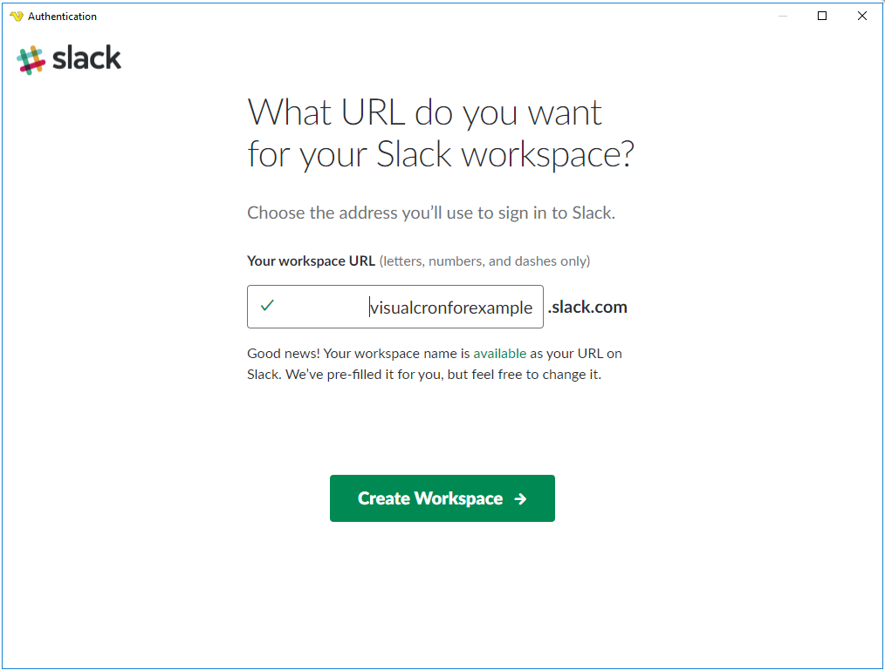
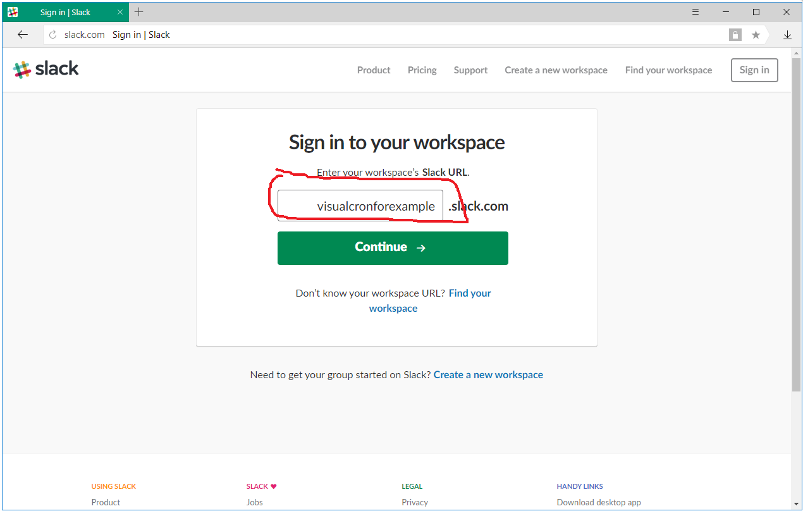
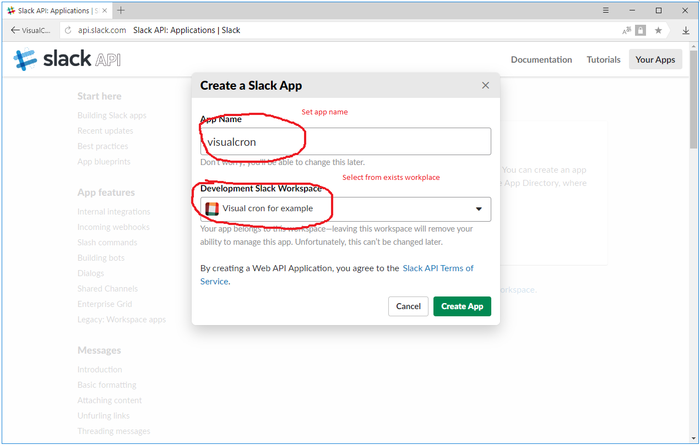
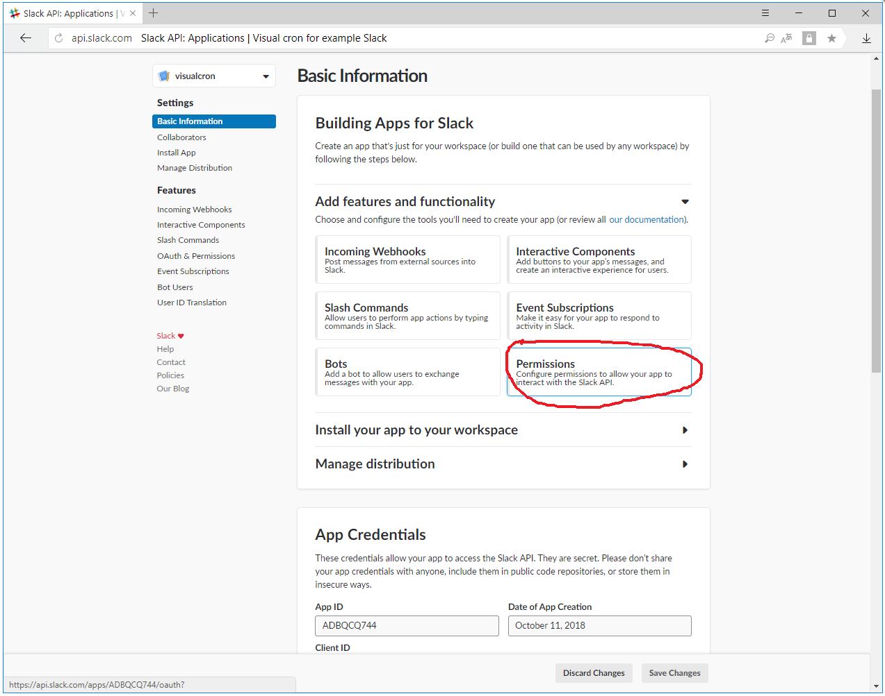
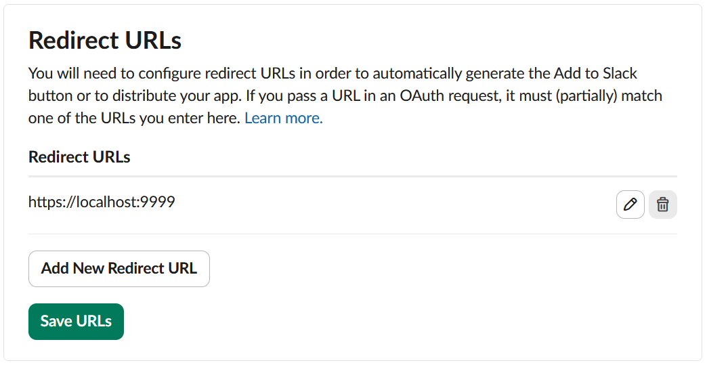
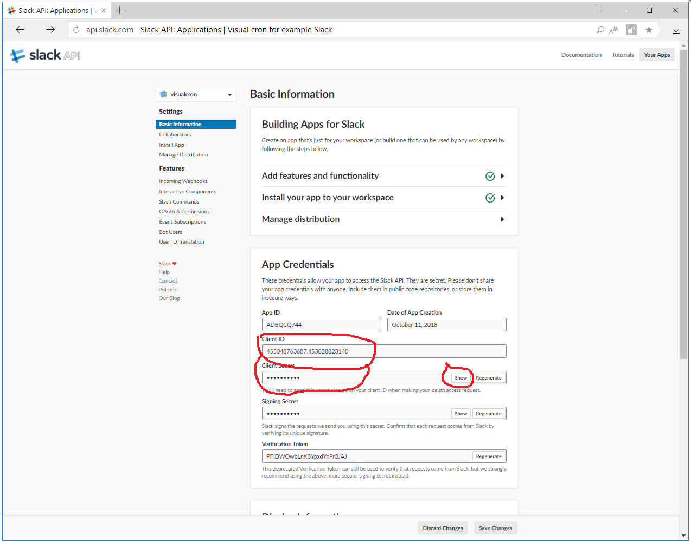
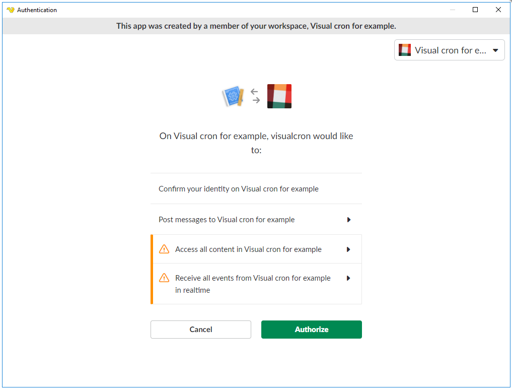

## Connection - Slack

The Slack Connection stores the sign-in and security settings that the [Slack - Send message](job-tasks/messaging-tasks/slack-send-message) Task and the [Slack Trigger](event-trigger-slack) use to connect to a Slack workspace.
 
### Common settings

The ***Common settings*** and ***Proxy*** tabs are the same for every Connection type that has them; see [Common settings](global-connections#common-settings) and [Proxy](global-connections#proxy). The Slack Connection has no _Test_ button.

### Main settings

These fields are on ***Connection settings*** -> ***Main settings***.

The ***Connection settings*** tab holds two tabs: ***Main settings*** and ***Proxy***.

_Client ID_

The Client ID of your Slack app. Required.

_Client Secret_

The Client Secret of your Slack app.

_Redirect Url_

The HTTPS address that receives the reply from Slack after sign-in, on the computer that runs the Client. The default is "https://localhost:9999". It must start with "https://" and must match a redirect URL of the Slack app.

_Auto-accept server certificates_

Selected by default. The Slack sign-in, the Slack Task and the Slack Trigger do not use this setting.

_Certificate_

Required. The certificate that _Authenticate_ uses for its HTTPS listener at _Redirect Url_. Select a certificate with a private key from [Certificates](global-certificates). Slack accepts only HTTPS redirect URLs, so a certificate is needed even for "localhost".

_Setup application_

Opens the Slack app management page in the web browser, where you create and manage Slack apps.

_Authenticate_

Opens the Slack authorization page in the web browser. After you allow access, the Slack token is saved in the Connection. The Slack Task and the Slack Trigger use this token.

### Proxy

The Slack Task, the Slack Trigger and _Authenticate_ do not use the settings on this tab. They connect to Slack directly.

### Set up the Slack app

To connect VisualCron to Slack, complete the following steps:

1. On ***Main settings***, click _Setup application_. The Slack app management page opens.
2. Create a Slack app in the workspace that VisualCron works with.
3. Add the _Redirect Url_ value of the Connection, for example "https://localhost:9999", to the redirect URLs of the app.
4. Add these Bot Token Scopes to the app: "commands", "chat:write", "channels:read", "files:write", "users:read" and "groups:read".
5. Copy the Client ID of the app into _Client ID_.
6. Copy the Client Secret of the app into _Client Secret_.
7. In _Certificate_, select a certificate with a private key.
8. Click _Authenticate_.
9. In the web browser, allow the app access to the workspace.
10. Click _OK_.

The Connection is ready for the Slack Task and the Slack Trigger. The screenshots below show these steps on the Slack site.
 
### Setting up Slack -> Create workspace

### Setting up Slack -> Sign in

### Setting up Slack -> Create Slack app

### Setting up Slack -> Edit permissions

### Setting up Slack -> Set Redirect URLs

The Redirect URL configured in the Slack app must use HTTPS (for example `https://localhost:9999`) and must match the Redirect Url set on the VisualCron connection.

### Setting up Slack -> Set Basic information

### Setting up Slack -> Authorize permissions for VisualCron

### Troubleshooting

#### "Missing scope" error

_Authenticate_ requests these Bot Token Scopes: "commands", "chat:write", "channels:read", "files:write", "users:read" and "groups:read". Add all six to the Slack app, then click _Authenticate_ again.

Before VisualCron 13.4.2, _Authenticate_ requested only "commands", "chat:write" and "channels:read". A Connection authenticated with an earlier version keeps that token after the upgrade. Until you add "files:write", "users:read" and "groups:read" to the Slack app and click _Authenticate_ again, file uploads, the user list and private channel lookups fail.
