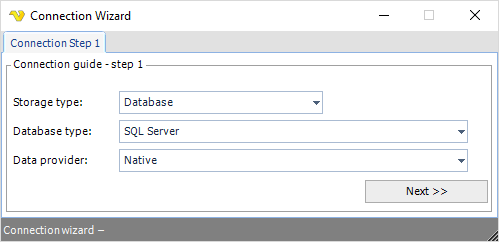
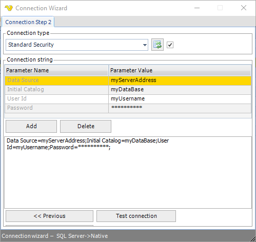
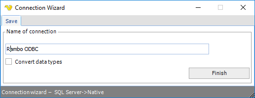
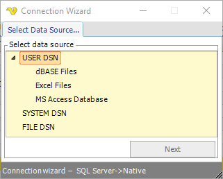
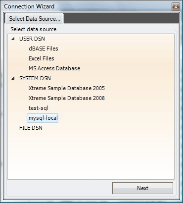
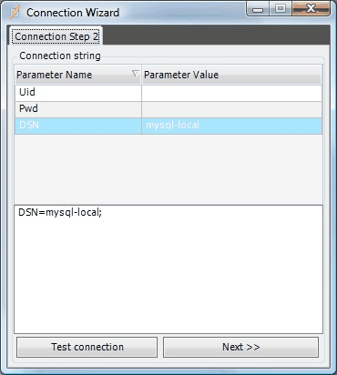
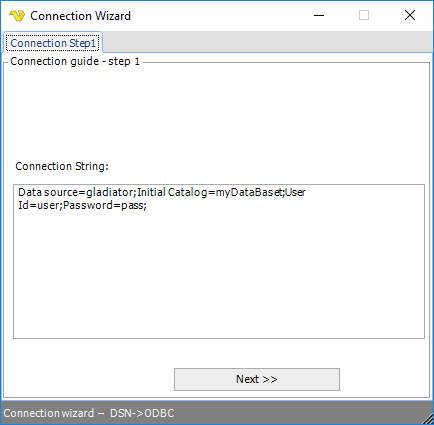
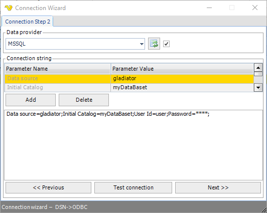
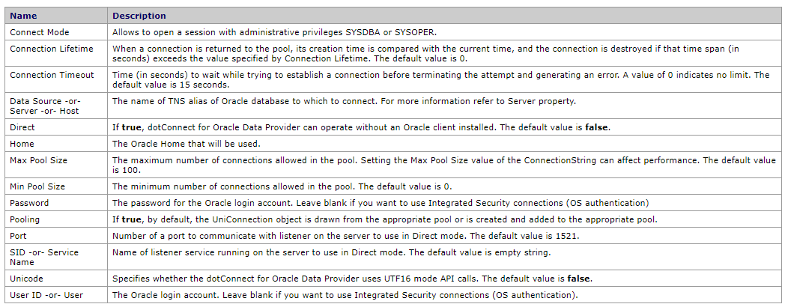
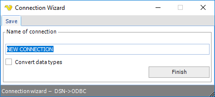

## Connection - SQL

The SQL Connection stores the address, sign-in and security settings that the [Database - SQL](job-tasks/database-tasks/sql), [Database - Execute SSISDB package](job-tasks/database-tasks/execute-ssisdb-package) and [Database - Sync tables](job-tasks/database-tasks/sync-tables) Tasks and the [SQL Trigger](event-trigger-sql) use to connect to a database. External database logging and *Copy database* in [Log settings](settings-log-settings) also use it. The settings are stored as a connection string and a data provider.

When you add a SQL Connection, the Connection window shows the connection wizard. On the *Choose wizard mode* page, select how to build the connection string, then click *Next >>*.


- *Use connection guide*: build the connection string from a database type and a data provider
- *Use existing data source*: start from an ODBC data source (DSN) on the Server computer
- *Use existing connection string*: start from a connection string that you already have

Every mode ends with the *Connection Step 2* page, where you edit and test the connection string, and the *Save* page.

### Use connection guide

#### Connection Step 1



A new Connection starts with *Storage type* "Database", *Database type* "SQL Server" and *Data provider* "Native".

*Storage type* sets the kind of data source: "Database", "File" or "Other". The *Database type* list shows only the types for the selected storage type:

- "Database": "Amazon Aurora", "AS/400 (iSeries)", "Caché", "Firebird", "IBM DB2", "Informix", "Ingres", "Interbase", "Lightbase", "Mimer SQL", "MySQL", "Oracle", "Paradox", "Pervasive", "Postgre SQL", "Progress", "SQL Server", "SQL Server 2005", "SQL Server 2005 Compact Edition", "SQLBase", "Sybase Adaptive Server Enterprise", "Sybase Advantage Database Server", "Teradata" and "VistaDB"
- "File": "Access", "Access 2007", "DBF / FoxPro", "Excel", "Excel 2007", "Filemaker", "SQLite", "Textfile" and "Visual FoxPro / FoxPro 2.x"
- "Other": "Active Directory", "DSN", "Exchange", "File DSN", "HTML Table", "Index Server", "Intuit QuickBase", "Lotus Notes", "MS Project" and "UDL"

To connect to a database that the list does not name, create an ODBC data source for it and use *Use existing data source*, or use *Use existing connection string*.

*Data provider* lists the providers for the selected database type: "ODBC", "OLEDB" and, for some types, "Native". "Native" is offered for "SQL Server", "SQL Server 2005", "Oracle", "MySQL", "IBM DB2" and "Postgre SQL", and "Amazon Aurora" offers "Native MySql". "Oracle" also offers "Devart dotConnect for Oracle". Some database types offer only "ODBC" or only "OLEDB". A native provider connects without an ODBC driver or an OLE DB provider.

*Allowed SSL/TLS versions* has the options *SSL version 3*, *TLS version 1*, *TLS version 1.1*, *TLS version 1.2* and *TLS version 1.3*. All five are selected for a new Connection. Clear *SSL version 3*, *TLS version 1* and *TLS version 1.1* unless you need them. These options do not set the encryption between the data provider and the database. To encrypt that connection, use the encryption parameters of your data provider in the connection string.

:::warning

Each time a SQL Task runs, it sets the SSL and TLS versions for the whole VisualCron Server process to the versions selected in *Allowed SSL/TLS versions*, and the Server then accepts any server certificate for HTTPS calls in the Server process. External database logging and *Copy database* do the same when they use a SQL Connection. Select the same versions on every SQL Connection, so that the versions in effect do not depend on which Connection was used last.

:::

Click *Next >>*.

#### Connection Step 2



To edit and test the connection string, complete the following steps:

1. Select a preset in *Connection type*. The *Connection string* grid fills with the parameters of that preset, with sample values.
2. In *Parameter Value*, replace the sample values with your own, such as the server, the database, the user name and the password. The connection string below the grid changes as you edit, with passwords masked.
3. (Optional) To add a parameter, click *Add*.
4. (Optional) Enter the name of the new parameter in *Parameter name*.
5. (Optional) Click *Add* next to *Parameter name*.
6. (Optional) To remove a parameter, select it in the grid.
7. (Optional) Click *Delete*.
8. (Optional) Click *Test connection*.
9. Click *Next >>*.

The wizard shows the *Save* page.

To return the grid to the parameters and sample values of the preset, click the refresh icon next to *Connection type*, then click *Yes* to "Do you want to refresh parameters?".

*Test connection* opens the *Test database Connection* window. Select a Credential if the connection string uses Windows authentication, then click *Test connection*. The test opens and closes a connection to the database from the Server, not from the Client computer. With a Credential selected, the test runs as the Windows user of that Credential. Without one, it runs as the account that runs the VisualCron Server, which is LocalSystem by default.

:::tip

For a trusted (Windows authentication) connection, select the same Credential in the Task that you used for the test. See [Global - Credentials](global-credentials).

:::

For "Oracle" with the "Native" provider, the connection string must not contain both "SID" and "Service Name". The wizard shows a warning and does not run the test until you delete one of them.

#### Save



To save the Connection, complete the following steps:

1. Enter a name in *Name of connection*.
2. (Optional) Select a *Group*.
3. (Optional) Click *Permissions..* to set group permissions for the Connection.
4. (Optional) Select *Convert data types*. See below.
5. Click *Finish*.

The wizard saves the Connection and closes.

*Group* and *Permissions..* work as described in [Common settings](global-connections#common-settings).

*Convert data types* is cleared by default. When it is selected, the SQL Task converts input parameter values to the data type set for each parameter before it sends them. It applies to the "ODBC" and "OLEDB" providers and to the "Native" provider for "Postgre SQL". It is mostly needed for stored procedures on some databases, such as Sybase or SAP.

### Use existing data source

#### Select data source





The *Select data source* page has the nodes *USER DSN*, *SYSTEM DSN* and *FILE DSN*. The *SYSTEM DSN* and *FILE DSN* entries are read from the Server computer, where the Tasks run. The *USER DSN* node shows no entries. Select a data source, then click *Next*.

#### Connection Step 2



The grid holds the parameters for an ODBC data source, with "DSN" set to the data source that you selected. Add the user name, the password or other parameters that the data source needs, test the connection, and click *Next >>*, as in [Connection Step 2](#connection-step-2). Then name and save the Connection as in [Save](#save).

### Use existing connection string

#### Connection Step 1



Enter the connection string in *Connection String*, then click *Next >>*.

#### Connection Step 2



In *Data provider*, select the provider that the connection string is for: "ODBC", "OLEDB", "MSSQL Native", "MySQL Native" or "Oracle Native". The default is "ODBC". The grid shows the parameters of the connection string. Edit and test them as in [Connection Step 2](#connection-step-2), then click *Next >>*.

For "Oracle Native", these connection string parameters are available:



#### Save



Name and save the Connection as in [Save](#save), including *Convert data types*.

### Troubleshooting

#### Error ORA-12514 when an "Oracle Native" Connection runs in a Task

Check that the connection string does not contain both "SID" and "Service Name". They cannot be used together, so delete one of them. The wizard shows a warning about this when you test the connection.

#### Error ORA-28009 and "Keyword not supported: dba privilege"

Use the "Connect Mode" parameter instead of "DBA Privilege", for example:

```text
Connect Mode=SYSDBA
```

For the "Oracle" connection type "Standard 2 - direct mode (no Oracle Client)" with the "Native" provider, the wizard renames "DBA Privilege" to "Connect mode" when you click *Finish*.
