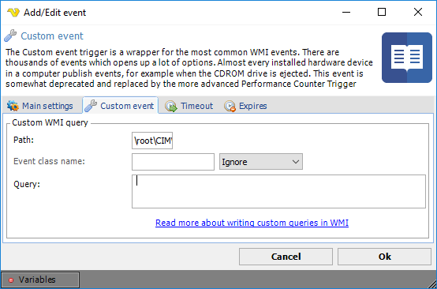

## Event Trigger - Custom

:::info

New Custom Triggers can no longer be added, because the Client does not offer this Trigger type. Existing Custom Triggers keep running and can still be opened. For new Triggers, use the [Performance Counter Trigger](event-trigger-performance-counter) or the Event Trigger type that covers the event.

:::

The Custom Trigger fires when a WMI event query that you write returns an event. It runs the query on the Server computer, or on the computer in *Computer name* on ***Main settings***. Select a Credential under *Credentials* only for a remote computer: with *Computer name* ".", a Credential makes the connection fail. With a Credential, only queries on intrinsic event classes such as `__InstanceCreationEvent` or `__InstanceOperationEvent` work, because the Trigger reads the event's target instance.
 
The query is written in WQL, the WMI Query Language. Test a new query before you use it; see [Querying with WQL](https://learn.microsoft.com/en-us/windows/win32/wmisdk/querying-with-wql) and [Receiving a WMI event](https://learn.microsoft.com/en-us/windows/win32/wmisdk/receiving-a-wmi-event).
 
The settings are on the ***Custom event*** tab.



**Path**

The WMI namespace. The default is "\root\CIMV2".
 
**Event class name**

Optional. Set the operator list next to the field to *Include* to enter an event class name. With *Ignore*, the default, the field is not available and not used. The event class is normally given in the `FROM` clause of the query.
 
**Query**

The WQL event query. The field can contain Variables. *Polling interval* on ***Main settings*** is shown but not used or saved. For event classes that need polling, set the interval in the query with `WITHIN`, in seconds. Do not use a value below 10, because frequent polling keeps the CPU busy.

For example, this query checks the processor load every 10 seconds:

```
SELECT * FROM __InstanceOperationEvent WITHIN 10
WHERE TargetInstance ISA 'Win32_Processor'
AND TargetInstance.LoadPercentage > 15
```

The query reports a change of the processor instance while the load is over 15 percent, so it can fire the Trigger at every check for as long as the load stays high. To start the Job once, check *Expiration enabled* on the ***Expires*** tab, select *Expire after being triggered* and set it to 1 time(s).
 
If VisualCron cannot connect to WMI or the query is not valid, the Trigger is deactivated when it starts. With a Credential, an error while the Trigger waits for events also deactivates it. Without a Credential, a WMI connection that is lost after the Trigger has started is not detected: the Trigger still shows as active, but its event no longer fires it (a timeout, if set, still fires), and nothing is logged. If a Custom Trigger that watches a remote computer stops firing, deactivate and activate the Trigger. To notice when the Trigger has gone silent, set a timeout on the ***Timeout*** tab. For the meaning of WMI error numbers in the log, see [WMI error constants](https://learn.microsoft.com/en-us/windows/win32/api/wbemdisp/ne-wbemdisp-wbemerrorenum).

### Result Variables

The Custom Trigger sets no Variables of its own. *Last run* gives the date and time it last fired, `{TRIGGER(Active|LastTrigger|LastRun)}`. In the *Variables* window, find it under the Job's *Triggers*, in *Last trigger*. See [Variables](global-variables).
