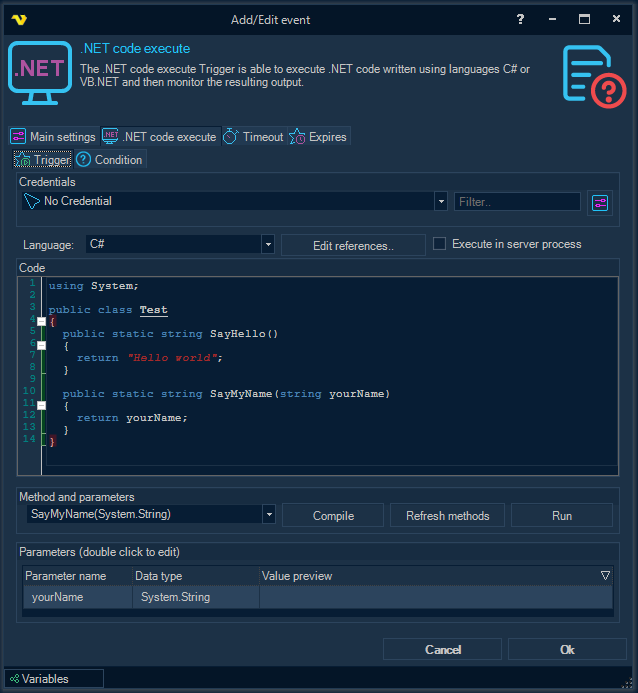
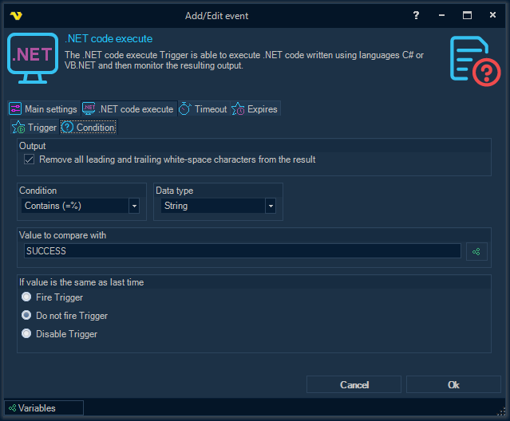

## Event Trigger - .NET Code Execute

The .NET code execute Trigger runs a method of your C# or VB.NET code at an interval and starts the Job when the
value it returns meets a condition.

**How the Trigger checks**

The method runs when the Trigger starts, for example when the Server starts or the Job is saved, and then every
*Polling interval* seconds (***Main settings*** tab, default 60). Checks are skipped while a Job time exception is
active. The code runs as the Credential selected on the ***Trigger*** sub tab (with *No Credential*, as the account
the VisualCron service runs under):

* With *Execute in server process* cleared (default), the code runs in a separate process on the Server, and the
  value it returns is compared as text
* With *Execute in server process* checked, the code runs inside the VisualCron Server process, and the value it
  returns is compared as the selected *Data type*

There is no time limit: until the method returns, the next check does not start, and a method that never returns
stops the Trigger from checking. If the code fails, the error is written to the Server log and the Trigger does not
fire; it runs again at the next interval. If the value, or the *Value to compare with*, cannot be read as the
selected *Data type*, the Trigger does not fire. If the selected Credential has been deleted, the checks do not
stop: the error is written to the Server log at every check, and the code still runs at each interval, as the account
the VisualCron service runs under, and can start the Job; select an existing Credential and save the Job. If another
error occurs during a check, the Trigger is
deactivated and the error is written to the Server log; correct the cause and activate the Trigger again.

:::warning

With *Execute in server process*, the code runs inside the VisualCron Server: an error that ends the process stops
every Job on the Server, and code that never returns stops this Trigger from checking.

:::

***.NET code execute*** tab, ***Trigger*** sub tab

The settings on the ***Trigger*** sub tab are the same as in the
[.NET code execute Task](job-tasks-task-process-dot-net-code-execute), except that there is no ***Output*** tab.
 
***.NET code execute*** tab, ***Condition*** sub tab

**Remove all leading and trailing white-space characters from the result**

Checked by default. For the *String* data type, when the returned value is text, the spaces and line breaks around
it are removed before it is compared. For the other data types they are always removed.

**Data type**

How the returned value is read: *Boolean*, *Int32*, *Int64*, *Double*, *Decimal* or *String* (default). The entries
in the *Condition* list depend on it. Numbers in text are read with the regional settings of the VisualCron Server.
For *Boolean*, a text value must be `True` or `False`, in any letter case.

**Condition**

How the returned value is compared with *Value to compare with*. Text comparisons are case-sensitive.

* *Boolean*: *Equal (=)*, *Not equal (!=)*
* *String*: *Equal (=)*, *Not equal (!=)*, *Contains (=%)*, *Not contains (!=%)*, *Regex - match*, *Regex - no match*
* *Int32*, *Int64*, *Double* and *Decimal*: *Equal (=)*, *Not equal (!=)*, *Larger than (>)*, *Larger than or equal
  (>=)*, *Smaller than (<)*, *Smaller than or equal (<=)* and *Contains (=%)*, which compares the numbers as text

**Value to compare with**

Enter a value or a Variable. Click the *Variables* icon to open the Variables list.

**If value is the same as last time**

What happens when the condition is met and the value is the same as at the previous check. The previous check counts
whether or not it met the condition.

* *Fire Trigger* (default): fire every time the condition is met
* *Do not fire Trigger*: do not fire; the Trigger fires again when the value changes and meets the condition
* *Disable Trigger*: deactivate the Trigger. Activate it again to use it
 
### Result Variables

When the Trigger fires, it sets this result Variable:

**Matched value** (`{TRIGGER(Active|LastTrigger|DotNETExecute.Result.DotNETExecute.MatchedValue)}`)

The returned value that met the condition, as read with the *Data type*. After a timeout fire it returns an error
text. See [Result Variables](event-triggers#result-variables) and [Variables](global-variables).
