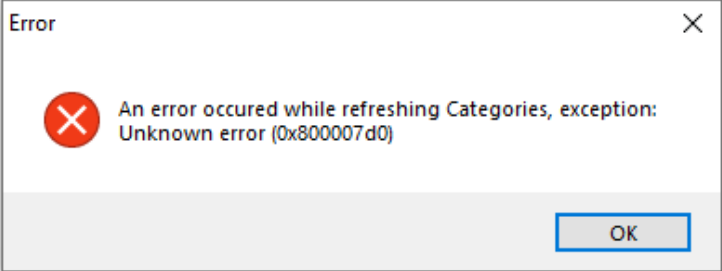

## Event Trigger - Performance Counter

The Performance counter Trigger watches one Windows performance counter and starts the Job when its value meets a condition for a length of time. Windows and many applications, services and drivers publish performance counters, for example the CPU use of a process or the free memory of the computer.

To watch a counter on another computer, enter the computer in *Computer name* under *Remote event* on the ***Main settings*** tab, and select a Credential that can read the counters on that computer. The default `.` is the computer that runs the VisualCron Server.

The settings are on the ***Performance counter*** tab.

Select a category, a counter and an instance, then set the condition. For example, to start the Job when one process uses more than 10% CPU for 10 seconds, select the *Process* category and the *% Processor Time* counter, select the process under *Instances of selected object*, and set *Condition* to *Greater than (>)*, *Value* to "10" and *Duration* to 10 seconds.

**List categories**

Click this button to fetch the performance counter categories, then select a counter in the tree. The VisualCron Server reads the categories, using the Credential if one is selected. The label above the tree shows which computer they came from, for example *Categories for computer 'SERVER01'*.

When *Computer name* is `.`, this button lists the categories of the computer that runs the Client. If the Client runs on another computer than the Server, enter the Server's computer name in *Computer name* first. When you open an existing Trigger, the categories of its saved computer are listed.

**Categories**

The tree lists the categories that *List categories* fetched, or that were listed when you opened the Trigger. Expand a category to see its counters. When you select a category or a counter, *Instances of selected object* lists the instances of that category, and the box below it shows the description.

**Instances of selected object**

The instances of the selected category, for example the running processes for the *Process* category. The first instance is selected; select the instance to watch.

**Counter description**

The read-only box below *Instances of selected object* shows the help text that Windows gives for the selected category or counter.

**Condition**

In the *Condition* group, choose how the counter value is compared with *Value*:

* *Greater than (>)*: the default
* *Greater or equal than (>=)*
* *Equal (=)*
* *Less or equal than (\<=)*
* *Less than (\<)*

:::warning

*Equal (=)* currently matches every sample, whatever the counter value, so the Trigger starts the Job after every *Duration*. Do not use *Equal (=)*. To catch an exact value, use *Greater or equal than (>=)* or *Less or equal than (\<=)* with the value you want.

:::

**Value**

The threshold value the counter is compared against. Accepts a numeric (double) value. The default is `0`.

**Duration**

How long the condition must hold before the Trigger fires. Enter hours, minutes (0 to 59) and seconds (0 to 59) in the three boxes, from left to right. The default is 0.

VisualCron reads the counter every second, starting two seconds after the Trigger starts. The time is counted from the first matching sample. A sample that does not match does not restart the count: the Trigger fires on the first matching sample at least *Duration* after the first match, even if some samples in between did not match. After the Trigger fires, the count starts again at the next matching sample, so a value that keeps matching fires the Trigger about every *Duration* plus 1 second.

The *Polling interval* on the ***Main settings*** tab is not used by this Trigger and is unavailable.

:::warning

With the defaults (*Greater than (>)*, *Value* 0, *Duration* 0), the Trigger fires on every sample above 0, which can start the Job every second. Set *Value* and *Duration* before you activate the Trigger.

:::

**Average**

When checked, the condition is checked against the average of the samples read since the Trigger started or since *Duration* was last reached (at most the latest 1,001 samples), instead of the latest sample. *Duration* still applies. The samples are cleared each time *Duration* is reached, even when *Run delay* holds back the Job. After the samples are cleared, the average starts again from the next sample. When *Average* is cleared, each sample is checked on its own.

If the counter cannot be read, for example because the instance no longer exists, the Trigger is deactivated and the error is written to the log.

### Result Variables

When the Trigger fires, it sets these result Variables:

* `PerformanceCounter.Result.LastValue`: the latest sample
* `PerformanceCounter.Result.AverageValue`: the average of the samples since the Trigger started or since *Duration* was last reached
* `PerformanceCounter.Result.ExpectedValue`: the *Value* you entered

For example, `{TRIGGER(Active|LastTrigger|PerformanceCounter.Result.LastValue)}` returns the value that fired the Trigger that started the run. *Last run*, `{TRIGGER(Active|LastTrigger|LastRun)}`, returns the time the Trigger fired. See [Variables](global-variables) for how *Last trigger* and the other keys work.

### Troubleshooting

*List categories* can show this error:

`An error occured while refreshing Categories, exception: Unknown error (0x800007d0)`

The VisualCron Server could not read the performance counter categories of the computer it was asked for. Check these causes:

* *Computer name* is `.` and the Client runs on another computer than the Server: the Server is then asked for the categories of the Client computer. Enter the Server's computer name, or the computer you want to watch, in *Computer name*
* The computer name is wrong or the computer cannot be reached
* The account the VisualCron service runs as, or the selected Credential, may not read performance counters on that computer
