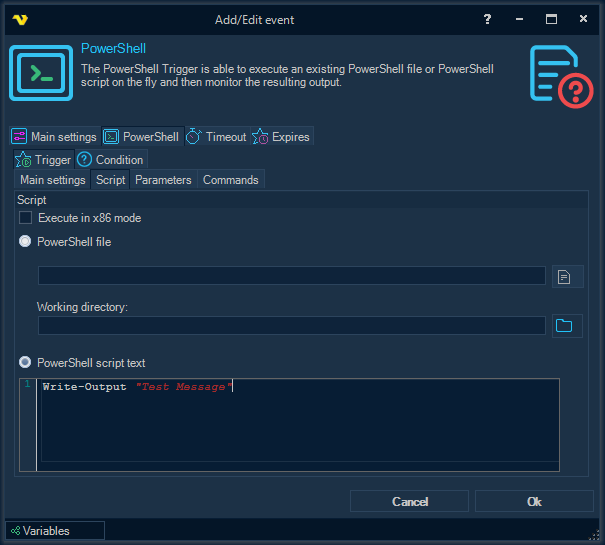
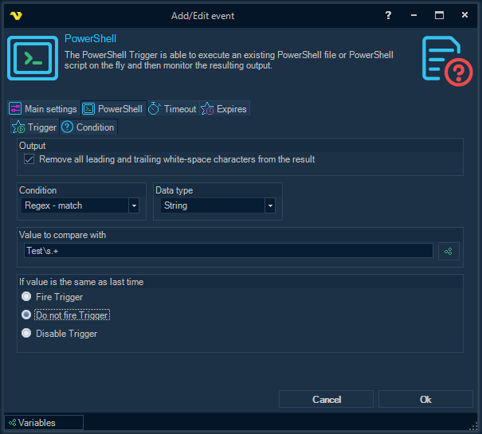

## Event Trigger - PowerShell

The PowerShell Trigger runs a PowerShell script or file at an interval and starts the Job when the output meets a
condition.

**How the Trigger checks**

The script runs when the Trigger starts, for example when the Server starts or the Job is saved, and then every
*Polling interval* seconds (***Main settings*** tab, default 60). Each run is a separate process on the VisualCron
Server, which runs as the Credential selected on the ***PowerShell*** tab, ***Trigger*** sub tab, ***Main settings***
tab (with *No Credential*, as the account the VisualCron service runs under). With the *Remote* scope, that process runs the script
on the remote host. Checks are skipped while a Job time exception is active.

* There is no time limit: until the script ends, the next check does not start, and a script that never ends stops
  the Trigger from checking. Give the script its own timeout
* If the script fails, the error is written to the Server log and the Trigger does not fire; it runs again at the
  next interval
* If the output, or the *Value to compare with*, cannot be read as the selected *Data type*, the Trigger does not
  fire
* If the selected Credential has been deleted, the checks do not stop: the error is written to the Server log at
  every check, and the script still runs at each interval, as the account the VisualCron service runs under, and can
  start the Job. Select an existing Credential and save the Job
* If another error occurs during a check, the Trigger is deactivated and the error is written to the Server log.
  Correct the cause and activate the Trigger again
 
***PowerShell*** tab, ***Trigger*** sub tab

The ***Trigger*** sub tab has four tabs, ***Main settings***, ***Script***, ***Parameters*** and ***Commands***. Their
settings are the same as in the [PowerShell Task](job-tasks-task-process-powershell). The Credential is on the
***Main settings*** tab.
 
***PowerShell*** tab, ***Condition*** sub tab

**Remove all leading and trailing white-space characters from the result**

Checked by default. For the *String* data type, the spaces and line breaks around the output are removed before it
is compared. For the other data types they are always removed.

**Data type**

How the output is read: *Boolean*, *Int32*, *Int64*, *Double*, *Decimal* or *String* (default). The entries in the
*Condition* list depend on it. Numbers are read with the regional settings of the VisualCron Server. For *Boolean*,
the output must be `True` or `False`, in any letter case.

**Condition**

How the output is compared with *Value to compare with*. Text comparisons are case-sensitive.

* *Boolean*: *Equal (=)*, *Not equal (!=)*
* *String*: *Equal (=)*, *Not equal (!=)*, *Contains (=%)*, *Not contains (!=%)*, *Regex - match*, *Regex - no match*
* *Int32*, *Int64*, *Double* and *Decimal*: *Equal (=)*, *Not equal (!=)*, *Larger than (>)*, *Larger than or equal
  (>=)*, *Smaller than (<)*, *Smaller than or equal (<=)* and *Contains (=%)*, which compares the numbers as text

**Value to compare with**

Enter a value or a Variable. Click the *Variables* icon to open the Variables list.

**If value is the same as last time**

What happens when the condition is met and the value is the same as at the previous check. The previous check counts
whether or not it met the condition.

* *Fire Trigger* (default): fire every time the condition is met
* *Do not fire Trigger*: do not fire; the Trigger fires again when the value changes and meets the condition
* *Disable Trigger*: deactivate the Trigger. Activate it again to use it
 
### Result Variables

When the Trigger fires, it sets this result Variable:

**Matched value** (`{TRIGGER(Active|LastTrigger|PowerShell.Result.PowerShell.MatchedValue)}`)

The output that met the condition, as read with the *Data type* (trimmed as described above). After a timeout fire it
returns an error text. See [Result Variables](event-triggers#result-variables) and [Variables](global-variables).
