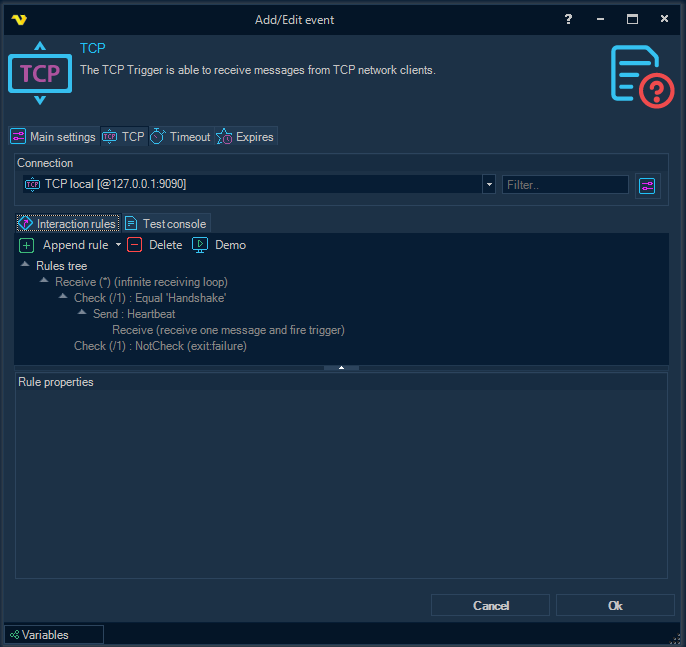
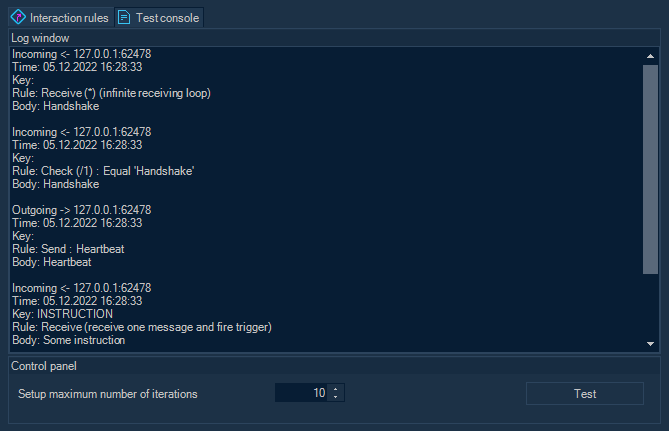

## Event Trigger - TCP

The TCP Trigger opens a TCP listener on the VisualCron Server and talks with each TCP client that connects, following
the interaction rules you configure. Each rule with *Fire trigger* checked fires the Trigger when it is processed, so
one conversation can fire the Trigger several times. *Run delay* and *Expire after being triggered* count each fire.
A fire that does not start the Job is lost; see [Triggers that fire once per item](event-triggers#triggers-that-fire-once-per-item).

**How the listener works**

* The listener uses the *Address* and *Port* of the selected [TCP Connection](connection-tcp). *Address* must be an
  IPv4 address of the Server, for example 127.0.0.1 for clients on the same computer or 0.0.0.0 for all its network
  addresses; a host name or an IPv6 address cannot be used
* Clients are handled at the same time, up to *Maximum number of connected clients* in the Connection's *TCP
  Listener* settings (default 0: no limit). Further clients wait until a conversation ends
* Failed listener starts, for example because another program uses the port: the Trigger tries again at once. After
  the fifth failure since the Trigger started, the Trigger is deactivated and the error is written to the Server log;
  correct the Connection and activate the Trigger again. If the selected Connection no longer exists, the Trigger is
  deactivated at once
* An error in one conversation ends that conversation and is written to the Server log; the Trigger keeps listening.
  This includes a client that closes its connection while a *Receive* rule waits, and a *Receive* rule that times out
 
***TCP*** tab, ***Interaction rules*** sub tab



**Connection**

Before you configure interaction rules, select a [TCP Connection](connection-tcp) in the *Connection* list. To add one, click the settings icon next to the list to open *Manage Connections*, add a TCP Connection and set its *Address* and *Port*.
 
***Interaction rules*** tab

The tab is split into two panes: a tree on the left that holds the rule hierarchy, and a properties panel on the right that displays the settings for the rule selected in the tree.
 
A new Trigger starts with one *Receive* rule with an infinite number of iterations and *Fire trigger* checked, so
every message a client sends fires the Trigger. A *Receive* rule reads whatever the client has sent at that moment as
one message; there is no message framing.

The toolbar above the tree has these commands:

* *Append rule*: adds a *Send*, *Receive* or *Check* rule as a child of the selected rule
* *Delete*: deletes the selected rule and all its child rules
* *Demo*: replaces the rules with an example conversation: receive "Handshake", answer "Heartbeat", then receive one
  instruction and fire the Trigger. It is available for a new Trigger and after you delete all rules; if there are
  rules, you are asked to confirm

*Rule properties* shows a ***Base*** tab for every rule (*Custom rule name*, *Result message key*, *Use key as format
string*, *Fire trigger*, *Force exit*) and the tab of the rule type:

* ***Send***: *Text body*, *Number of iterations*, *Delay before send* and *Delay after send* (in milliseconds)
* ***Receive***: *Number of iterations* and *Receive timeout* in seconds. -1, shown as "default", uses the timeout of
  the Connection, or 30 seconds if that is 0; 0, shown as "infinite", waits without a limit
* ***Check***: *Match condition*, *Match value* and *Exclusive group index*. Check rules under the same rule with the
  same index other than 0 exclude each other: after one of them matches, the others are skipped

In *Number of iterations*, -1 is shown as "infinite".
 
For the settings of each rule type, see [TCP messaging rules](../server/job-tasks/net-tasks/tcp#tcp-messaging-rules) on the TCP Task page.
 
***TCP*** tab, ***Test console*** sub tab



Click *Test* to try the rules without saving the Trigger. The Server opens a listener on the Connection's address and
port and waits for one client to connect; the rules then run for that client, and the *Log window* shows each
message. No Job is started. The whole test, including the wait, must finish within the Connection's timeout; with a
timeout of 0 the test fails at once. Connect a client in that time, for example a [TCP Task](job-tasks/net-tasks/tcp)
with the same Connection or the sample application below. While this Trigger, or another, is active and listening
on the same address and port, the test cannot open its listener: deactivate that Trigger while you test.

**Setup maximum number of iterations**

In the test, rules with a large or infinite number of iterations stop after this number, from 1 to 999 (default 10).
 
### Result Variables

When the Trigger fires, it sets these result Variables. In the Job, write the TCP result Variables in the *Last
trigger* form, for example `{TRIGGER(Active|LastTrigger|TCP.Result.TCP.TextBody)}`,
with the last part as listed below. The *Last trigger* form keeps the values of the fire that started the run, even
when several clients make the Trigger fire at nearly the same time (see
[Result Variables](event-triggers#result-variables) and [Variables](global-variables)).

**Body (text)** (`TCP.Result.TCP.TextBody`)

The text of the message processed by the rule that fired the Trigger, decoded with the Connection's *Code page*.

**Received time** (`TCP.Result.TCP.ReceivedTime`)

When that message was processed. To format the date, write `TCP.Result.TCP.ReceivedTime|<date format>`, for example
`{TRIGGER(Active|LastTrigger|TCP.Result.TCP.ReceivedTime|yyyy-MM-dd HH:mm:ss)}`.

**From address** (`TCP.Result.TCP.FromAddress`)

The address of the client, as "address:port". When the rule that fired is a *Send* rule, it is the Server's own
address.

**Get text body of a message with the specified key** (`TCP.Result.TCP.Messages|<Key>`)

The text of the message whose *Result message key* is `<Key>`, from the messages of the same conversation since the
previous fire. The key is case-sensitive. Empty if there is no such message.
 
### Sample TCP client

**Sample TCP Client application code** (_C#_)

```c#
using System.Net.Sockets;
using System.Text;
 
namespace TCP_Client
{
  internal class Program
   {
      static void Main()
       {
          /*
            * Connecting
            */
          using var tcpclnt = new TcpClient();
           Console.WriteLine("Connecting .....");
 
           tcpclnt.Connect("127.0.0.1", 9090);
          using var stm = tcpclnt.GetStream();
 
          if (stm.CanWrite)
           {
               Console.WriteLine("Connected");
               Thread.Sleep(1000);
           }
          else
           {
               Console.WriteLine("The stream is unavailable");
              return;
           }
           
          /*
            * WARNING:
            *   the encoding should be the same as configured in the TCP Connection / Common settings / Code page
            */
          var enc = Encoding.UTF8;
          string message;
          byte[] buffer;
 
          /*
            * Sending "Handshake"
            */
           message = "Handshake";
           Console.WriteLine();
           Console.WriteLine($"Sending '{message}' .....");
           buffer = enc.GetBytes(message);
           stm.Write(buffer, 0, buffer.Length);
 
           Console.WriteLine($"'{message}' sent");
           Thread.Sleep(1000);
 
          /*
            * Receiving a response
            */
           Console.WriteLine();
           Console.WriteLine("Receiving .....");
           buffer = new byte[tcpclnt.ReceiveBufferSize];
          var cnt = stm.Read(buffer, 0, buffer.Length);
 
           message = enc.GetString(buffer, 0, cnt);
           Console.WriteLine("Message received : " + message);
 
          /*
            * Checking the response
            */
          const string heartbeat_response = "Heartbeat";
          if (message == heartbeat_response)
           {
               Console.WriteLine("Response checked. Ready to send a command");
               Thread.Sleep(1000);
           }
          else
           {
               Console.WriteLine($"The response is invalid. Must be '{heartbeat_response}'");
              return;
           }
 
          /*
            * Sending some command
            */
           Console.WriteLine();
           Console.Write("Enter the command to be transmitted : ");
           message = Console.ReadLine() ?? string.Empty;
 
           Console.WriteLine($"Sending '{message}' .....");
           buffer = enc.GetBytes(message);
           stm.Write(buffer, 0, buffer.Length);
 
           Console.WriteLine("Command sent.");
           Console.WriteLine("Exit.");
       }
   }
}
```
