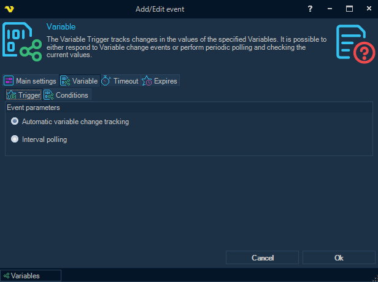
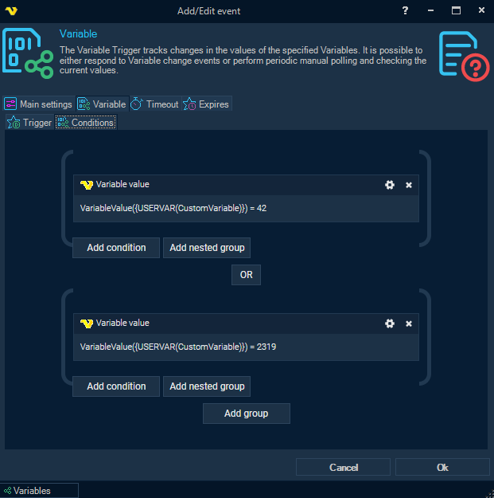
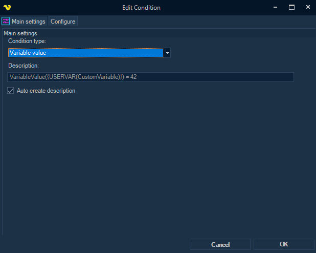
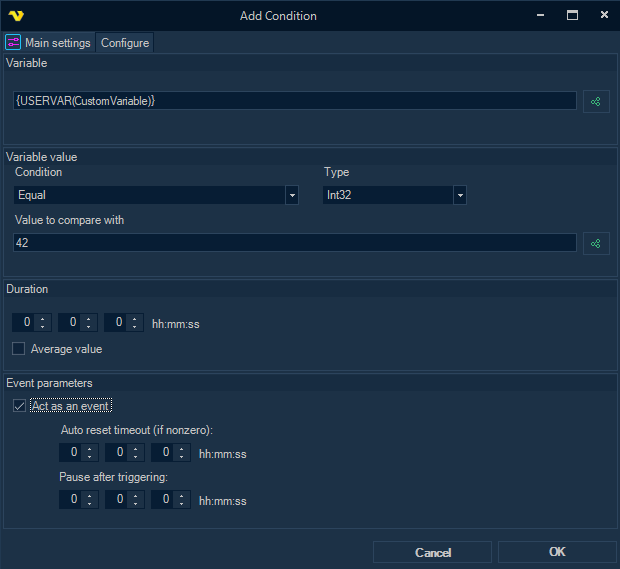
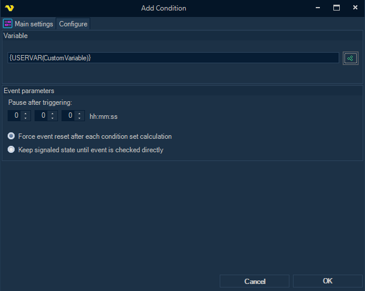

## Event Trigger - Variable

The **Variable Trigger** tracks changes in the values of the specified Variables. It is possible to either respond to Variable change events or perform periodic polling and checking the current values.
 
***Variable*** tab, ***Trigger*** sub tab



**Automatic variable change tracking**

The default. The Trigger calculates the conditions when a Variable in them changes, and fires if the conditions are
met and either a condition acts as an event or the conditions were not met before. *Polling interval* on the
***Main settings*** tab is not used.

**Interval polling**

The Trigger calculates the conditions when it starts and then every *Polling interval* seconds (***Main settings***
tab), and fires each time they are met.

:::note

In both modes the conditions are also calculated when the Trigger starts, for example when the Server starts or the
Job is saved. If they are met then, the Trigger fires and starts the Job, on every Job save or Server restart while
the conditions hold.

:::

In *Automatic variable change tracking*, every match while a [time exception](job-time-exceptions) of the Job is
active is kept. The next time the conditions are met after the time exception ends, the Trigger fires once for each
kept match and once for the new one, and each counts toward *Run delay* and *Expire after being triggered*.
 
***Variable*** tab, ***Conditions*** sub tab



Add one or more conditions here. Conditions are joined with AND by default. An operator joins two conditions or two groups. To switch an operator between AND and OR, click it.

At every level of the tree, inside a group and between groups, AND is calculated before OR: `A AND B OR C` means `(A AND B) OR C`. A group works like a pair of parentheses, so to calculate `A AND (B OR C)`, put B and C in a group of their own.

Use these buttons to build the condition tree:

* *Add condition*: adds a condition to the group above the button
* *Add nested group*: adds a group inside the group above the button
* *Add group*: adds a group at the top level of the tree, below the last group

To change a condition, click the settings icon in its title bar; to remove it, click the delete icon (x).
 
*Add Condition* window, ***Main settings*** tab



There are currently two types of conditions supported:
 
**Variable value**

A state-check condition that checks the current value of a Variable against a given criterion.
Allows the duration, including the calculation of the average value if a numeric value type is selected.
Can act as an event, so that the next match of the condition is possible only after an unmatched state is detected or the reset timeout expires.
 
**Variable value changed**

An event-based condition that triggers every time the value of a Variable changes from its previous value.

**Description** and **Auto create description**

*Condition type* on the ***Main settings*** tab selects *Variable value* or *Variable value changed*. *Description*
is the text shown for the condition in the condition tree. While *Auto create description* is checked, the
description is created from the settings of the condition; clear the checkbox to enter your own.
 
 
*Add Condition* window, ***Configure*** tab, *Variable value*



**Variable**

Variable, or a combination of several Variables, the value of which is checked in the condition.
 
**Type**

How the value is read: *String*, *Byte*, *Int16*, *Int32*, *Int64*, *Single*, *Double*, *Decimal*, *DateTime* or
*Boolean*. The entries in the *Condition* list depend on it.

**Condition**

How the value of the Variable is compared with *Value to compare with*. The entries depend on the *Type*:

* *String*: *Equal*, *Not equal*, *Contains*, *Not contains*, *RegEx match*, *RegEx no match*
* *Boolean*: *Equal*, *Not equal*
* *Byte*, *Int16*, *Int32*, *Int64*, *Single*, *Double*, *Decimal* and *DateTime*: *Equal*, *Not equal*, *Smaller*,
  *Smaller or equal*, *Larger*, *Larger or equal*
 
**Value to compare with**

Can be a specific value, or another Variable.
 
**Duration**

Shown only for the number types, *Byte* to *Decimal*. All values of the Variable during this period, in hh:mm:ss,
are checked against the condition.

**Average value**

Shown with *Duration*. The average of the values of the Variable during the period is checked against the condition
instead.
 
**Act as an event**

If enabled, the next match of the state-check condition is possible only after an unmatched state is detected or the reset timeout expires.
 
**Auto reset timeout**

If nonzero, the condition can trigger again after the specified timeout, even if the state matched all the time.
 
**Pause after triggering**

The period of time after previous triggering when the event generation is suppressed.
However, if while waiting for the end of the suppression period, the state changes to non-matching, and then changes back to matching, then immediately after the end of the suppression period, the condition will be triggered again.
 
*Add Condition* window, ***Configure*** tab, *Variable value changed*



**Variable**

Variable, or a combination of several Variables, the value of which is checked in the condition.
 
**Pause after triggering**

The period of time after previous triggering when the event generation is suppressed.
If an event occurs in the system before the suppression period has ended, the event will be ignored.
 
**Event reset behavior**

A pair of radio buttons that control how the signaled state of the change event is reset:

* *Force event reset after each condition set calculation*: the state is set to non-signaled when the entire condition tree is calculated, regardless of whether the event is checked directly or not
* *Keep signaled state until event is checked directly*: the event remains in the signaled state until it is checked directly during condition calculations
 
### Result Variables

When the Trigger fires, it sets these result Variables:

**General evaluated expression** (`{TRIGGER(Active|LastTrigger|Variable.Result.Variable.EvaluatedExpression)}`)

The evaluated expression of all conditions, for example
`VariableValue({USERVAR(CustomVariable)}):42 = 42 OR VariableValue({USERVAR(CustomVariable)}) = 2319`.

For each condition, the *Variables* window lists three more Variables under the *Result* node of that Trigger (not
under *Last trigger*), in the `<JobId>|<TriggerId>` form with the ID of the condition filled in. To use them in the
Job that the Trigger starts, replace `<JobId>|<TriggerId>` with `Active|LastTrigger`, for example
`{TRIGGER(Active|LastTrigger|Variable.Result.Variable.MatchDetails|<ConditionId>|Success)}`:

* **Success** (`...|MatchDetails|<ConditionId>|Success)}`): "True" or "False", whether the condition was met; empty
  if the condition was not calculated
* **Actual parameter value** (`...|MatchDetails|<ConditionId>|ActualParameterValue)}`): the value of the Variable in
  the condition; an error text if the condition was not calculated
* **Evaluated expression** (`...|MatchDetails|<ConditionId>|EvaluatedExpression)}`): the evaluated expression of the
  condition

See [Result Variables](event-triggers#result-variables) and [Variables](global-variables).
 
### Configuration examples

The examples below set up the Trigger for common cases. Each step names the tab and the setting to change.

#### Interval polling

**Example 1.1**

Every 10 minutes, check the value of the Variable "VarX". If the value is "X", run the Job.

To set up this example, complete the following steps:

1. On the ***Main settings*** tab, under *Polling interval*, set *Check every* to "600" seconds.
2. On the ***Variable*** tab, ***Trigger*** sub tab, select *Interval polling*.
3. On the ***Conditions*** sub tab, click *Add condition*.
4. In the window that opens, on the ***Main settings*** tab, set *Condition type* to *Variable value*.
5. On the ***Configure*** tab, set:
    * *Variable*: `{USERVAR(VarX)}`
    * *Condition*: *Equal*
    * *Value to compare with*: "X"
6. Click *OK*.

**Example 1.2**

Every 10 minutes, check the average value of the numeric Variable "VarN" over the last 10 minutes. If the average is larger than `<N>`, run the Job.

To set up this example, complete the following steps:

1. On the ***Main settings*** tab, under *Polling interval*, set *Check every* to "600" seconds.
2. On the ***Variable*** tab, ***Trigger*** sub tab, select *Interval polling*.
3. On the ***Conditions*** sub tab, click *Add condition*.
4. In the window that opens, on the ***Main settings*** tab, set *Condition type* to *Variable value*.
5. On the ***Configure*** tab, set:
    * *Variable*: `{USERVAR(VarN)}`
    * *Type*: *Int32*
    * *Condition*: *Larger*
    * *Value to compare with*: `<N>`
    * *Duration*: "00:10:00"
    * *Average value*: checked
6. Click *OK*.

#### Variable value changed events

**Example 2.1**

Run the Job each time the value of the Variable "VarX" changes.

To set up this example, complete the following steps:

1. On the ***Variable*** tab, ***Trigger*** sub tab, select *Automatic variable change tracking*.
2. On the ***Conditions*** sub tab, click *Add condition*.
3. In the window that opens, on the ***Main settings*** tab, set *Condition type* to *Variable value changed*.
4. On the ***Configure*** tab, set *Variable* to `{USERVAR(VarX)}`.
5. Click *OK*.

**Example 2.2**

Run the Job each time the value of the Variable "VarX" changes, but at most once a minute. A change less than 1 minute after the previous fire is ignored.

To set up this example, complete the following steps:

1. On the ***Variable*** tab, ***Trigger*** sub tab, select *Automatic variable change tracking*.
2. On the ***Conditions*** sub tab, click *Add condition*.
3. In the window that opens, on the ***Main settings*** tab, set *Condition type* to *Variable value changed*.
4. On the ***Configure*** tab, set:
    * *Variable*: `{USERVAR(VarX)}`
    * *Pause after triggering*: "00:01:00"
5. Click *OK*.

**Example 2.3**

Run the Job each time the value of the numeric Variable "VarN" changes, but only when the new value is outside the range from `<MinN>` to `<MaxN>`, that is, smaller than `<MinN>` or larger than `<MaxN>`.

The condition to build is `VarN changed AND (VarN < <MinN> OR VarN > <MaxN>)`. It needs two groups, joined with AND. The sketch below is schematic; the descriptions are in the form the Client creates, such as `VariableValue({USERVAR(VarN)}) < <MinN>`:

```
Group 1
    VariableValueChanged({USERVAR(VarN)})
AND
Group 2
    VariableValue({USERVAR(VarN)}) < <MinN>
    OR
    VariableValue({USERVAR(VarN)}) > <MaxN>
```

Without the second group, the three conditions would be calculated as `(VarN changed AND VarN < <MinN>) OR VarN > <MaxN>`, which is a different condition.

To set up this example, complete the following steps:

1. On the ***Variable*** tab, ***Trigger*** sub tab, select *Automatic variable change tracking*.
2. On the ***Conditions*** sub tab, click *Add condition*.
3. In the window that opens, on the ***Main settings*** tab, set *Condition type* to *Variable value changed*. On the ***Configure*** tab, set *Variable* to `{USERVAR(VarN)}`, and click *OK*. This condition is group 1.
4. Click *Add group*. In the window that opens, set *Condition type* to *Variable value*, and on the ***Configure*** tab set:
    * *Variable*: `{USERVAR(VarN)}`
    * *Type*: *Int32*
    * *Condition*: *Smaller*
    * *Value to compare with*: `<MinN>`

    Click *OK*. This condition starts group 2.
5. In group 2, click *Add condition*, and add a *Variable value* condition with *Variable* `{USERVAR(VarN)}`, *Type* *Int32*, *Condition* *Larger* and *Value to compare with* `<MaxN>`.
6. Make sure that the operator between group 1 and group 2 is AND, and set the operator between the two conditions in group 2 to OR.

#### Variable value that starts to match

**Example 3.1**

Run the Job each time the value of the Variable "VarX" becomes "X".

To set up this example, complete the following steps:

1. On the ***Variable*** tab, ***Trigger*** sub tab, select *Automatic variable change tracking*.
2. On the ***Conditions*** sub tab, click *Add condition*.
3. In the window that opens, on the ***Main settings*** tab, set *Condition type* to *Variable value*.
4. On the ***Configure*** tab, set:
    * *Variable*: `{USERVAR(VarX)}`
    * *Condition*: *Equal*
    * *Value to compare with*: "X"
5. Click *OK*.

**Example 3.2**

Run the Job each time the value of the Variable "VarX" becomes "X", and again every 10 minutes while the value stays "X". Start the Job at most once a minute: if the value becomes "X" again less than 1 minute after the previous fire, the Job starts when that minute has passed, if the value is still "X".

To set up this example, complete the following steps:

1. On the ***Variable*** tab, ***Trigger*** sub tab, select *Automatic variable change tracking*.
2. On the ***Conditions*** sub tab, click *Add condition*.
3. In the window that opens, on the ***Main settings*** tab, set *Condition type* to *Variable value*.
4. On the ***Configure*** tab, set:
    * *Variable*: `{USERVAR(VarX)}`
    * *Condition*: *Equal*
    * *Value to compare with*: "X"
    * *Act as an event*: checked
    * *Auto reset timeout (if nonzero)*: "00:10:00"
    * *Pause after triggering*: "00:01:00"
5. Click *OK*.

**Example 3.3**

Run the Job each time the value of the Variable "VarX" becomes "X", but only when the value of the Variable "VarN" is "N" at that moment. The condition to build is `VarX = "X" AND VarN = "N"`, with the first condition acting as an event.

To set up this example, complete the following steps:

1. On the ***Variable*** tab, ***Trigger*** sub tab, select *Automatic variable change tracking*.
2. On the ***Conditions*** sub tab, click *Add condition*.
3. In the window that opens, set *Condition type* to *Variable value*, and on the ***Configure*** tab set:
    * *Variable*: `{USERVAR(VarX)}`
    * *Condition*: *Equal*
    * *Value to compare with*: "X"
    * *Act as an event*: checked

    Click *OK*.
4. In the same group, click *Add condition*, and add a *Variable value* condition with *Variable* `{USERVAR(VarN)}`, *Condition* *Equal* and *Value to compare with* "N".
5. Make sure that the operator between the two conditions is AND.

**Example 3.4**

Run the Job each time the value of the Variable "VarX" becomes "X", but only when the value of the Variable "VarN" has changed since the previous run. The condition to build is `VarX = "X" AND VarN changed`.

To set up this example, complete the following steps:

1. On the ***Variable*** tab, ***Trigger*** sub tab, select *Automatic variable change tracking*.
2. On the ***Conditions*** sub tab, click *Add condition*.
3. In the window that opens, set *Condition type* to *Variable value*, and on the ***Configure*** tab set:
    * *Variable*: `{USERVAR(VarX)}`
    * *Condition*: *Equal*
    * *Value to compare with*: "X"
    * *Act as an event*: checked

    Click *OK*.
4. In the same group, click *Add condition*. In the window that opens, set *Condition type* to *Variable value changed*, and on the ***Configure*** tab set *Variable* to `{USERVAR(VarN)}` and select *Keep signaled state until event is checked directly*. Click *OK*.
5. Make sure that the operator between the two conditions is AND.
