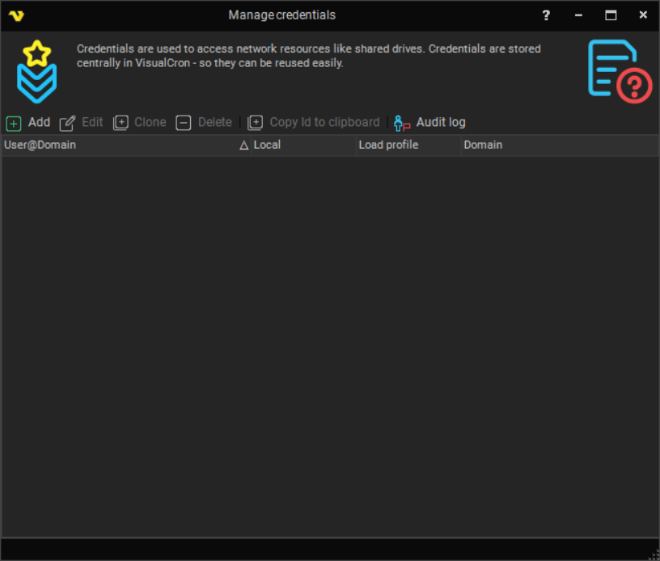
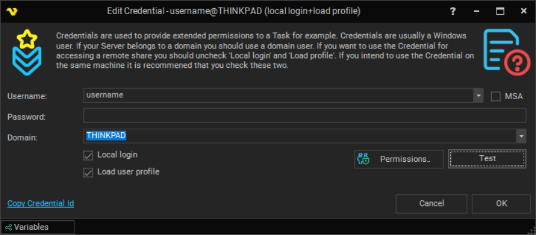
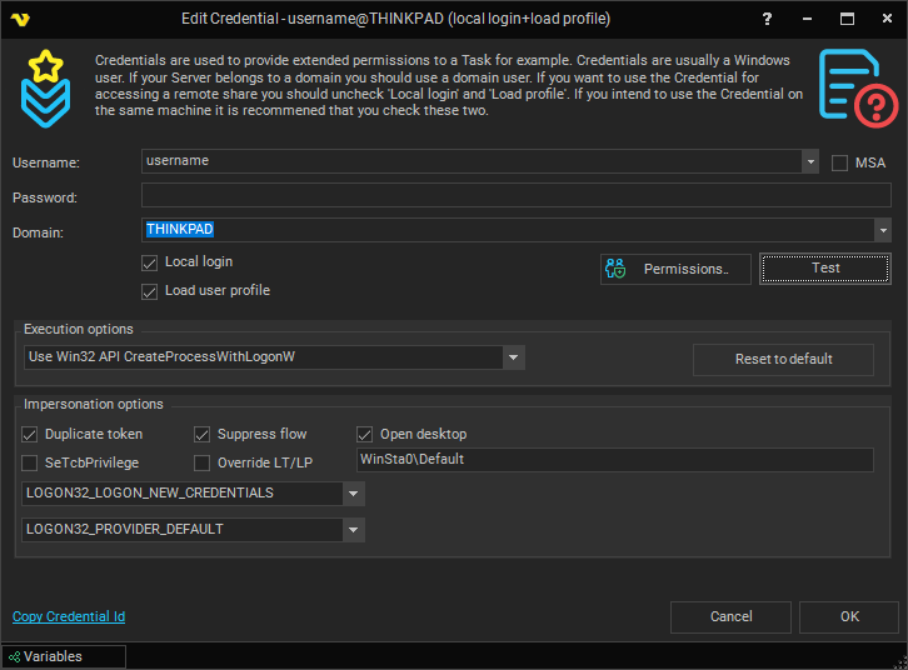

## Global - Credentials

A Credential stores a Windows user name, password and domain centrally on the VisualCron Server, so that Tasks, Triggers and Connections can run or connect as that user. This page describes the _Manage credentials_ window, the window where you add and edit a Credential, and how the Server uses a Credential. Use it when a Task needs rights that the VisualCron service account does not have.

You need a Credential, for example, when:

- An Execute Task must run as a certain user
- An SQL Task uses a trusted connection (Windows authentication)
- A Task must authenticate against a web server or a network share
- Another Task, Trigger or Connection needs a certain user's permissions

Without a Credential, a Task runs as the account that the VisualCron Server service runs as. That account may not have access to your network drives or to certain folders, which is why you sometimes need a Credential.

The Server stores the user name, password and domain of each Credential encrypted.

To open the window, click the main menu **_Server_** -> _Global objects_ -> _Credentials_. You need the _Credentials_ permission with _Read_ (see [Credential permissions](#credential-permissions) below).



The grid shows one row for each Credential that you have _Read_ on. The columns are:

- _User@Domain_: the user name and the domain of the Credential
- _Local_: "True" when _Local login_ is checked
- _Load profile_: "True" when _Load user profile_ is checked
- _Domain_: the domain or computer name the Credential logs on to

The toolbar has these buttons:

- _Add_: opens the _Add Credential_ window
- _Edit_: opens the selected Credential. You can also double-click the row
- _Clone_: opens a copy of the selected Credential with its own identifier, so changing the copy does not affect the original
- _Delete_: deletes the selected Credential after you confirm. If other objects use the Credential, the question says how many
- _Copy Id to clipboard_: copies the identifier of the selected Credential
- _Audit log_: opens the audit log for Credentials (see [Objects - Audit Log](../tools/objects-audit-log))

Right-click a row for these commands:

- _Add_, _Edit_, _Clone_, _Delete_ and _Audit log_: the same as the toolbar buttons
- _Versions.._: the version history of the Credential
- _Object relations_: the Jobs, Tasks, Triggers and other objects that use the Credential
- _Export ..._: export the selected Credentials (see [Import/Export - Export Settings](../file/export-settings))
- _Send to connection ..._: copy the Credential to the Server that a VisualCron Connection points to (see [Connection - VisualCron](connection-visualcron))
- _Send to server connection ..._: copy the Credential to another Server that this Client is connected to

In the grid, press Delete to delete the selected Credential, or Ctrl+A to select every row, for example before _Export ..._.

:::note

A clone, or a copy sent to another Server, may not carry the stored password. Type the password again in the copy before you test or use it.

:::

:::warning

Deleting a Credential does not update the Jobs, Tasks and Triggers that use it. Before you delete a Credential, use _Object relations_ to see what uses it. Afterwards, select another Credential in each of those objects.

A Task that still refers to the deleted Credential behaves as follows:

- Some Tasks stop. Their result starts with "Impersonation failed in Task (Credential not found)"
- The Execute Task, and other Tasks that start a separate program, run as the VisualCron service account instead. They report no Credential error, so the program silently runs with the service account's rights
- When you open the Task, its Credential list shows _No Credential_. If you save the Task, the reference is removed, and from then on the Task runs without a Credential

To be told when a Task refers to a Credential that no longer exists, add a VisualCron Trigger on the _Credential not found_ event (see [Event Trigger - VisualCron](event-trigger-visualcron)).

:::

### Add or edit a Credential

Click _Add_ to create a Credential, or select one and click _Edit_.



The window title is _Add Credential_, _Edit Credential_ or _Clone Credential_, followed by the user, the domain and a summary of the logon options. For example: "Edit Credential - `<user>@<domain>` (local login+load profile)". The summary is "(local login+load profile)", "(local login)" or empty. The title updates while you edit, so you can check what the Credential will do before you save it.

#### _Username:_

The user to log on as. This field is required. The list offers the users of the Server computer. When _MSA_ is checked, it offers the (g)MSA accounts instead. A new Credential starts with the user name and domain of the person running the Client.

#### _MSA_

Check it to use a Managed Service Account (MSA) or group Managed Service Account (gMSA). The _Password:_ field is then not used, because the password comes from Active Directory when the Credential is used. See [(g)MSA accounts](#gmsa-accounts) below.

#### _Password:_

The user's password. The field is masked. For a saved Credential, the field shows a fixed placeholder instead of the stored password. Leave the field untouched to keep the stored password.

:::warning

Clearing the _Password:_ field counts as a change, and saves an empty password. If you only want to change another field, leave _Password:_ alone.

:::

#### _Domain:_

The domain, or the name of the computer, that the user belongs to. The list offers the Server's domain, computers on the network, the hosts of your Connections and the domains of existing Credentials, and you can type any other value.

The field accepts VisualCron variables. Click _Variables_ at the bottom left of the window to look one up. Variables are resolved when you click _OK_, and the resolved value is stored.

#### _Local login_ and _Load user profile_ checkboxes

These two checkboxes decide how the logon is made. See [Local login and Load user profile](#local-login-and-load-user-profile) below.

#### _Test_

_Test_ asks the Server to try the logon, without saving the Credential.

The test only runs when _Local login_ and _Load user profile_ are both checked. With any other combination, VisualCron says that a test can only be performed and validated on Credentials using Local login and Load profile, and no test is made. A Credential for a network resource therefore can't be tested here. Check it by running a Task that uses the resource.

The result says whether the logon succeeded, whether the profile was loaded, whether a local logon was used and which user the test ran as. If the test failed, it also shows the error that Windows returned.

If you test a saved Credential without typing the password again, the Server tests the Credential as it was last saved, with its stored password and its saved options, not the values on screen. Save your changes first, or type the password again to test what is on screen. For this test, the Server checks that your groups have _Read_ and _Execute_ on the _Credentials_ row, as for a run (see [Credential permissions](#credential-permissions)). Without them, no test result is shown.

When you test a clone, type the password first. When you test with a typed password, variables in _Domain:_ are not resolved.

#### _Permissions.._

Opens the _Override permissions for this object_ window. There you set, for a group, the _Read_, _Add_, _Edit_, _Execute_ and _Delete_ permissions on this Credential only (see [Override permissions on one object](main-user-permissions#override-permissions-on-one-object)). These overrides do not change the check made when a run or a test uses the Credential (see [Credential permissions](#credential-permissions)).

#### _Copy Credential Id_

Click the link at the bottom left to copy the Credential's identifier to the clipboard. The identifier names the Credential in exported settings and in the API. The link, and the right-click command below, work once the Credential has been saved.

To change the identifier, right-click the link and enter the new one in _Enter new Credential Id_. The new identifier must be in GUID format, and no other Credential may already use it. VisualCron tells you how many objects will change with it. Click _Yes_ to continue, or _No_ to see the list of objects first. The objects that use the Credential are updated to the new identifier. The change is made on the Server at once, even if you then click _Cancel_ in the Credential window.

#### _Variables_

Opens the _Variables_ window, where you can look up a variable to use in _Domain:_.

### Local login and Load user profile

These two options cause most Credentials that "do not work", so set them deliberately. The text at the top of the window gives the same guidance.

#### _Local login_

Check it when the account exists on the VisualCron Server computer and you want to run something as that user. VisualCron then makes an interactive logon, which Windows validates when the Credential is used.

Clear it when you use the Credential to reach a network resource, such as a share on another server, with a user from a domain or from that other server. VisualCron then logs on with network-only credentials:

- **On the Server computer:** the program keeps its own identity
- **On the network:** the Credential is used only when the program connects to a network resource

This is useful between domains that have no trust relationship. Windows doesn't check the user name and password until the network resource is used, so a wrong password shows up only then.

#### _Load user profile_

This option is available only when _Local login_ is checked. Clearing _Local login_ also clears it.

When checked, VisualCron loads the user's profile after the logon. This makes the user's own environment variables and "HKEY_CURRENT_USER" registry settings available to the Task. Loading the profile is slower and uses more resources on the Server, so check it only when the Task needs the user's own environment.

If the user has never logged on to the Server computer, the profile doesn't exist yet. The logon then fails with "Impersonation error: the profile directory does not exist. Please login manually first or uncheck 'Load user profile'". Log on to the computer once as that user, or clear _Load user profile_.

Only two combinations are useful:

| What you need the Credential for | Local login | Load user profile |
|---|---|---|
| Reaching a network share or file path on another server (for example, the Copy Files Task) | Cleared | Cleared (not available) |
| Running something as a specific user on the VisualCron Server computer | Checked | Checked |
| Windows authentication to a database (SQL Task, SSISDB Task, SQL Trigger) | Checked | Checked |

:::warning

If you check _Local login_ and leave _Load user profile_ cleared, VisualCron warns when you save that this combination will probably give undesired results. Clear _Local login_ if you want to reach a network resource, or check _Load user profile_ if you want to run something as a certain user.

:::

:::tip Always use UNC paths

When a Credential is used to reach a network resource, address the resource with a UNC path such as `\\<server>\<folder>\<file>.bat`. A mapped drive letter such as `Y:\<file>.bat` does not work, because drive mappings belong to a single user, and the VisualCron Server does not see the drives mapped by your own account. If you need drive letters, map them in VisualCron instead (see [Global - Network Drives](global-network-drives)).

:::

### Examples

- **Copying files to a protected network share:** create a Credential for a domain user, or for a user that exists on the remote server, with _Local login_ and _Load user profile_ cleared. Select it in the Copy Files Task (see [Task File - Copy Files](job-tasks/file-tasks/copy-files)), and address the destination with a UNC path
- **Running a program as a specific user:** create a Credential for that user with _Local login_ and _Load user profile_ both checked, and select it in the Execute Task (see [Task Process - Execute](job-tasks-task-process-execute)). Loading the profile makes the user's environment variables available to the program
- **Running an SQL query with a trusted connection:** create a Credential for a Windows user that has access to the database, with _Local login_ and _Load user profile_ both checked, and select it in the SQL Task (see [Task Database - SQL](job-tasks/database-tasks/sql)). The SQL Connection must use Windows authentication (see [Connection - SQL](connection-sql)). Otherwise, VisualCron warns when you save the Task that you should not use a Credential with that Connection. VisualCron also warns if _Load user profile_ is cleared, because the Task might then fail to authenticate
- **Unlocking the desktop for a Task that needs the screen:** a Robot Task or a Desktop Macro Task needs an active desktop (see [Task Interactivity - Robot Task](job-tasks/interactivity-tasks/robot-task/overview) and [Task Interactivity - Desktop Macro](job-tasks/interactivity-tasks/desktop-macro)). Create a Credential for the user that normally logs on to that computer, with _Local login_ and _Load user profile_ both checked. Then select it for _Logon/Unlock using Credential_ in the Task's execution context (see [Task Main Settings - Execution Context](task-main-settings-execution-context))
- **Using a service account without storing a password:** check _MSA_ and select the account in the _Username:_ list. The _Password:_ field is not used, because the password comes from Active Directory when the Credential is used

### Execution and impersonation options

Two additional groups of settings appear in the window when *Extended debug logging* is selected on the **_Log settings_** tab of the Server settings.

For that setting, see [Settings - Log Settings](settings-log-settings).

:::warning

These options are for fine-tuning a logon that fails, normally together with VisualCron support. The defaults work in almost every environment. Click _Reset to default_ to return to them.

:::



#### _Execution options_

This list selects how a Task that starts a separate program starts it as the user:

- _Use Win32 API CreateProcessWithLogonW_ (the default)
- _Use managed API_
- _Use Win32 API CreateProcessAsUserW_

Selecting an option also sets a matching logon type. _Use Win32 API CreateProcessWithLogonW_ sets _LOGON32_LOGON_NEW_CREDENTIALS_, and _Use Win32 API CreateProcessAsUserW_ sets _LOGON32_LOGON_BATCH_. _Use managed API_ leaves the logon type unchanged.

_Reset to default_ sets every option in both groups back to the defaults in the table below, and also _Local login_ and _Load user profile_.

#### _Impersonation options_

The first list is the Windows logon type:

- _LOGON32_LOGON_INTERACTIVE_
- _LOGON32_LOGON_NETWORK_
- _LOGON32_LOGON_BATCH_
- _LOGON32_LOGON_SERVICE_
- _LOGON32_LOGON_UNLOCK_
- _LOGON32_LOGON_NETWORK_CLEARTEXT_
- _LOGON32_LOGON_NEW_CREDENTIALS_

The second list is the Windows logon provider:

- _LOGON32_PROVIDER_DEFAULT_
- _LOGON32_PROVIDER_WINNT35_
- _LOGON32_PROVIDER_WINNT40_
- _LOGON32_PROVIDER_WINNT50_

The checkboxes are:

- _Duplicate token_: duplicate the access token for the impersonated session
- _Suppress flow_: keep the impersonated identity from flowing to other threads
- _SeTcbPrivilege_: enable the "Act as part of the operating system" privilege during a network-only logon, or during any logon when _Override LT/LP_ is checked
- _Override LT/LP_: use the logon type and logon provider selected in the two lists, instead of the ones VisualCron picks itself
- _Open desktop_: open the user's desktop when the program starts. When it is checked, the box next to it holds the desktop name

:::info

The two lists are used only when _Override LT/LP_ is checked. When it is cleared, VisualCron picks the logon type and provider itself. _Use Win32 API CreateProcessAsUserW_ then always uses _LOGON32_LOGON_BATCH_.

For a Credential with a password, a checked _Override LT/LP_ applies only to _Test_ and to Tasks that start a separate program with _Use Win32 API CreateProcessAsUserW_. Other Tasks use VisualCron's own choice.

For a (g)MSA Credential, the selected values are used by _Test_, by Tasks that use the Credential inside VisualCron, and by _Use Win32 API CreateProcessAsUserW_.

:::

The defaults are:

| Option | Default |
|---|---|
| Local login | Checked |
| Load user profile | Checked |
| Execution options | Use Win32 API CreateProcessWithLogonW |
| Logon type | LOGON32_LOGON_NEW_CREDENTIALS |
| Logon provider | LOGON32_PROVIDER_DEFAULT |
| Duplicate token | Checked |
| Suppress flow | Checked |
| SeTcbPrivilege | Cleared |
| Override LT/LP | Cleared |
| Open desktop | Checked |
| Desktop name | "WinSta0\Default" |

### (g)MSA accounts

To use a Managed Service Account (MSA) or group Managed Service Account (gMSA), check _MSA_ and select the account in the _Username:_ list. Leave _Password:_ empty, because the password comes from Active Directory when the Credential is used.

:::warning

The "Act as part of the operating system" privilege, named in step 2 below, lets an account act as any user on the computer. Grant it only to the dedicated account that the VisualCron Server service runs as, and to no other account.

:::

To prepare your Active Directory environment for a gMSA Credential, complete the following steps:

1. Check that the VisualCron Server computer can retrieve the gMSA password. In PowerShell, run:

   ```
   Get-ADServiceAccount -Identity <gMSA-account> -Properties PrincipalsAllowedToRetrieveManagedPassword
   ```

   If the Server computer is not allowed, update the gMSA account.
2. Check that the VisualCron Server service runs under an account that has the "Act as part of the operating system" privilege.
3. On both the domain controller and the VisualCron Server computer, open the Group Policy security option _Computer Configuration_ -> _Windows Settings_ -> _Security Settings_ -> _Local Policies_ -> _Security Options_ -> _Network security: Configure encryption types allowed for Kerberos_. Enable at least one encryption type that fits your company's security policy.

Then create the Credential. The example below uses these settings:

- _MSA_: checked
- _Local login_: cleared, so _Load user profile_ is cleared too
- _Execution options_: _Use Win32 API CreateProcessAsUserW_
- Logon type: _LOGON32_LOGON_SERVICE_
- Logon provider: _LOGON32_PROVIDER_DEFAULT_
- _Duplicate token_, _Suppress flow_, _SeTcbPrivilege_ and _Override LT/LP_: checked
- _Open desktop_: cleared

The execution and impersonation options are shown only when _Extended debug logging_ is selected (see [Execution and impersonation options](#execution-and-impersonation-options)).


### Select a Credential in a Task

After you add a Credential, it is available wherever a Task, Trigger or Connection asks for one. Select it in the Credential list. Type in _Filter.._ to narrow the list, and click the button next to it to open the _Manage credentials_ window.


The list shows each Credential as `<user>@<domain>`, followed by the same summary of the logon options as the window title, such as "(local login+load profile)". One Credential per purpose and per account keeps the list readable. Use _Object relations_ in the _Manage credentials_ window to see everything that uses a Credential.

### Credential permissions

Credentials are governed by the _Credentials_ permission (see [Main - User Permissions](main-user-permissions) and [Supported Permissions](supported-permissions)). With _Permissions.._ (see above), you can give a group different rights on one Credential. On the Server, overrides on a Credential control who can view, edit, delete and export it. They do not change the check made when a run uses it.

- _Read_: open the _Manage credentials_ window, and see the Credential in the grid and in the Credential lists of Tasks, Triggers and Connections
- _Add_: add a Credential. A clone is a new Credential, so it needs _Add_ as well as _Edit_
- _Edit_: save changes to a Credential, and change its identifier
- _Delete_: delete a Credential
- _Execute_: use the Credential

When a run is tied to a user, the Server checks _Read_ and _Execute_ for that user when the Task runs. The Server checks the group's _Credentials_ row only. Overrides on the Credential, and _Use group permissions only (ignore per-object overrides)_, are not taken into account for this check. A grant in an override therefore does not make the run pass, and a deny in an override does not block it. A run is tied to a user when it is a single _Run Job_ or _Run Task_ started from a Client, a test of a saved Credential, or a Task run requested through the Web API with a user (`Task/Run`). Runs started by the schedule or by a Trigger, _Run selected Jobs_, and Jobs started through the Web API (`Job/Run`) are not tied to a user, so no check is made. If the check fails, Tasks that start a separate program, such as the Execute Task, run as the VisualCron service account, and Tasks that use the Credential inside VisualCron fail with an error.

In the Client, many Task and Trigger windows check _Execute_ when you save. When you run a single Task, the Client checks your groups' _Execute_ on _Credentials_, not a group's override on the Task's Credential, and it does so even for a Task that uses no Credential. If that check fails, the Client does not start the Task and shows "You are not allowed to use this Credential in this Task". A group that needs to run single Tasks from the Client therefore needs _Execute_ on the _Credentials_ row itself, not only in a Credential's override.

:::warning

After a Credential is added or changed, the Server sends the Credential to every logged-on Client, including users who do not have _Read_ on it. Give logons to the Server only to people you trust with your Credentials.

The built-in Viewers group always has _Read_ on _Credentials_. The box is grayed out and can't be cleared. Put users who must not see Credentials in a group you create yourself, and clear what that group must not have.

Don't rely on _Execute_ alone to keep a user from running programs with a Credential's rights. Runs that are not tied to a user are not checked, and a failed check makes Tasks that start a separate program run as the VisualCron service account. Also limit who can add, edit and run Jobs and Tasks.

If a user who can't read a Credential opens a Task that uses it, the Credential list shows _No Credential_, and saving the Task removes the Credential from it. Let only users with _Read_ on the Credential edit such Tasks.

:::

### Troubleshooting

#### A Task using a Credential fails with access denied

1. Check the combination of _Local login_ and _Load user profile_ against the table above. Reaching a network share needs both cleared. Running as a local user, or an SQL Task with Windows authentication, needs both checked.
2. Check that the resource is addressed with a UNC path, not a mapped drive letter.
3. For a local account, open the Credential and use _Test_ to confirm the user name, password and domain.
4. See also [File Not Found / Access Denied](../../troubleshooting/file-not-found-access-denied).

#### A Task fails with "Impersonation failed in Task (Credential not found)"

The Credential was deleted while the Task still referred to it. Select an existing Credential in the Task, or create the Credential again and select it.

:::note

In this situation, the Task's Credential list shows _No Credential_, so nothing in the Task shows that a Credential was ever selected. If the Task has been saved since the Credential was deleted, the reference is gone, and the Task now runs without a Credential. That usually shows up later as an access denied error instead of this message.

:::

#### A program runs with the service account's rights

An Execute Task, or another Task that starts a separate program, runs as the VisualCron service account in two cases:

- Its Credential has been deleted
- The user tied to the run lacks _Read_ or _Execute_ on the _Credentials_ row

Check the Task's Credential, and the permissions of the users who run the Job (see [Credential permissions](#credential-permissions)).

#### A Task fails only when certain users run it

When a run is tied to a user who lacks _Read_ or _Execute_ on the _Credentials_ row, Tasks that use the Credential inside VisualCron fail with an error. That is a single _Run Job_ or _Run Task_ started from a Client, or a Task run requested through the Web API with a user (`Task/Run`). The same Job works when it runs on its schedule, from a Trigger, with _Run selected Jobs_ or through the Web API with `Job/Run`. Give the user's group _Read_ and _Execute_ on the _Credentials_ row, or let another user run the Job. An override on the Credential does not change this check (see [Credential permissions](#credential-permissions)).

#### Test can't check a Credential for a network resource

_Test_ runs only when _Local login_ and _Load user profile_ are both checked, so a Credential with both cleared can't be tested in this window. To check it, run a Task that uses the network resource, or verify the account details directly on the remote server.

#### The logon fails because the profile directory does not exist

The user has never logged on to the VisualCron Server computer, so there is no profile to load. Log on to the computer once as that user, or clear _Load user profile_.

#### An SQL Task warns about the Credential when you save it

There are two possible reasons:

- The SQL Connection doesn't use Windows authentication, so you should not use a Credential with it (see [Connection - SQL](connection-sql))
- _Load user profile_ is cleared, so the Task might fail to authenticate

See the SQL example above.

#### Error -1073741502

See [Task Process - Execute](job-tasks-task-process-execute).

#### Failed to connect to Credential Provider

See the troubleshooting steps in [Task Main Settings - Execution Context](task-main-settings-execution-context).
