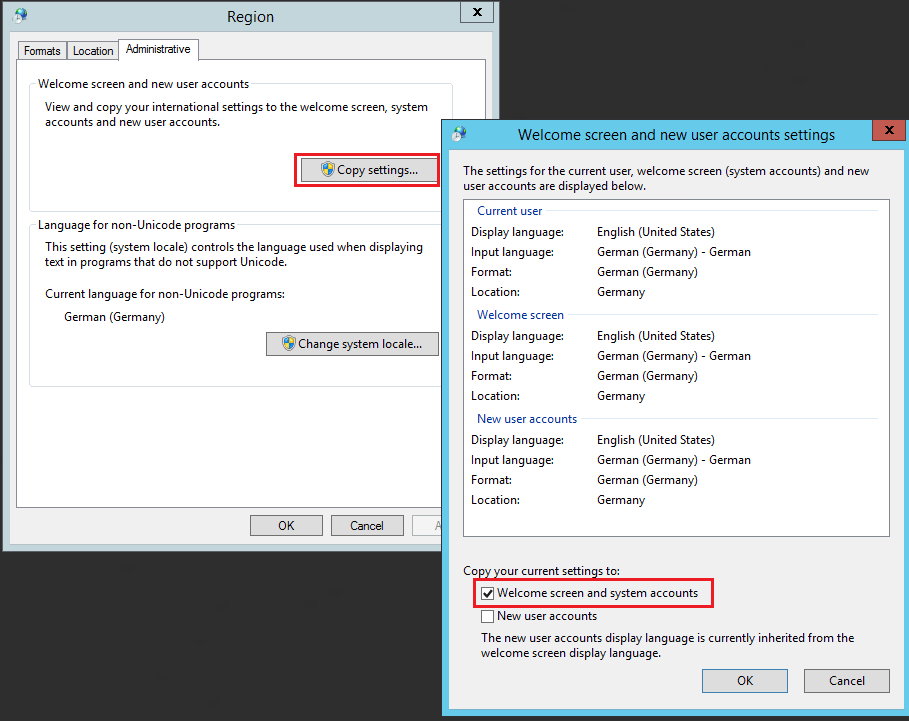

## Date/Time Variables

Use these .NET date and time format strings in `{DATEFORMAT(<format>)}`, which returns the current date and time of the VisualCron Server, and as the output format of `{DATENOWADD(...)}` and `{DATEADD(...)}` (see **Adding to a date**). The result follows the regional settings of the account the VisualCron service runs under. The examples are for August 17, 2000, 4:32:32 PM on a Server with English (United States) settings, seven hours behind UTC.

**Standard formats**

| Format string | Result |
| --- | --- |
| d | 8/17/2000 |
| D | Thursday, August 17, 2000 |
| f | Thursday, August 17, 2000 4:32 PM |
| F | Thursday, August 17, 2000 4:32:32 PM |
| g | 8/17/2000 4:32 PM |
| G | 8/17/2000 4:32:32 PM |
| m | August 17 |
| r | Thu, 17 Aug 2000 16:32:32 GMT |
| s | 2000-08-17T16:32:32 |
| t | 4:32 PM |
| T | 4:32:32 PM |
| u | 2000-08-17 16:32:32Z |
| U | Thursday, August 17, 2000 11:32:32 PM |
| y | August 2000 |

:::note

`r` and `u` show the Server's local time with a GMT or Z suffix; they do not convert it to UTC. `U` converts to UTC. Do not use `r` or `u` where another system expects a real UTC time.

:::

**Custom formats**

| Format string | Meaning (result for the example date) |
| --- | --- |
| d | Day of the month, 1 to 31 (17) |
| dd | Day of the month, 01 to 31 (17) |
| ddd | Abbreviated day name (Thu) |
| dddd | Full day name (Thursday) |
| f, ff, fff, ffff, fffff | Fractions of a second, as many digits as letters |
| F, FF, FFF, FFFF, FFFFF | Fractions of a second, without trailing zeros |
| g, gg | Era (A.D.) |
| h | Hour, 12-hour clock, 1 to 12 (4) |
| hh | Hour, 12-hour clock, 01 to 12 (04) |
| H | Hour, 24-hour clock, 0 to 23 (16) |
| HH | Hour, 24-hour clock, 00 to 23 (16) |
| K | Time zone (-07:00) |
| m | Minutes, 0 to 59 (32) |
| mm | Minutes, 00 to 59 (32) |
| M | Month, 1 to 12 (8) |
| MM | Month, 01 to 12 (08) |
| MMM | Abbreviated month name (Aug) |
| MMMM | Full month name (August) |
| s | Seconds, 0 to 59 (32) |
| ss | Seconds, 00 to 59 (32) |
| t | First letter of AM/PM (P) |
| tt | AM/PM (PM) |
| y | Year, 0 to 99 (0) |
| yy | Year, 00 to 99 (00) |
| yyyy | Year, four digits (2000) |
| z, zz, zzz | Offset from UTC (-7, -07, -07:00) |
| : | Time separator |
| / | Date separator |
| 'text', "text" or \c | Literal text |
| Any other character | Copied as it is. Letters can have a meaning (`g`, for example, is the era), so put literal letters in quotes, for example `yyyyMMdd'_log'` |

A single letter on its own is a standard format: `{DATEFORMAT(d)}` returns `8/17/2000`. To get one part only, put `%` before it: `{DATEFORMAT(%d)}` returns `17` and `{DATEFORMAT(%M)}` returns `8`. Separators follow the regional settings; for example, with German settings `M/yy` gives `8.00`. `/` and `:` are not valid in file names, so for a file name use a format such as `yyyyMMdd_HHmmss`.

**Examples**

| Variable | Result |
| --- | --- |
| `{DATEFORMAT(dddd, MMMM dd yyyy)}` | Thursday, August 17 2000 |
| `{DATEFORMAT(ddd, MMM d "'"yy)}` | Thu, Aug 17 '00 |
| `{DATEFORMAT(dddd, MMMM dd)}` | Thursday, August 17 |
| `{DATEFORMAT(M/yy)}` | 8/00 |
| `{DATEFORMAT(dd-MM-yy)}` | 17-08-00 |
| `{DATEFORMAT(yyyy-MM-dd HH:mm:ss)}` | 2000-08-17 16:32:32 |
| `{DATEFORMAT(yyyyMMdd_HHmmss)}` | 20000817_163232 |

**Adding to a date**

`{DATENOWADD(<unit>|<number>|<output format>)}` adds to the current date and time. `<unit>` is `Years`, `Months`, `Weeks`, `Days`, `Workdays`, `Hours`, `Minutes` or `Seconds`; a negative number subtracts. The unit is case-sensitive: a unit that does not match returns January 1, 0001, for example `0001-01-01`. For example, `{DATENOWADD(Days|10|yyyy-MM-dd)}` returns `2000-08-27` and `{DATENOWADD(Days|-1|yyyy-MM-dd)}` returns `2000-08-16`.

`{DATEADD(<unit>|<date>|<input format>|<number>|<output format>)}` does the same for another date, which is read with `<input format>`, for example `{DATEADD(Days|2000-08-17|yyyy-MM-dd|10|yyyy-MM-dd)}` returns `2000-08-27`.

`Workdays` skips the weekend days of the Server's country, from its regional settings. To use another country, add its two-letter code as the last argument, for example `{DATENOWADD(Workdays|1|yyyy-MM-dd|US)}`. Holidays are skipped only through a [Time exception](global-time-exceptions) collection: when you edit a collection, a link copies its ID. A collection ID given alone replaces the weekend, so only the days the collection excludes are skipped and Saturday and Sunday count as workdays. To skip both, give the country code and then the collection ID, for example `{DATENOWADD(Workdays|1|yyyy-MM-dd|US|<collection ID>)}`. `{DATEADD(...)}` cannot combine a country code with a collection ID.

In the forms above without a country code or Time exception, the output format can also be `totalmilliseconds`, `totalseconds`, `totalminutes`, `totalhours` or `totaldays` (lowercase), which return the resulting date as a number of those units since January 1, 0001. `{DATEFORMAT(...)}` does not accept these values.

**VisualCron-specific format keywords**

In addition to the standard .NET format specifiers, the `{DATEFORMAT(...)}` Variable also supports the following VisualCron-specific keywords:

| Keyword | Format |
| --- | --- |
| JulianYearDay | Two-digit year followed by the three-digit day of the year (for example `00230` for August 17, 2000) |
| JulianDay | Three-digit day of the year (for example `230` for August 17, 2000) |

Use the keyword as the whole argument, for example `{DATEFORMAT(JulianDay)}`. Keywords are case-sensitive, always use the current date and work only in `{DATEFORMAT(...)}`. To add a four-digit year, combine Variables: `{DATEFORMAT(yyyy)}{DATEFORMAT(JulianDay)}` returns `2000230`.
 
More information:
* [Standard date and time format strings](https://learn.microsoft.com/en-us/dotnet/standard/base-types/standard-date-and-time-format-strings)
* [Custom date and time format strings](https://learn.microsoft.com/en-us/dotnet/standard/base-types/custom-date-and-time-format-strings)

**Regional settings of the VisualCron service**

If dates have an unexpected format, check the regional settings of the account the VisualCron service runs under. If the service runs as a named account, sign in as that account and set its formats. To give the Local System account your formats, complete the following steps:

1. On the VisualCron Server computer, open Control Panel -> *Region*.
2. On the **_Formats_** tab, set the formats you want.
3. On the **_Administrative_** tab, click *Copy settings...*.
4. Select *Welcome screen and system accounts*.
5. Click *OK*, and click *OK* in the *Region* window.
6. Restart the VisualCron service.

Date Variables now use the formats you set.

