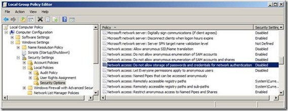
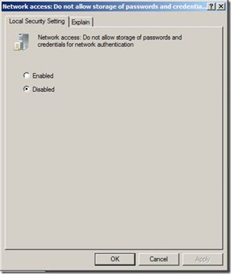

## Global - Network Drives

The _Manage network drives_ window maps network shares to drive letters for the account that the VisualCron Server service runs under. By default that is the SYSTEM account. Windows keeps mapped drives per logon session, so the Server does not see the drives you map in your own Windows session. Map drives here when a Task that runs as the Server service account, without a Credential, needs a drive letter.

When a Task can use a UNC path such as `\\<server>\<share>\<folder>`, use the UNC path together with a [Credential](../server/global-credentials) instead. A UNC path does not depend on a drive mapping being in place.

To open the window, go to _Server_ -> _Global objects_ -> _Network drives_.

### Manage network drives window

The list has the following columns:

- A status icon without a heading: connected or disconnected, see below
- _Drive_: the drive letter
- _Path_: the UNC path the letter is mapped to
- _Credential_: the [Credential](../server/global-credentials) used for the mapping. "No Credential id specified" means none. "Could not find Credential" means the Credential has been deleted, or you do not have permission to see it
- _Controlled_: "True" for a drive mapped from this window, which the Server maps again each time it starts. "False" for a drive that the Server found already mapped for its service account, at this start or an earlier one, for example by a script that ran as that account. The Server lists such a drive but does not map it at startup, and the entry can stay in the list after the mapping is gone

For a drive with _Controlled_ "True", the status icon shows the result of the mapping at Server startup, or of the last _Map drive_ or _Reconnect_ that succeeded. A failed attempt shows only until the Client connects to the Server again, see [Map a drive](#map-a-drive) and [Reconnect a drive](#reconnect-a-drive). For a drive with _Controlled_ "False", it shows whether the drive could be reached when the Server first listed it. The Server does not check the drives again in between, so a drive whose share has become unavailable can still show as connected.

The toolbar has the following buttons:

- _Map drive_: opens the _Map Network Drive_ window, see [Map a drive](#map-a-drive)
- _Unmap drive_: removes the selected drive from the list and disconnects it, see [Unmap a drive](#unmap-a-drive)
- _Reconnect_: maps the selected drive again, see [Reconnect a drive](#reconnect-a-drive)
- _Audit log_: opens the [Audit log](../tools/objects-audit-log) for network drives

Right-click a row to open a shortcut menu with _Map drive_, _Audit log_ and _Versions.._. _Versions.._ shows the [version history](../tools/audit-log-versions) of the selected drive entry. To unmap a drive, use the _Unmap drive_ button or press Delete.

### Map a drive

1. Click _Map drive_. The _Map Network Drive_ window opens.

   

2. In the _Credentials_ group, select the Credential of an account that can access the share: a domain account, or a local account on the file server. Type in the _Filter.._ box to shorten the list. If the account is not in the list, add it first in [Credentials](../server/global-credentials). You can also select _No Credential_ to connect with the identity of the Server service account; see [Which account authenticates the mapping](#which-account-authenticates-the-mapping), including the _Credential not found_ warning there.
3. In the _Drive info_ group, select the letter in the _Drive_ list. The default is the highest letter, from "Z:" down, that no entry in the _Manage network drives_ window uses. Letters in use on the Server computer are not taken into account, so choose a letter that is free there (see the warning below).
4. In _Path_, enter the UNC path of the share, for example `\\<server>\<share>`. The folder button opens a folder browser if your user has the _Remote file explorer_ permission with _Read_; without it, the Client shows a permission message. When the Client is connected to a remote Server, the browser shows the folders of the Server computer. In all cases, check that _Path_ is a UNC path that the Server computer can reach.
5. Click _Map drive_ at the bottom of the _Map Network Drive_ window.

:::warning

If the selected letter is already mapped on the Server, VisualCron disconnects the existing mapping first, without asking. If the letter is already in the list and the new mapping succeeds, the new path and Credential replace that entry. If the new mapping fails, the old mapping has in most cases been disconnected as well. Only if Windows refuses to disconnect it does the old mapping stay; the new mapping then fails with a message from Windows.

:::

If the mapping succeeds, the window closes and the drive appears in the list with _Controlled_ "True".

If the mapping fails, the window stays open. In most cases the Server shows a message that starts with "Could not map drive", followed by the message from Windows; see [Troubleshooting](#troubleshooting). If the selected Credential has been deleted, no message appears, and the Server log shows "Could not find Credential when mapping drive."

After a failed mapping, the list shows the drive as disconnected, but the Server has not saved the attempt:

- For a letter that was not in the list, the row stays until the Client connects to the Server again. _Unmap drive_ cannot remove it; disconnect the Client from the Server and connect again to clear it.
- For a letter that was already in the list, the row shows the new path until the Client connects to the Server again. It then shows the earlier entry again, with its earlier path, Credential and status. That status can be connected although the earlier mapping was disconnected (see the warning above).

### When the Server starts

Each time the VisualCron Server service starts, it tries once to map every drive whose _Controlled_ value is "True". If a drive cannot be mapped, for example because the file server is not yet available, the Server logs an error that the drive "could not be mounted" (see [Log](../server/information-log)) and shows the drive as disconnected. The Server does not retry on its own. The drive is mapped again when you click _Reconnect_. Importing network drive settings with [Import settings](../file/import-settings) can also map the Controlled drives again.

:::warning

Jobs that use the drive letter fail until the drive is mapped again.

- After the Server computer restarts, open the _Manage network drives_ window, select each drive that is shown as disconnected and click _Reconnect_.
- After the file server restarts, the icon can still show the drive as connected. If a Job cannot reach the drive, select the drive and click _Reconnect_.

For Tasks that do not need a drive letter, use a UNC path with a [Credential](../server/global-credentials).

:::

### Reconnect a drive

Select a drive in the list and click _Reconnect_. VisualCron disconnects the drive and maps it again with the Credential stored for it. If this succeeds, the status icon shows the drive as connected and _Controlled_ is set to "True", so the Server also maps the drive each time it starts. If it fails, the Server shows a message that starts with "Could not map drive", see [Troubleshooting](#troubleshooting). The drive is then no longer mapped, unless Windows refused to disconnect it. The list shows the drive as disconnected until the Client connects to the Server again, and then shows the status from before the attempt, which can be connected. If the Credential of the drive has been deleted, no message appears, and the Server log shows "Could not find Credential when mapping drive."

:::warning

A drive with no Credential stored, which includes every drive listed with _Controlled_ "False", is mapped again with the identity of the Server service account. Most shares do not accept that identity, so _Reconnect_ can turn a working mapping into a failed one. To have the Server map such a drive at startup with an account that has access, click _Map drive_, select the same letter and path, and select a Credential.

:::

### Unmap a drive

Select a drive and click _Unmap drive_, or press Delete. The drive is removed from the list and disconnected on the Server right away, without a confirmation. The Server no longer maps it at startup. If Windows cannot disconnect the drive, the entry is still removed, and the Server shows a message that starts with "Could not unmap drive".

### Which account authenticates the mapping

The VisualCron Server service maps the drive itself. The mapping does not run in the execution context of a Task, so the account that the service runs under matters:

- With a Credential: the user name and password of the Credential are used to connect to the share. If the Credential stores the domain separately and the user name does not already include one, the user name is sent as `<domain>\<user>`
- With _No Credential_: no user name or password is sent, and the connection uses the identity of the service account. Under the default SYSTEM account that is the computer account of the VisualCron Server computer, which most file shares do not grant access to

As described at the top of this page, a drive mapped by one account is not visible to another. If you prefer not to store a Credential for the drive, you can run the VisualCron service under a domain account that has access to the share and map the drive with _No Credential_; the mapping then uses that account's identity. See [Credentials](../server/global-credentials) for the account options, and note the warning below.

:::warning

When the running Server maps a drive with _No Credential_, or a drive whose Credential has been deleted, it raises the VisualCron event _Credential not found_. This happens, for example, when you click _Map drive_ or _Reconnect_. A Job with a [VisualCron Event Trigger](../server/event-trigger-visualcron) on that event can start. To avoid this, select an existing Credential for the drive.

:::

### Authentication protocol

VisualCron does not choose an authentication protocol for network shares. It passes the user name and password to Windows, and Windows negotiates Kerberos or NTLM on its own. VisualCron has no setting that prefers, forces or falls back to either protocol, and it does not record which protocol was used. It logs only whether the mapping succeeded.

To find out which protocol Windows used, check the Windows event logs:

- On the file server, Security event ID 4624. The _Authentication Package_ field names the protocol, and the _Package Name (NTLM only)_ field is filled in only when NTLM was used
- On a domain controller, event IDs 4768 and 4769 indicate Kerberos, and event ID 4776 indicates NTLM

If NTLM is disabled at operating system or domain level, VisualCron cannot use NTLM on its own, because it has no separate NTLM implementation for network drives. Windows then uses Kerberos, or the connection fails.

### Troubleshooting

Most headings below are Windows messages that follow "Could not map drive" in the message from the Server.

#### A specified logon session does not exist

On the VisualCron Server computer, open the Local Group Policy Editor and go to _Computer Configuration_ -> _Windows Settings_ -> _Security Settings_ -> _Local Policies_ -> _Security Options_. Set _Network access: Do not allow storage of passwords and credentials for network authentication_ to _Disabled_. Then map the drive again.

#### The specified network password is not correct

Check the password of the Credential, and check that its user name and domain are those of an account that can access the share. If they are correct, also check that the clocks of the VisualCron Server computer and the file server are in sync.

#### The network path was not found / The network name cannot be found

These messages point to the server name or the share name. From the VisualCron Server computer, check that the server name resolves and that the share can be reached. Also check that _Path_ is a plain UNC path, without a prefix such as `http://`, and that the share name is spelled correctly.

#### Multiple connections to a server or shared resource by the same user, using more than one user name, are not allowed

The Server service account already has a connection to that server under another user name, for example another drive in the list that uses a different Credential. Give every drive on that server the same Credential, or unmap the other drive, and map the drive again.

#### Access is denied

If the share is an IFS share on an IBM i (AS400) server and the Credential is correct, the IFS server may not accept the LAN Manager authentication level of the VisualCron Server computer. In the Local Group Policy Editor, under _Computer Configuration_ -> _Windows Settings_ -> _Security Settings_ -> _Local Policies_ -> _Security Options_, the setting is _Network security: LAN Manager authentication level_.

:::warning

This policy applies to every outgoing connection of the computer, not only to VisualCron, and a lower level allows weaker authentication. Get approval from your security team before you change it.

:::
