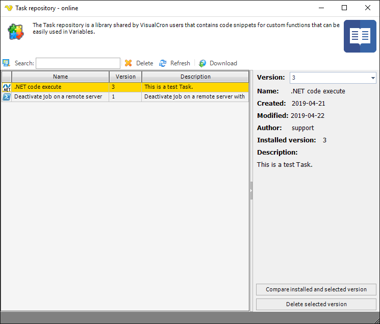

## Global - Task Repository

The Task repository is a shared Task library for the VisualCron community. The primary focus is on Tasks of type PowerShell and .NET Execute Tasks. The idea is that anyone can create a code snippet using any of these Task types and then share that code snipped (in Task) to the VisualCron community. After that, anyone in the community (depending on share settings) can access this Task and download locally.
 
The Task repository can be found in **Server tab->Global objects->Task** repository.
 
 
**Variables**

What makes Task repository even more useful is that you can execute these Task repository Tasks through Variables. In the Variables browser you can see all Task repository Tasks and send your own arguments. The Variable string itself can be used in any field within VisualCron.

**Task repository - main window**

The local Task repository window shows the stored Tasks in a grid with the following columns:

* **Name** — the name of the repository Task
* **Description** — a description of what the Task does
* **Lang** — an icon indicating the language (.NET or PowerShell)
* **Version** — the current version of the repository Task

Right‑clicking a row opens a context menu with the **Add**, **Edit**, **Delete**, **Clone**, **Upload**, and **Import** commands. The toolbar above the grid provides the same commands plus _Refresh_, _Search_, _Clear filter_, and _Online repository_:

**Add**

Opens the Add popup menu where you can select to add a Powershell or .NET Task for the repository.

In the *Add* or *Edit* window, on the **_ShareTo_** tab, choose who can see the object online: *All users*, or the users you enter in *Comma separated list of users*.
 
**Edit**

Edits the Task in the selected row.
 
**Clone**

Clones the Task in the selected row.
 
**Delete**

Deletes the Task in the selected row.
 
**Import**

Opens the selected repository Task in the Client. If the Task already exists on the Server, it opens in the *Edit Task* window and is not replaced. Otherwise a new Job named `"Task repository job - <name> <version>"` in the group `"Task repositories"` opens in the *Edit Job* window; the Job is created when you save it.
 
**Refresh**

Refreshes the list of local Task repository objects manually.
 
**Search**

Search field lets you filter the local Task repository on multiple columns.
 
**Clear filter**

Clears the existing search filter.
 
**Online repository**

Opens the community powered Online Task repoitory.
 
**Upload**

Uploads the selected local Task repository object to the Online repository. This can be done many times to update an existing object. Each time a new version is being created online and a diff can be made. Before you upload, check the **_ShareTo_** tab of the object: it decides who can see it online.

**Online Task repository**

The Online Task repository window has the same **Name**, **Description**, **Lang**, and **Version** columns as the local view, plus a details panel on the right side that shows additional information for the row currently selected in the grid.

To use the online repository, enter the username and password of your visualcron.com forum account on the **_Forum Credential_** tab of _File_ -> _Settings_ -> _Client settings_ (see [Client settings](../file/client-settings)). The *Online repository* window opens only when a forum username is entered.

The toolbar above the grid provides the following buttons:

**View**

Opens the Task repository Task for viewing
 
**Search**

Filter the list of online Task repository objects by text. The search matches against the Name and Description columns.
 
**Delete**

Deletes all versions of the selected object from the online repository. Only the user who uploaded it, or an administrator, can delete it. To remove one version only, use *Delete selected version* in the details panel.
 
**Refresh**

Reloads the online list of Task repository objects.
 
**Download**

Downloads the selected Task repository object to the local Task repository.

**Details panel**

A collapsible panel on the right side of the window shows details about the selected online Task repository object. It contains the following controls:

* **Version** — a list of all available versions of the selected Task
* **Installed version** — the version number currently present in the local repository (if any)
* **Name** — the name of the Task
* **Created** — the date when the version was first uploaded
* **Modified** — the date when the version was last modified
* **Author** — the user that uploaded the version
* **Description** — a longer description of the Task
* **Compare installed and selected version** — opens a comparison view between the locally installed version and the version selected in the _Version_ list above
* **Delete selected version** — removes the specific version selected in the _Version_ list (only the user who uploaded it, or an administrator, can delete it)
