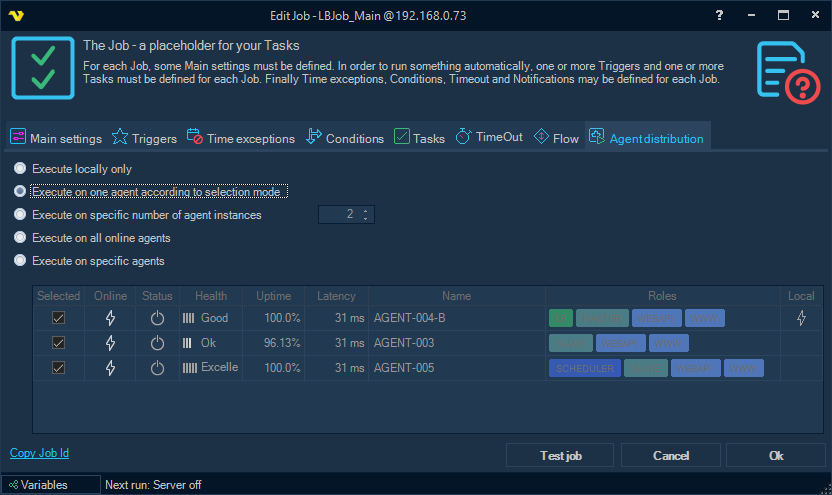

## Job - Agent Distribution

**Agent distribution** is a setting up of a certain Job so that execution of the Job can be performed not only on the local Server, but also on one or more Servers connected to the Broker Server.
In addition to this setting, you may need to specify in the Load balancer settings the method according to which Servers are selected for Job execution. This page summarizes the setting on the Job. For the full description, see [Load balancer - Execution Distribution](../servers/execution-distribution).

:::note

The *Agent distribution* tab is available with a Pro Subscription, which includes Load Balancing (see [Load Balancer](../servers/load-balancer)). It can be used only when this Server is a Broker Server or is set up as a client of one.

:::

:::warning

If this Server's edition does not include Load Balancing, a Job set to any mode other than *Execute locally only* is not run, and it does not fail, so its *On error* flows and Notifications are not carried out. An information entry is written to the Server log, and a *Job missed* event is raised, which a [VisualCron Trigger](event-trigger-visualcron) can act on. To run the Job on this Server again, open it: the *Agent distribution* tab is shown with only *Execute locally only* available. Select it and save.

:::

Distributed execution is configured on the "*Agent distribution*" tab in the Job editing form:

**Supported Job execution modes**

* *Execute locally only*

This is the default execution mode. The Job runs on the local Server only and no request is sent to the Broker.

* *Execute on one agent according to selection mode*

The Job execution request is sent to the Broker to whom the current Server is connected. The Broker determines on which of the connected Servers the Job should actually be executed, according to the selection mode configured in the Load balancer settings.

* *Execute on specific number of agent instances*

This mode is similar to the previous one, but the Broker sends the request to up to the specified number of different Agents, never to the same Agent twice, and to fewer if fewer are available. Set the number in the box next to this option.

* *Execute on all online agents*

The Job execution request is sent to the Broker, which in turn sends a request to each of the connected Agents, taking into account additional filters configured on the Broker's side.

* *Execute on specific agents*

A list of Agents is selected on the tab. If the specified Agents include the current Server, the Job is started locally first, and the request for the other specified Agents is then sent to the Broker without waiting for the local run to finish, so the runs overlap. If the current Server is the only Agent selected, no request is sent to the Broker. Broker filtering is not applied to this mode, because the Agents are chosen explicitly.

**Agent selection and filtering**

For the modes that let the Broker pick the Agent (*Execute on one agent according to selection mode*, *Execute on specific number of agent instances* and *Execute on all online agents*), the selection method and the optional Agent filters are configured in the Load balancer settings, not on the Job.
 
**Synchronizing the Job to the Agents**

When you save a Job that uses a mode other than *Execute locally only*, and its distribution settings or the objects it depends on have changed, the Client asks whether to update the synchronization settings for the Job and its dependencies on the Agents involved, and lists the objects. Click *Yes* to update them; with *No*, the synchronization settings are not changed. See [Servers - Sync Server Objects](../servers/sync-server-objects).
