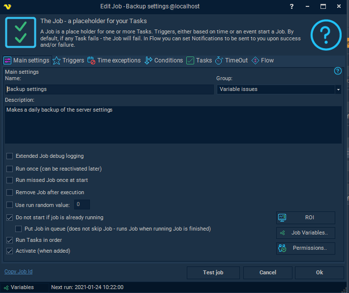
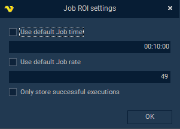

## Job - Main Settings

The **_Main settings_** tab of the _Add Job_, _Edit Job_ and _Clone Job_ windows holds the Job's general settings.
 
**Add/Edit Job > Main settings** tab

**Name**

Mandatory. The name of the Job. When you add or clone a Job and another Job already has the name, the Client asks you to confirm before it saves; renaming a Job is not checked. Use a unique name so that Jobs are easy to tell apart.
 
**Group**

This is the visual grouping in the main window grid. To create a new group you just manually enter a value in this field.
 
**Description**

Add information to see the difference between Jobs.
 
**Extended Job debug logging**

When selected, the Job writes additional debug entries to the Server log, for example its next execution time and why a run was queued. Support may ask you to select it to investigate a problem; clear it again afterward. To log detail about a Trigger, select *Extended Trigger debug logging* on that Trigger.
 
**Run once (can be reactivated later)**

When the Job starts, it is deactivated: the run continues, but its Triggers no longer start it. To use the Job again, activate it (see [Activate/Deactivate Job](../server-group-job-task-area/job-list/activate-deactivate-job)). A start that is skipped, by *Use run random value* or *Do not start if job is already running*, does not deactivate it. The Job is deactivated even if its Conditions then stop the run.
 
**Run missed Job once at start**

This function can be used for a specific Job to let a Job automatically run if it should have been run during a time when the VisualCron service was down/stopped for any reason (typically due to server computer off). For example, a Job is supposed to run once a day at 08:00. Suppose the server goes down at 07:00 because of a power failure. The problem is corrected and the server goes up at 09:00. If *Run missed Job once at start* is selected, VisualCron will at startup check if the Job was supposed to run between the last time VisualCron was up and the current time. If so, that Job will be run **once**.
 
:::note Note 1 

If the time of the missed run falls inside one of the Job's [time exceptions](job-time-exceptions), it is skipped.

::: 

:::note Note 2 

Missed runs are checked only when the Server starts with its status set to *On*. If the Server was turned *Off* in the Client, missed runs are not run. Only active Jobs are checked.

:::

**Remove Job after execution**

The Job is deleted after it runs, whatever the result. If a user starts the run and does not have Delete permission for the Job, the Job is not deleted and an error is logged; a run not started by a user, for example by a Trigger or as a missed run, always deletes it.

:::warning

The Job and its Tasks are deleted permanently, and the run is not written to the Job log, so it has no [Job result](job-result). Do not use this setting for a Job you need to audit or run again.

:::
 
**Use run random value**

Select to run the Job on only some of its starts. Each time the Job is started, including a manual run, it runs with a chance of 1 in the value you enter; otherwise the run is skipped and logged. *Test job* is not affected. For example, with the value `20` and a Time Trigger that fires every minute, the Job runs about 3 times an hour (60 / 20); the number varies from hour to hour. Enter a whole number of 1 or more.
 
**Do not start if job is already running**

Selected by default. If the Job is started while it is already running, the new run is skipped and the Server log records "Job was not started because it was already running". If *Put Job in queue* is selected, the run is queued instead. When it is cleared, a new run starts even while the Job is running. Keep it selected for Jobs with Event Triggers, which can start a Job very often.
 
**Put Job in queue (does not skip Job - runs Job when running Job is finished)**

Available only when *Do not start if job is already running* is selected. Instead of skipping a run that starts while the Job is running, VisualCron queues it. Queued starts run one at a time, in the order they arrived. The queue is kept in memory: it is cleared when you stop the Job and lost when the Server restarts. Each queued start is checked again when it runs, so *Use run random value* can still skip it. Use it with Event Triggers so that every event, for example each new file found by a File Trigger, is processed. If the Job often runs longer than the time between its starts, the queue keeps growing. When you save a Job that has an active Event Trigger and *Do not start if job is already running* selected but this option cleared, the Client offers to select it.
 
**Run Tasks in order**

Selected by default: the Job runs its Tasks one at a time, in the order set on the **_Tasks_** tab. When it is cleared, the Tasks start without waiting for each other, which can shorten the run when Tasks wait on external systems. With it cleared:

* the Job cannot contain [Loops](job-tasks-loop-functionality); the Client does not save it
* for the *On error*, *On success* and *On complete* events, Task [Flow](task-flow) actions other than *Run Notification* are not carried out

:::warning

With *Run Tasks in order* cleared, retries and other Task flow actions on those events are ignored without a message. Job flows are not affected.

:::
 
**Activate (when added)**

By default a new Job is activated (will be run if the time is right) when it's added.
 
**ROI**

Opens the *Job ROI settings* window. Its settings override the Server's [ROI](roi-return-on-investment) defaults for this Job:

* *Use default Job time* - clear it to set the time this Job saves on each run
* *Use default Job rate* - clear it to set an hourly rate for this Job
* *Only store successful executions* - when selected, a failed run is logged with no time or amount saved

With a *Use default* option selected, the Server's default is copied into the Job when you save this window; a later change to the Server default does not change the Job. To apply new defaults to existing Jobs, use *Update Jobs* in the Server's [ROI](roi-return-on-investment) settings.

 
**Job Variables..**

See [Job Variables](job-variables) for more information.
 
**Permissions..**

Opens the *Override permissions for this object* window. From version 6.1.2, permissions for a specific Job can be set. It is controlled by overriding the current existing groups. When a specific permission is overridden in a positive way (granting access) it becomes green in the grid and it becomes red if overridden in a negative way (denying access).

:::note

A user group with *Use group permissions only (ignore per-object overrides)* selected ignores its overrides here and uses its general Job permissions (version 13.3.1 and later).

:::

**Copy Job Id**

Click to copy the Job's id to the clipboard.

Right-click to change the id. Enter a new id, a GUID that no other Job uses. You need Edit permission for the Job, and you cannot change the id of a Job that is running or has not been saved yet. The Client shows how many objects on this Server refer to the Job and are changed with it. Click *No* to see the list (the question is then asked again), *Yes* to change the id, or *Cancel* to keep it.

:::warning

The new id is saved on the Server at once; closing the window without saving does not undo it. Anything outside this Server that names the Job by its id is not updated, for example VCCommand or Web API calls, scripts, and Jobs on other Servers. Update those when you change the id.

:::

**Variables**

Opens the *Variables* window.

**Next run**

Shows when the Job runs next.
