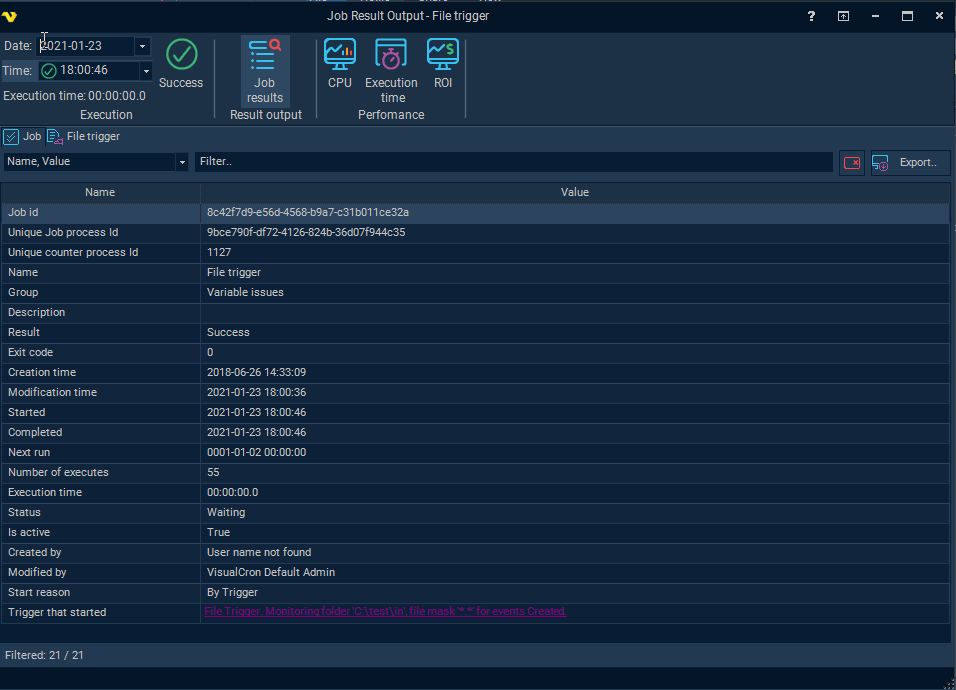
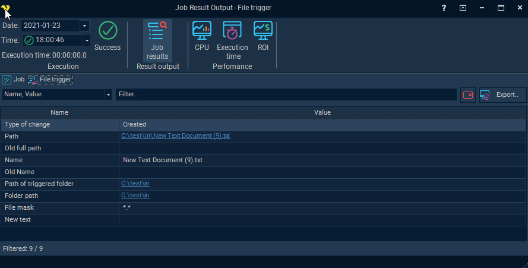
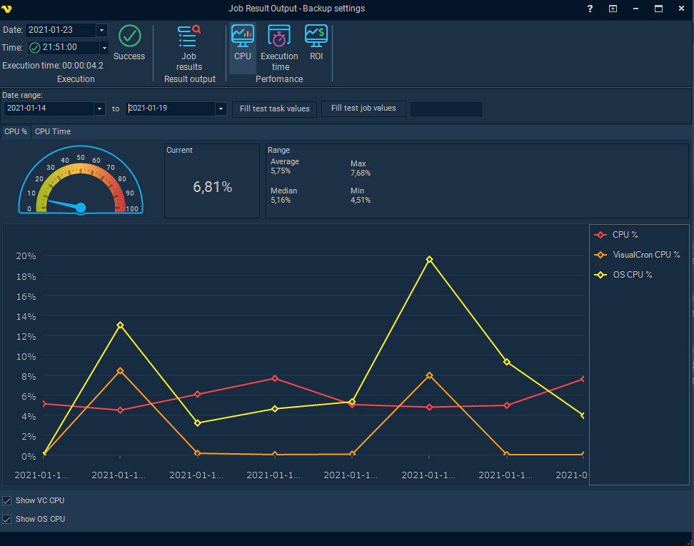
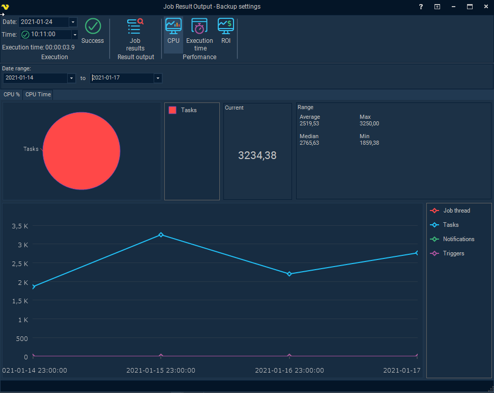
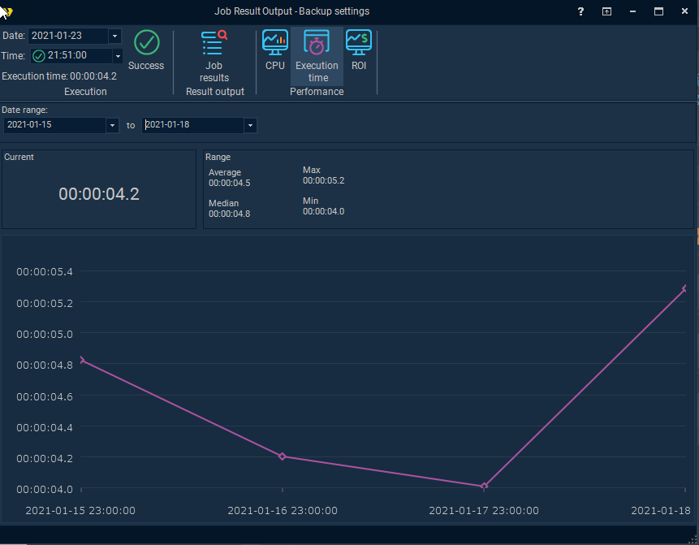
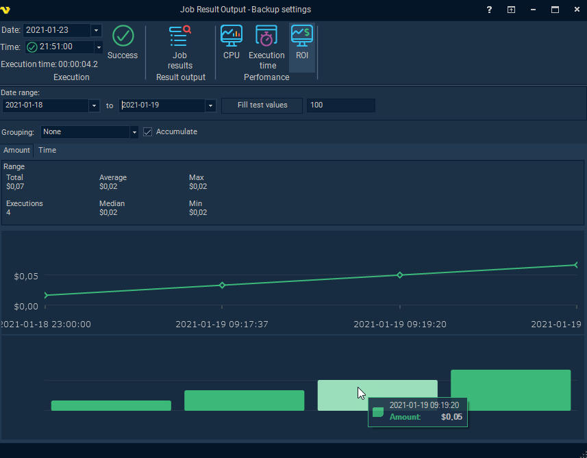

## Job - Result

The Job result window is similar to [Task output and result](task-output-and-result) window but collects statistics and results for the whole Job.
 
### Accessing Job Result
 
You can access the Job result window the following ways:
* double-click the result (success/failure) icon in the Job row
* double-click the result (success/failure) text in the Job row
* right-click the Job and select *Result* -> *Job result*

### Execution

**Date**

Select the day to view. Only dates with at least one run can be selected. How long results are kept is set in [Settings - Log Settings](settings-log-settings).
 
**Time**

Select a run of that day. The icon in front of each time shows whether the run succeeded or failed.
 
**Execution time**

How long the selected run took.
 
**Success/Failure button**

Shows the result of the selected run, for example *Success* or *Failed*, or *Running* or *Paused* while it is in progress. Click it to show charts and statistics of the results over a date range. Success is marked in green and Failure in red. Drag across a chart to zoom in on that area.
 
### Job results
 
Job results panel has at least one tab, "Job". This tab contains general information when, how and who started the Job among other things.
 
Depending on how it was started it might contain a Trigger tab. This will contain specific information about the Trigger, and what caused it to Trigger, at the moment of execution. The second screenshot below shows the File Trigger results tab. In that tab you can see, for example, which exact file caused the Trigger to trigger and in which folder it was created. The information available depends on the Trigger type.
 
Right-click a row and select *Copy variable* to copy the [Variable](global-variables) for that value (for the active Job or by Job id), for example to use it in a Notification. *Copy selected* and *Copy all* copy the selected rows, or all rows, as name and value.

### Performance->CPU
 
The CPU chart displays the CPU usage for each execution. These are approximate values VisualCron calculates and logs during execution to see the cost of the CPU usage during different operations. The information can be used to schedule Jobs and Tasks during different hours - to spread the CPU load.
 
There are two main views:
 
* CPU % - this is a % being used during the execution time period
* CPU Time - this is the cost value for the CPU during the execution time period

The CPU % view shows the following:
 
* **CPU %** - the overall CPU % used by the Job during the execution time period
* **VisualCron CPU** - how much CPU % the VisualCron Server consumed during that time, so general usage can be compared. Enable it with the *Show VC CPU* checkbox.
* **OS CPU** - how much CPU % the operating system was using at that moment. Enable it with the *Show OS CPU* checkbox.
 
The CPU Time view is separated into the following categories:
 
* **Job thread** - how much CPU time is consumed by the Job thread itself
* **Tasks** - how much CPU time is consumed by the Job's Tasks
* **Notifications** - how much CPU time is consumed by Notifications
* **Triggers** - how much CPU time is consumed by Triggers
 
There is a chart showing the latest value which is based on the selection Date + Time in the top left window. The data range defines the period being used for the line chart and the range values - this is controlled by the date range controls. *Grouping* (*None*, *Day*, *Week*, *Month* or *Year*) groups the runs in the chart by period. Drag across a chart to zoom in on that area. The screenshots below do not show *Grouping*, and they show two buttons, *Fill test task values* and *Fill test job values*, that do not appear in the window.

In the Job result->Performance CPU->CPU time you can see how much the CPU spent on Job, Task, Trigger and Notification. In general the footprint is low in VisualCron and you would see most work in the Task.
 
### Performance->Execution time
 
The Execution time is how long it takes for a Job to complete. This is affected by the CPU load and the amount of data being processed and the delay in any external service. The charts help VisualCron users to get an overview, over time, how long a specific operation takes.
 
The date range controls the line chart and range values. The current value is controlled by the selected Date + Time in the top left window.

### Performance->ROI
 
Shows how much each run of the Job saved over a period. The amount is the time saved by a run, in hours, multiplied by the hourly rate, both as stored in the Job's ROI settings when it ran. See [ROI - Return On Investment](roi-return-on-investment).

The *Amount* and *Time* tabs show the money and the time saved. Select *Accumulate* to show a running total.

