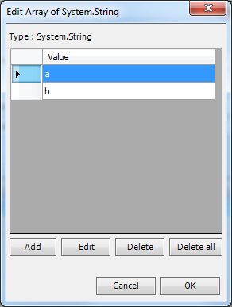

## Task Process - Assembly Execute

The Process - Assembly execute Task lets you specify a .NET .exe or .dll file and execute methods within that assembly. Select an assembly, class and method. Then double click on parameter rows to set values. Depending on the value type different input forms will be used.
 
**Output**

The Assembly execute returns a string representation of the result. The output format determines how the return value is serialized. When using the ToString format, array values are separated by commas.

**Output format**

Select how the method's return value is serialized:

* *ToString representation of output* — calls `.ToString()` on the return value (default). Arrays are comma-separated.
* *XML representation of output* — serializes the return value as XML.

**Credentials**

The assembly runs as the user of the selected [Credential](global-credentials). Select a Credential in the combo box, or click the *Settings* icon to open *Manage credentials* and add or edit one. With *No Credential*, the Task runs as the account the VisualCron service runs under. This applies with *Load user profile* selected on the Credential (the default); without it, the Credential is used only for network access (see [Local login and Load user profile](global-credentials#local-login-and-load-user-profile)).
 
**Select dll/exe file**

This is the full path to the assembly file. If you move this Task to another place you need to move the assembly file as well. The browse button opens a file browser. The Refresh button reloads the class/method information.
 
**Execute in x86 mode**

Executes the assembly in a x86 process.
 
**Local execution**

Hosts the assembly in the VisualCron Server instead of a separate process. Use it only for simple assemblies without dependencies.

:::warning

With *Local execution*, the assembly runs inside the VisualCron Server as the account the service runs under; the Credential, *Execute in x86 mode* and *Load app.config if existing* are not used. A changed assembly is not reloaded until the VisualCron service restarts. A Task timeout, or stopping the Task, does not end a method that is running; it keeps running inside the VisualCron Server until it returns. Do not use *Local execution* for a method that can hang.

:::
 
**Load app.config if existing**

Selected by default. Loads the `<assembly file name>.config` file next to the assembly, for example `MyLibrary.dll.config`.
 
**Class**

This is the name of the Class.
 
**Show only Public types**

Only public classes are listed. Clearing this option has no effect.
 
**Method**

When you change the Class all methods within that Class will be populated into the method combo box.
 
**Show only Public methods**

Only public methods are listed. Clearing this option has no effect.
 
**Return type**

This label shows the return type of the selected method. This is the type that will be converted to a string in the Output of the Task.

**Nesting level**

Controls how many levels deep VisualCron reflects into complex types when loading class and method information. Default is 3. Increase this value if nested parameter types are not fully resolved; lower it if loading is slow for assemblies with deeply nested types. The level is applied when you click *Refresh*; click it after changing the level or selecting a file.
 
**Parameters**

Double click on parameter rows to set values. Depending on the value type different input forms will be used.

