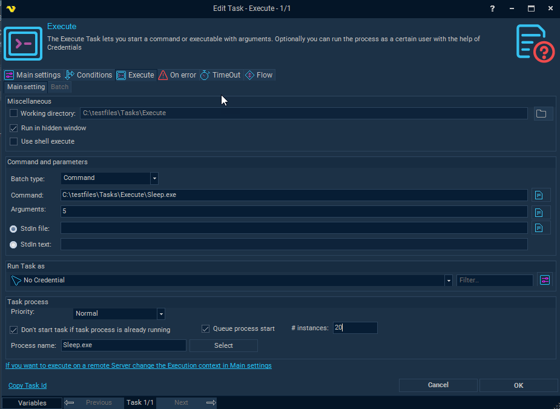
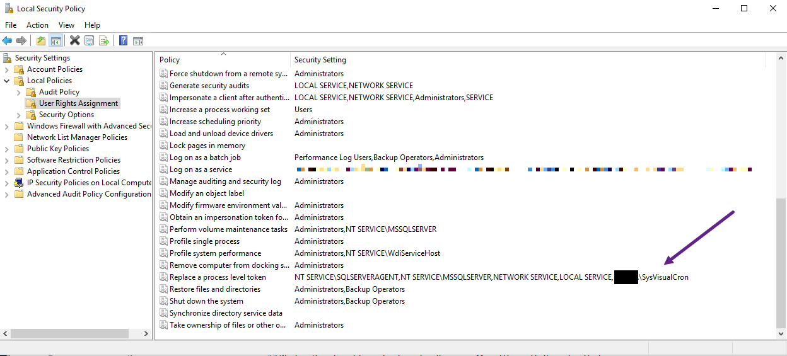
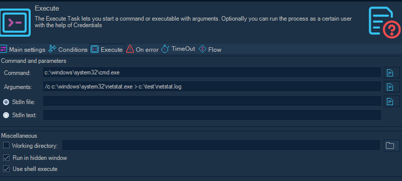

## Task Process - Execute

The Execute Task lets you start a command or executable with arguments. Optionally, you can run the process as a certain user with the help of Credentials.



**Miscellaneous**
 
**Working directory**

Select the check box and enter the folder the process starts in. When it is cleared, the process starts in the command's folder if the Task uses a Credential with the default execution options, and otherwise in the VisualCron service's current folder (for a Windows service, normally `"System32"`). Set a working directory when the command reads or writes files with relative paths. Saving is refused when the box is selected and the field is empty.
 
**Run in hidden window**

Selected by default. Hides the window the process would normally show. With a Credential and the default execution options, this hides any application. Otherwise a GUI application is hidden only if *Use shell execute* is also selected.
 
**Use shell execute**

Cleared by default. Without a Credential, or with the *Use managed API* execution option, it starts the process through the Windows shell. With either Win32 API execution option, it only turns off output capture and standard input. With it selected, no Task output is captured and standard input is not passed to the process.
 
**Command and parameters**
 
**Batch type**

Command (default) - used for single command and arguments.
Batch - ability to create batch files inside the Batch tab of this Task. The advantages compared to external batch files are;

* VisualCron will store changes to batch files so you can track that
* You will be able to use VisualCron Variables in the batch script
* The batch script will, among the other objects in VisualCron, be part of backup

:::warning

All Execute Tasks on the Server whose *Batch type* is *Batch* use the same temporary batch file. If two run at the same time, in one Job or in different Jobs, one can overwrite or delete the other's file and run the wrong commands. Where such Tasks can overlap, save the commands as a .bat file and run it with *Batch type* *Command*.

:::
 
**Command**

This is the path to the executable - always enter full path and name to the executable file. UNC paths to network drives are supported.
The rightmost button opens a file browser for selection. Required when *Batch type* is *Command*. With *Batch*, *Command* shows `"cmd.exe"` and cannot be edited; the text on the **_Batch_** tab is required and is run as a temporary .bat file.
 
**Arguments**

Arguments don't have to start with a space key, look at the Add Task view for an example. Use "" around long arguments.

**Standard input**

You can pass standard input (stdin) to the process either from a file or as inline text.

* *StdIn file* - the path to a file whose contents are passed to the process
* *StdIn text* - text passed to the process

Standard input is not passed when *Use shell execute* is selected.
 
**Run Task as**

Select a [Credential](global-credentials) in the combo box to run the process as that user, or click the *Settings* icon to open *Manage credentials*. With *No Credential*, and Background execution on this Server, the process runs as the account the VisualCron service runs under. This applies with *Load user profile* selected on the Credential (the default); without it, the Credential is used only for network access (see [Local login and Load user profile](global-credentials#local-login-and-load-user-profile)).

:::warning

If the selected Credential has been deleted, or a VisualCron user without permission to use it starts the run (for example from the Client), the command runs with Background execution as the account the VisualCron service runs under, and by default the Task does not fail. To make the Task fail instead, on the **_On error_** tab, select *All errors* in the *Error causes* group; every error the Task can raise then fails it.

:::
 
:::tip Note about domain

If the user belongs to a domain you must specify that domain. If the computer is not connected to a domain you should use the exact computer name. This can be found when opening "This PC".

:::

:::tip Note about arguments/parameters:

Use "" around arguments.

:::
 
**Priority**

In the *Task process* group, select the priority the process runs with. The default is *Normal*. The priority is ignored when the Credential uses the *Use Win32 API CreateProcessAsUserW* execution option (see [Execution and impersonation options](global-credentials#execution-and-impersonation-options)).

* *Idle* - runs only when the system is idle
* *Below Normal*
* *Normal*
* *Above Normal*
* *High* - takes precedence over normal processes
* *RealTime* - the highest priority, above operating system processes

*High* and *RealTime* can starve other processes, including VisualCron; use them with care.
 
**Don't start task if task process is already running**

Select this option and enter a name in *Process name* (with or without `".exe"`), or click *Select* to pick a running process. Before the command starts, VisualCron counts the processes with that name on the Server, whoever started them. If at least one is running and the count reaches *# instances*, the command does not start (see *Queue process start*).
 
**Queue process start**

When selected, the Task waits and checks again every 3 seconds until the count is below *# instances*. When cleared, the command is not started and the Task fails with exit code 77778.

:::warning

With *Queue process start*, the Task waits with no time limit, and its timeout does not count the wait. If the process never ends, the Task and its Job wait indefinitely.

:::
 
**# instances**

The number of running processes with that name at which the command is stopped or delayed. With the default 0, or 1, any running instance stops or delays it.

:::tip Remote execution

If you want to execute on a remote Server, change the Execution context in Main settings.

:::
 
### Notes about Troubleshooting:
 
**Error: The service cannot be started, either because it is disabled or because it has not enabled services associated with it**

Always use the full path to the file. Also, make sure that you split up command and argument. For example, if your command is normally:
```netsh DHCP server \\servername dump```
 
Then use:
Command: ```c:\windows\system32\netsh.exe```
Argument: ```DHCP server \\servername dump```
 
**Error: Redirecting output to a file does not work**

By default VisualCron captures all output, so you can reuse it in other Tasks, for example in the body of an Email Task. To redirect output to a file, run the command through `cmd /c` (see *Redirecting output*).
 
**Error: A UAC prompt is shown**

Select *Run in hidden window* (without a Credential, also *Use shell execute*). A process started by a Windows service cannot interact with the desktop.
 
**Error: The process cannot be started because the file cannot be found**

A couple of reasons:
1. If the command depends on environment variables, for example a new runtime's PATH, restart the VisualCron service after changing them. To see the PATH the Task sees, run an Execute Task with the same Credential, *Command* `"C:\Windows\System32\cmd.exe"` and *Arguments* `"/c echo %PATH%"`; the Task output shows it.
2. Make sure you use the full path to the file.
3. Do not mix arguments and path to executable in command. Divide them - see first error.
 
**Error: Exit code -1073741502 / -1066598274**

There is a permissions problem, either on user level (the Credential you use) or the Local Security Policy settings on the server that prevents the SYSTEM account from running a process as another user. While the problem might be unknown there are some alternatives and workarounds:
 
Alternative 1
Make sure that the *serviceuser* account is a local administrator and member of the group ```BUILTIN\Administrators```.
 
Alternative 2
1. Select *Extended debug logging* (see the error 1314 entry below).
2. Edit the Credential you use.
3. Under *Execution options*, select *Use Win32 API CreateProcessAsUserW* (*Priority* is then ignored).
 
Workaround 1
Turn off UAC: on the **_Main settings_** tab of the Server settings, click the button in the *UAC - set UAC status* group, and reboot. This lowers the security of the whole computer; turn UAC back on if it does not help.
 
**Error: Unhandled error when trying to start process:  A required privilege is not held by the client. (1314)  If the Credential is removed, the Job runs successfully.**

Go to _Server_ -> _Main settings_ -> _Settings_ and, on the **_Log settings_** tab, select *Extended debug logging*; the Credential's execution options are shown only while it is selected. Edit the Credential you use and select *Use Win32 API CreateProcessWithLogonW* (see [Execution and impersonation options](global-credentials#execution-and-impersonation-options)). The Credential keeps the option when you clear *Extended debug logging* again afterward.
 
Please try any of the following:
1. Open Services->Find VisualCron and right click and select Properties. Uncheck "Allow service to interact with desktop". Restart the service.
2. Run the VisualCron service as SYSTEM account.
3. Turn off UAC: on the **_Main settings_** tab of the Server settings, click the button in the *UAC - set UAC status* group, and reboot. This lowers the security of the whole computer; turn UAC back on if it does not help.
 
If this does not work you can select the Credential option *Use Win32 API CreateProcessAsUserW* and then add the ```SE_ASSIGNPRIMARYTOKEN_NAME (SeAssignPrimaryTokenPrivilege)``` permission on the user that runs the VisualCron service. You do this in the Local Security Policy:



**No output is captured**

Try unchecking Use shell execute.
 
**Redirecting output**

Pipe commands are implemented by cmd.exe. So you need to run ```cmd /c``` and add your executable path as argument.



