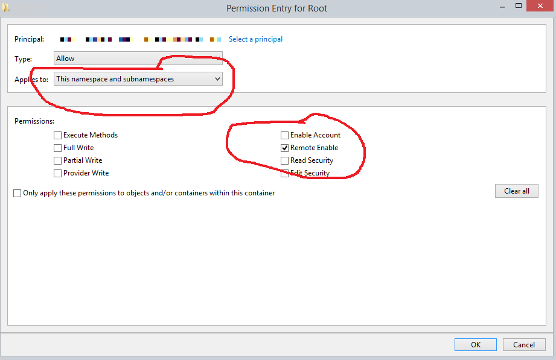

## Task Process - Remote Execute

This Task type can execute commands on a remote server. If you want to execute commands locally you should use the Execute Task.
 
 
**Limitations**

Remote Execute starts the process through Windows Management Instrumentation (WMI). This means:

* the process runs on the remote server as the user of the selected Credential (with *No Credential*, as the account the VisualCron service runs under); there is no separate run-as user
* standard output and error output are not captured
* the process has no visible desktop, so it cannot show a user interface


**Credentials**

The user that connects to the remote server through WMI; the process runs as this user. Select a Credential in the combo box, or click the *Settings* icon to open *Manage credentials* and add or edit one.

:::warning

If the selected Credential has been deleted, the process is not started and by default the Task still succeeds; to make it fail, select *All errors* in the *Error causes* group on the **_On error_** tab. If a VisualCron user without permission to use the Credential starts the run, the Task connects as the account the VisualCron service runs under; that setting does not catch this.

:::

**Host name**

The hostname or IP address of the remote server on which the command will be executed. This is a required field.
 
**Command**

The full path to the executable on the remote server. The browse button browses the VisualCron Server's files, so check that the path is valid on the remote server. Required, like *Host name*. VisualCron joins *Command* and *Arguments* with a space and adds no quotes, so put a path that contains spaces in quotes, for example `"C:\Program Files\App\app.exe"`.
 
**Arguments**

Arguments don't have to start with a space key, look at the Add Task view for an example. Use "" around long arguments.

:::tip Note about arguments/parameters:

Use "" around arguments.

:::

**Working directory**

The folder the process starts in on the remote server. Select the check box and enter a path that exists there.
 
**Run in hidden window**

Has no visible effect, because a process started through WMI has no visible desktop.

**Priority**

In the *Miscellaneous* group, select the priority the process runs with. The default is *Normal*.

* *Idle* - runs only when the system is idle
* *Below Normal*
* *Normal*
* *Above Normal*
* *High* - takes precedence over normal processes
* *RealTime* - the highest priority, above operating system processes

*High* and *RealTime* can starve other processes, including VisualCron; use them with care.

**Wait for completion**

When checked (default), VisualCron will wait for the remote process to finish before the Task completes. Uncheck this if you want the Task to return immediately after launching the process on the remote server. Set a Task timeout: without one, the wait ends after about 7 days (with *Use fallback method*, it has no limit), and the remote process keeps running. When the Task times out, VisualCron tries to stop the remote process.
 
**Use fallback method**

When checked, VisualCron uses an alternative thread-watcher method to monitor the remote process. Enable this if the standard completion detection is unreliable in your environment.
 
:::note

If WMI refuses to create the process, the Task's exit code is 80000 plus the WMI return code: 80002 access denied, 80003 insufficient privilege, 80008 unknown failure, 80009 path not found, 80021 invalid parameter. A successful start with *Wait for completion* cleared gives exit code 0. If VisualCron cannot connect to the remote server, the Task fails with exit code 77777. With *Wait for completion* selected, the exit code is normally the remote process's own exit code; a process that ends before VisualCron starts watching it is reported as 0. A non-zero exit code fails the Task by default.

:::

:::warning

With *Wait for completion* cleared, the Task succeeds as soon as the process starts; a later failure of the remote process is not reported.

:::

:::tip Note about Security settings:
These are the settings needed for a user account in Computer Management->WMI Control->Properties->Security tab->Select user and click Advanced:

:::



**Firewall settings on remote host**

Remote Execute uses WMI over DCOM, not WinRM. On the remote server, allow the *Windows Management Instrumentation (WMI)* firewall rules, for example:

```
netsh advfirewall firewall set rule group="Windows Management Instrumentation (WMI)" new enable=yes
```
 
*Other security settings on **remote** host*
 
Step 1. DCOM permission
1.    Open Dcomcnfg
2.    Expand Component Services -> Computers -> My Computer
3.    Go to the properties of My Computer
4.    Select the COM Security Tab
5.    Click *Edit Limits* under *Access Permissions*, and ensure the Credential's user (or a group it belongs to) has *Local Access* and *Remote Access*.
6.    Click *Edit Limits* under *Launch and Activation Permissions*, and ensure that user has *Local Launch*, *Remote Launch*, *Local Activation* and *Remote Activation*.
 
Step 2. Permission for the user to the WMI namespace
1.    Open WMImgmt.msc
2.    Go to the Properties of WMI Control
3.    Go to the Security Tab
4.    Select "Root" and open "Security"
5.    Ensure the Credential's user (or a group it belongs to, such as "Authenticated Users") has *Execute Methods*, *Provider Write*, *Enable Account* and *Remote Enable*; ensure the Administrators group has all permissions.
 
Step 3. Verify WMI Impersonation Rights
 
1.    Click Start, click Run, type gpedit.msc, and then click OK.
2.    Under Local Computer Policy, expand Computer Configuration, and then expand Windows Settings.
3.    Expand Security Settings, expand Local Policies, and then click User Rights Assignment.
4.    Verify that the SERVICE account is specifically granted Impersonate a client after authentication rights.
 
:::tip Note about Verifying security settings:
Run WBEMTest from the local computer. Put domain, username and password and connect to the remote machine.

 
:::

**More information about ports**

[https://support.microsoft.com/en-us/help/832017/service-overview-and-network-port-requirements-for-windows#method39](https://support.microsoft.com/en-us/help/832017/service-overview-and-network-port-requirements-for-windows#method39)
