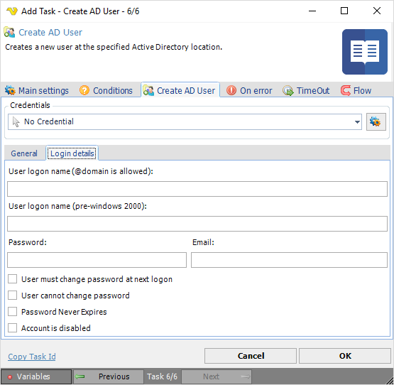

## Task Active Directory - Create AD User

The Create AD User Task creates a user in an Active Directory container and sets the user's password and account options.

The ***Main settings***, ***Flow***, ***On error***, ***Conditions*** and ***TimeOut*** tabs are the same for every Task; see [Job - Tasks](../../job-tasks).

### Create AD User tab

The _Credentials_ list is above the ***General*** and ***Login details*** sub tabs.

#### General sub tab

- _Credentials_: the Credential that the Task uses to connect to Active Directory; see [Global - Credentials](../../global-credentials). Click the _Settings_ icon to open _Manage credentials_

  With "No Credential", the Task connects as the account that the VisualCron Server service runs as. The account that is used needs permission in Active Directory for what the Task does.

  When the selected Credential has been deleted, the Task fails, but it may already have carried out the change as the account of the VisualCron Server service.

- _Parent path_: the LDAP path of the container to create the user in, for example `LDAP://OU=<unit>,DC=<domain>,DC=<suffix>`. Click _Select container_ to pick it
- _First name_: the user's first name
- _Initials_: the user's initials
- _Middle name_: the user's middle name
- _Last name_: the user's last name
- _Full name_: the user's display name. It is required. The Client does not fill it in from the other names, so type it

:::warning

Check the new user in Active Directory after the Task runs: the first, middle and last name, initials, full name, e-mail address and user logon name may not be set.

:::

#### Login details sub tab

- _User logon name (@domain is allowed)_: the user's logon name, for example `<name>@<domain>`. It is required. The Task also uses this value, as typed, as the name (CN) of the new user object
- _User logon name (pre-windows 2000)_: the pre-Windows 2000 logon name. The Client does not fill it in from _User logon name_, so enter it
- _Password_: the initial password. The box shows the password as it is typed; the Task stores it encrypted
- _Email_: the user's e-mail address. It is required
- _User must change password at next logon_: the user must change the password at the next logon
- _User cannot change password_: the user cannot change the password. Do not combine it with _User must change password at next logon_
- _Password Never Expires_: the password does not expire
- _Account is disabled_: the account is created disabled

### Output and errors

The Task writes no output. When Active Directory rejects the request, for example because the account does not have permission or the object does not exist, the Task fails with the error that Active Directory returns.

### Troubleshooting

**Error 0x80072035**

Active Directory returns error 0x80072035 ("The server is unwilling to process the request") when the password does not meet the domain's password policy, for example its length, complexity or password history rules. Use a password that meets the policy.

When this error occurs, the user has already been created without the password. Delete the user, or reset the password with [Task Active Directory - Modify AD User](modify-ad-user), before you run the Task again.
