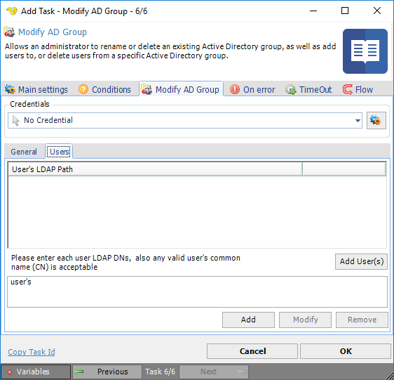

## Task Active Directory - Modify AD Group

The Modify AD Group Task adds users to or removes users from an Active Directory group, or renames or deletes the group.

The ***Main settings***, ***Flow***, ***On error***, ***Conditions*** and ***TimeOut*** tabs are the same for every Task; see [Job - Tasks](../../job-tasks).

### Modify AD Group tab

#### General sub tab

- _Credentials_: the Credential that the Task uses to connect to Active Directory; see [Global - Credentials](../../global-credentials). Click the _Settings_ icon to open _Manage credentials_

  With "No Credential", the Task connects as the account that the VisualCron Server service runs as. The account that is used needs permission in Active Directory for what the Task does.

  When the selected Credential has been deleted, the Task fails, but it may already have carried out the change as the account of the VisualCron Server service.

- _Path_: the LDAP path of the group. Click _Select group_ to pick it
- _Action_: "Add users" (default), "Remove users", "Rename" or "Delete"
  - "Add users" and "Remove users" use the users on the ***Users*** sub tab
  - "Rename" renames the group to _New name_. Only the group's common name (CN) changes
  - "Delete" deletes the group
- _New name_: the new name of the group. It is shown only for "Rename"

:::warning

With "Delete", the Task deletes the group at _Path_. VisualCron cannot undo the deletion.

:::

#### Users sub tab

The list has the users to add or remove. Enter each user's distinguished name (DN), for example `CN=<name>,OU=<unit>,DC=<domain>,DC=<suffix>`; an `LDAP://` prefix is removed before use.

To add a user:

1. Type the user's DN in the text box.
2. Click _Add_.

Click _Add User(s)_ to search for a user and add it.

To change a user:

1. Select the entry.
2. Change the text.
3. Click _Modify_.

To remove a user:

1. Select the entry.
2. Click _Remove_.

### Output and errors

The Task writes no output. When Active Directory rejects the request, for example because the account does not have permission or the object does not exist, the Task fails with the error that Active Directory returns.

Users are added or removed one at a time. When one fails, for example because the user is already a member, the earlier changes are kept, the remaining users are not processed, and the Task fails.
