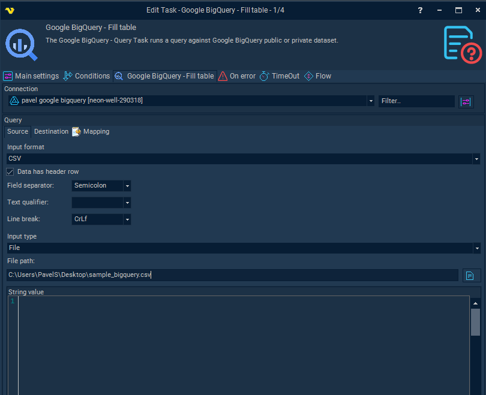
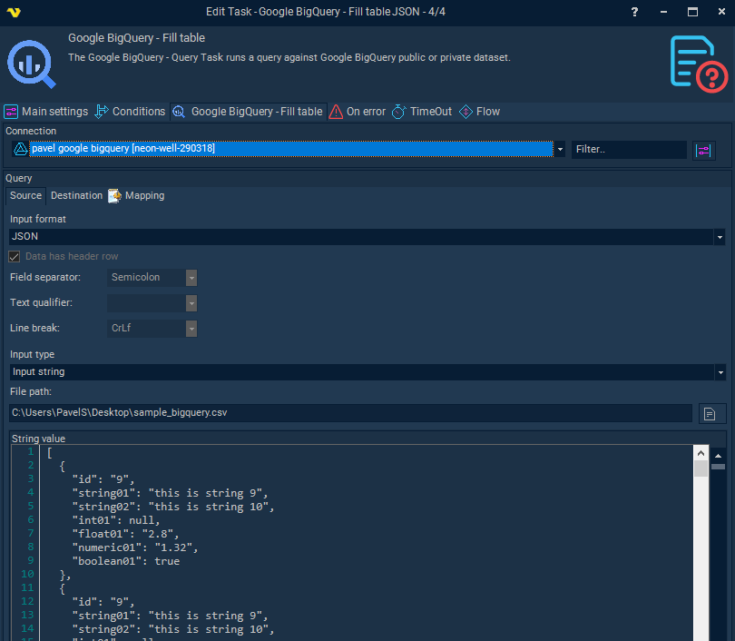

## Task Database - BigQuery - Fill Table

The Google BigQuery - Fill table Task loads rows from CSV or JSON data into a table of a private Google BigQuery dataset, using a Google Cloud Connection. The rows are added to the table; existing rows are kept.

:::warning

This Task uses a Google Cloud Connection; see [Connection - Google Cloud](../../connection-google-cloud).

When _Input type_ is "File", _Input format_ is "CSV" and the file does not exist, the Task loads nothing, writes "No valid rows to insert." to the output, and reports success. With "JSON", the Task fails.

With "CSV", the lines are split at the field separator before the text qualifier is considered, so a separator inside a qualified value splits the field, and the following columns shift.

When no Connection is selected or the Connection is not found, the Task writes "No Connection was selected" or "Connection not found", but with the default ***On error*** settings it reports success. To have it fail the Task, select "All errors" on the ***On error*** tab; see [Task - On Error](../../task-on-error).

:::

The ***Main settings***, ***Flow***, ***On error***, ***Conditions*** and ***TimeOut*** tabs are the same for every Task; see [Job - Tasks](../../job-tasks).

### Google BigQuery - Fill table tab

- _Connection_: The Google Cloud Connection to use

**Source**

- _Input format_: "CSV" or "JSON". With "CSV", the CSV settings below are available
- _Data has header row_: When selected, the first line of the input holds the column names. A column is mapped when its header equals the name of the destination column; otherwise _Source column position_ is used. When cleared, the columns are mapped by position
- _Field separator_: The character between the fields of a line
- _Text qualifier_: The character around text values. It is removed from the start and end of values for STRING columns
- _Line break_: The characters between the lines
- _Input type_: "File" to read the data from a file, or "Input string" to enter the data in _String value_
- _File path_: The full path of the input file. Used with "File". Variables can be used
- _String value_: The data to load. Used with "Input string". Variables can be used

**When input format is JSON**

The input must be a JSON array of objects. The columns are mapped by the property names of the objects.

**Destination**

- _Project_: The Google Cloud project with the target dataset
- _Dataset_: The dataset with the target table. Click the icon next to the list to load the datasets of the project
- _Table_: The table to load the rows into. Click the icon next to the list to load the tables of the dataset

**Mapping**

The grid maps the source columns or JSON properties to the columns of the table, with the _Source Column_, _Position_, _Destination Column_, _Data type_ and _Mode_ of each entry. Click _Refresh mapping_ to fill the grid from the table. Use _Add_, _Edit_ and _Delete_ to change the entries. In the mapping window:

- _Source column name_: The name of the JSON property in the input. With CSV, it only has to be set: the CSV header must have the name of the destination column
- _Source column position_: The position of the column in the input, used when there is no header row
- _Destination column name_: The column of the table. Select it in the list of the table columns
- _Data type_: Read-only. The BigQuery data type of the destination column
- _Column mode_: Read-only. The mode of the destination column: "NULLABLE", "REQUIRED" or "REPEATED"

### Output and errors

- The output of the Task is a line with the status of the insert and the number of lines processed and rows attempted
- When the input cannot be parsed, a mapping has neither a source name nor a position, or BigQuery rejects rows, the errors are written to the error output, and the Task fails
