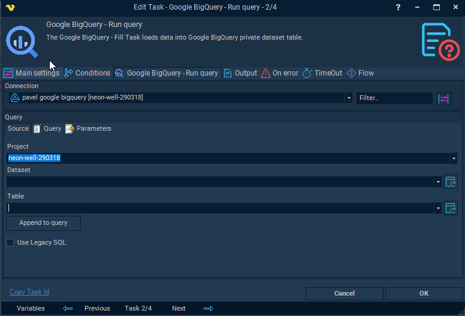

## Task Database - BigQuery - Run Query

The Google BigQuery - Run query Task runs a SQL query against a public or private Google BigQuery dataset and returns the rows as the output of the Task, using a Google Cloud Connection.

:::warning

This Task uses a Google Cloud Connection; see [Connection - Google Cloud](../../connection-google-cloud). Variables in the query text and in parameter values are not replaced: the text is sent to BigQuery as entered.

:::

The ***Main settings***, ***Flow***, ***On error***, ***Conditions*** and ***TimeOut*** tabs are the same for every Task; see [Job - Tasks](../../job-tasks).

### Google BigQuery - Run query tab

- _Connection_: The Google Cloud Connection to use

**Source**



The ***Source*** sub tab helps you find a table and start a query. The _Dataset_ and _Table_ selections are not saved with the Task.

- _Project_: The project of the selected Connection, or `bigquery-public-data` to browse the public datasets
- _Dataset_: The datasets in the selected project. Click the icon next to the list to load them
- _Table_: The tables in the selected dataset. Click the icon next to the list to load them
- _Append to query_: Click to add a starter query for the selected table to the ***Query*** sub tab, for example ```SELECT * FROM `project.dataset.table` LIMIT 1000```
- _Use Legacy SQL_: When selected, the query runs as Legacy SQL. When cleared, the default, it runs as Standard SQL

**Query**

Enter the SQL query to run against BigQuery.

**Parameters**

- _Parameters type_: Select named parameters to reference parameters by name in the query, for example `@name`, or position parameters to reference them by position with `?`

The grid lists the parameters with their _Name_, _Data type_, _Item data type_, _Value_ and _Is Null_. Use _Add_, _Edit_ and _Delete_ to change the list. In the parameter window:

- _Name_: The name of the parameter, used as `@name` in the query with named parameters
- _Data type_: The BigQuery data type: "Array", "Bool", "Bytes", "Date", "DateTime", "Float64", "Geography", "Int64", "Numeric", "String", "Struct", "Time" or "Timestamp"
- _Item data type_: The data type of each element of an "Array" parameter. Available only when _Data type_ is "Array"
- _Value_: The value of the parameter, as text. Variables are not replaced
- _Use null value_: When selected, NULL is sent instead of _Value_

### Output tab

The ***Output*** tab sets how the returned rows are written: _Include field names_, _Field separator_, _Text qualifier_ and _Line break_, and whether the rows go to the standard output or to a file, with the _File output settings_. The settings are the same as on the ***Output*** tab of the [SQL Task](sql#output-tab). With output to a file, the output of the Task is the path of the file.

### Output and errors

- When the query fails in BigQuery, the Task fails
- When no Connection is selected or the Connection is not found, the Task writes "No Connection was selected" or "Connection not found", but with the default ***On error*** settings it reports success. To have it fail the Task, select "All errors" on the ***On error*** tab; see [Task - On Error](../../task-on-error)
