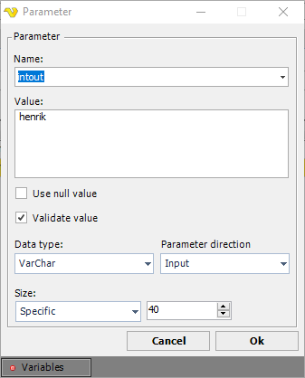

## Task Database - SQL

The SQL Task runs a SQL command, a stored procedure or a SQL Server Agent job against a database, using a SQL Connection. The Connection can use ODBC, OLE DB or a native provider, such as the native providers for Microsoft SQL Server, Oracle, MySQL, PostgreSQL and IBM DB2.

The ***Query*** area has the sub tabs ***Text***, ***Stored Procedure*** and ***Job***. Only the sub tab that is active when the Task is saved is used.

:::warning

This Task uses a SQL Connection; see [Connection - SQL](../../connection-sql). Each time the Task runs, it sets the SSL and TLS versions for the whole VisualCron Server process to the versions selected on the Connection, and the Server then accepts any server certificate for HTTPS calls in the Server process.

:::

The ***Main settings***, ***Flow***, ***On error***, ***Conditions*** and ***TimeOut*** tabs are the same for every Task; see [Job - Tasks](../../job-tasks).

:::warning

With a native Microsoft SQL Server Connection and _Add info messages to output_ selected on the ***Output*** tab, SQL Server reports most errors in the query (severity 16 or lower) as messages instead of errors. They are added to the output, and the Task reports success. Clear _Add info messages to output_ when the Task must fail on such errors, or add an error condition on the output on the ***On error*** tab; see [Task - On Error](../../task-on-error).

:::

### SQL tab

**Connection**

- _Connection_: The SQL Connection to the database. Select a Connection in the list, or click the icon next to it to open _Manage Connections_; see [Global - Connections](../../global-connections)
- _Credential_: The Windows user the Task runs the query as. Use it with a Connection that uses Windows authentication (a trusted connection). For a local database, the Credential must be a valid Windows user on the VisualCron Server; for a remote database, a valid user on the database server. See [Global - Credentials](../../global-credentials)
- _Command timeout_: The number of seconds a query may run before it is stopped. "0", the default, means no time limit

**Text sub tab**

- The SQL command to run. Variables can be used in the text
- _Split and run multiple queries with semicolon as separator_: When selected, the text is split at each semicolon, and each part is run as a separate query, in order. The text is split at every semicolon, also at a semicolon inside a quoted value or inside the body of a procedure

**Stored Procedure sub tab**

- _Name of Stored Procedure_: The stored procedure to run. Click the icon next to the list to load the stored procedures of the database
- _Parameters_: The parameters of the stored procedure, with their _Name_, _Data type_, _Direction_ and _Value_. Click _Refresh parameters_ to load them from the database. Use _Add_, _Edit_ and _Delete_ to change the list

In the parameter window:

- _Name_: The name of the parameter, with the prefix the database uses, normally `@`
- _Value_: The value of the parameter. Variables can be used
- _Use null value_: When selected, NULL is sent instead of _Value_
- _Validate value_: When selected, the Client checks that _Value_ matches the data type. Clear it when _Value_ is a Variable that has no value yet
- _Data type_: The data type of the parameter. The list depends on the provider of the Connection
- _Parameter direction_: "Input", "Output", "InputOutput" or "ReturnValue"
- _Size_: "Auto", "Max", or "Specific" with the size in the field next to it

With ODBC, add the parameters in the order in which the stored procedure uses them.

**Date and time parameter values**

How the Task sends the _Value_ of a date or time parameter depends on the provider of the Connection. Where the steps below say that the value is read, VisualCron tries, in this order:

1. The primary format that the provider and data type use
2. A fixed list of year-first formats, the same on every Server: `yyyyMMddHHmmss`, `yyyyMMdd`, `yyyy-MM-dd HH:mm:ss`, `yyyy-MM-ddTHH:mm:ss.fff`, `yyyy-MM-ddTHH:mm:ss`, `yyyy-MM-dd`
3. The date and time patterns of the Server's current culture
4. A general date parse with the Server's current culture

A value that none of these match ends the Task with an error. In steps 3 and 4, a value such as `03/04/2026` follows the day and month order of the Server's culture. For the same result on every Server, use the primary format or a format from the fixed list.

- Native Microsoft SQL Server: A "DateTime" value is read, with the primary format `yyyyMMddHHmmss`. Other date and time data types, such as "Date", "DateTime2", "SmallDateTime" and "Time", are sent as text, and SQL Server converts them. For these, use a format that SQL Server reads in any language setting, such as `yyyy-MM-dd` or `yyyy-MM-ddTHH:mm:ss`
- OLE DB: A "Date" value is read with the primary format `yyyyMMddHHmmss` and sent as `yyyy-MM-dd HH:mm:ss`. A "DBDate" value is read with the primary format `yyyyMMdd` and sent as `yyyy-MM-dd`. A "DBTime" value must be exactly `HHmmss`, and is sent as `HH:mm:ss`
- ODBC, with _Convert data types_ cleared on the Connection (the default): The value is sent as entered
- ODBC, with _Convert data types_ selected: A "Date" value must be in one of the forms `yyyyMMdd`, `yyyy-MM-dd`, `dd-MM-yyyy`, `MM/dd/yyyy`, `dd/MM/yyyy` or `yyyy/MM/dd`, tried in that order, so `03/04/2026` is read as March 4. A "DateTime" or "SmallDateTime" value must be exactly `yyyyMMddHHmmss`
- Oracle and MySQL with a native provider: A "DateTime" value is read, with the primary format `yyyyMMddHHmmss`
- IBM DB2 with a native provider: A "DateTime" value is read, with the primary format `yyyyMMddHHmmss`
- PostgreSQL with a native provider: The value is sent as text. With _Convert data types_ selected, Variables in the value of a date or time parameter may not be replaced

:::warning

With ODBC and _Convert data types_ selected on the Connection, a "Date", "DateTime" or "SmallDateTime" value in any other form is sent as NULL. No error is raised, and the Task reports success.

With OLE DB and _Convert data types_ selected, parameters of data type "Date" and "DBTime" currently end the Task with a format error. Use "DBDate" for dates, or a text data type, instead.

:::

**Job sub tab**

The ***Job*** sub tab runs a SQL Server Agent job, and works only with Microsoft SQL Server. Use it, for example, to run an SSIS or DTS package on a remote server: create a SQL Server Agent job for the package first.

- _Name of job_: The SQL Server Agent job to run. Click the icon next to the list to load the jobs of the server
- _Job steps_: A read-only list of the steps of the selected job, with the _Step_, _Name_, _Query_ and _Database_ of each step. Click _Refresh steps_ to load them again

### Output tab

The ***Output*** tab sets how the rows that the query returns are written.

**Output settings**

- _Include field names_: When selected, the first line contains the column names
- _Indent XML_: When selected, XML that the query returns is written with indentation. It applies with _Output to file_
- _Field separator_: The character between the fields of a row
- _Text qualifier_: The character around each field value. The default is none
- _Line break_: The characters between the rows
- _Add info messages to output_: When selected, the messages of the database server, such as `PRINT` output and warnings, are added to the output. With a native Microsoft SQL Server Connection, most errors are then reported as messages; see the warning at the top of this page
- _Output to standard output_: The default. The rows are written to the standard output of the Task
- _Output to file_: The rows are written to a file, and the output of the Task is the path of the file. The _File output settings_ are then available

**File output settings**

- _Credential_: The Credential used to write the file. See [Global - Credentials](../../global-credentials)
- _File path_: The full path of the output file
- _Include BOM (if UTF8)_: When selected, a byte order mark is written at the start of the file when the file is written as UTF-8
- _Append to file_: When selected, the default, the rows are added to the end of the file. When cleared, the file is replaced

:::warning

With _Append to file_ cleared, an existing file at _File path_ is replaced on each run.

:::

- _Write buffer size_: The size in bytes of the write buffer for the file. The default is "65536"

:::tip

- Test the Task in the Client before you save it; errors are shown in the log window
- Use the predefined connection strings and the data sources (DSN) of the Server where you can
- For a PL/SQL statement on Oracle, put it in a `BEGIN ... END;` block, for example: `BEGIN FM.MQ.ADD_MSG_DIRECT('FORM','LV_SENDER','LV_POSN_UPLOAD',213,'ORG_ID'); END;`
- To get the values of output parameters and the messages of the server, use the result Variables of the Task, shown below

:::

### Troubleshooting

**`ODBC->ERROR [42000] [Microsoft][ODBC SQL Server Driver][SQL Server]Invalid parameter 1 (''): Data type 0x23 is a deprecated large object, or LOB, but is marked as output parameter. Deprecated types are not supported as output parameters. Use current large object types instead.`**

- Change the data type from "Text" to "VarChar" or "NVarChar"
- Make sure the size of the parameter is exactly the size of the parameter in SQL Server

**The Size property has an invalid size of 0.**

Set _Size_ to "Specific", with exactly the size of the parameter.

**ORA-03113**

Upgrade to the latest version of VisualCron.
