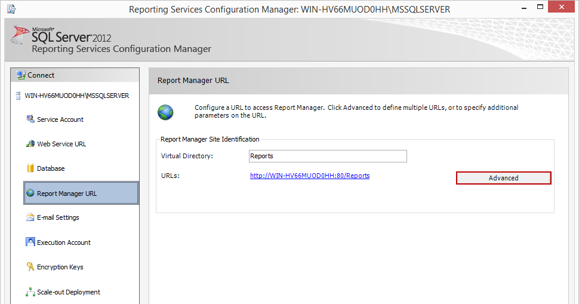

## Task Database - SSRS

The SSRS Task runs a report in SQL Server Reporting Services and saves the result as a file in the format you select, using an SSRS Connection.

The ***Main settings***, ***Flow***, ***On error***, ***Conditions*** and ***TimeOut*** tabs are the same for every Task; see [Job - Tasks](../../job-tasks).

:::warning

The report file is written with the name that _File mask_ gives. An existing file with that name is replaced without a warning. With the default _File mask_ `*`, each run replaces the file of the previous run.

:::

### SSRS: Main settings tab


- _Connection_: The SSRS Connection, which holds the user name, password, host name and proxy of the report server; see [Connection - SSRS](../../connection-ssrs) and [Global - Connections](../../global-connections)
- _Use default folder (hostname/reportserver/)_: When selected, the default, the virtual directory "reportserver" of the report server is used. Clear it to enter another virtual directory name in the field below. The name is set in the _Reporting Services Configuration Manager_ under _Virtual Directory_:



- _Report_: The path of the report on the report server. Click the icon next to the list to load the paths of all reports
- _Is SharePoint report_: Select it when the report is a SharePoint report
- _Service type_: "SSRS 2005" for SQL Server 2005 Reporting Services, or "SSRS 2010" for SQL Server 2008 R2 and later

### SSRS: Parameters tab


Click _Refresh_ to load the parameters of the selected report. Use _Add_, _Edit_ and _Delete_ to change the list. In the _Add/Edit parameter_ window:

- _Name_: The name of the parameter
- _Data type_: The data type of the parameter
- _Value_: The value of the parameter
- _Is null_: When selected, NULL is sent for the parameter
- _CSV_: When selected, _Value_ is a comma-separated list that is split into several values
- _Add Multi-Value_: Click to enter several values for one parameter

### SSRS: Destination tab


- _File format_: The format of the report file: "XML", "CSV", "Image", "PDF", "Excel", "ExcelOpenXML", "Word", "MHTML" or "HTML4"
- _Credential_: The Credential used to write the file, for example to a network share. See [Global - Credentials](../../global-credentials)
- _Folder_: The destination folder of the report file
- _File mask_: The name of the report file. `*`, the default, gives the report name and the extension of the format

### Output and errors

- The output of the Task is the path of the saved report file
- When the report cannot be run or saved, the Task fails

### Troubleshooting

**Exception in Task: System.Web.Services.Protocols.SoapException: You have attempted to use a rendering extension that is either not registered for this report server or it is not supported in this edition of Reporting Services**

Check the file rsreportserver.config in  ```c:\Program Files\Microsoft SQL Server\MSRS10_50.MSSQLSERVER_RS\Reporting Services\ReportServer```

The Task requests the report in the selected format, and the configuration file of the Reporting Services instance does not include a rendering extension for that format.
In MS SQL Server 2008-R2, the configuration file is located in a directory structure resembling the following:
 
```text

 E:
   \Program Files
      \Microsoft SQL Server
         \MSRS10_50.MSSQLSERVER_RS
            \Reporting Services
               \ReportServer

```

In the configuration file, find the "Render" section:

```xml

< Configuration >
< Extensions >
< Render >

```

Within the Render section, find the matching "Extension" entry. If the file format is "HTML4" and the entry is named "HTML4.0", change the name to "HTML4".
