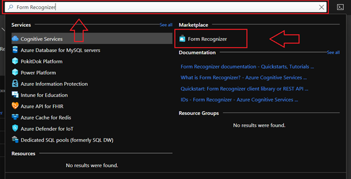
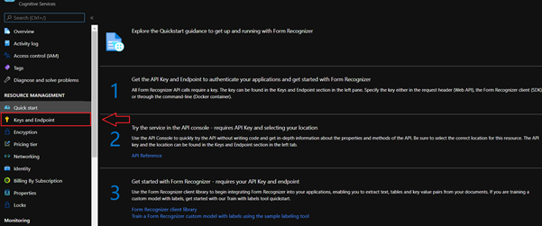
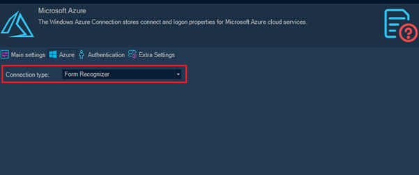
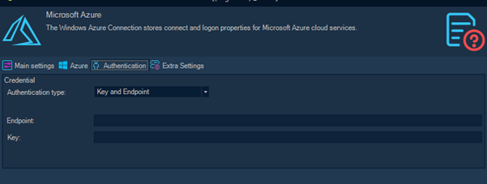
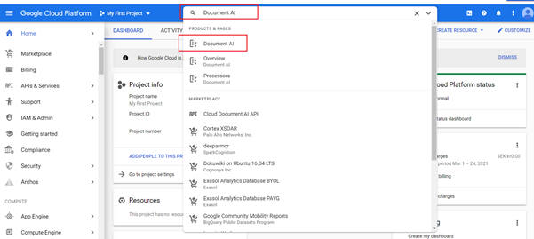
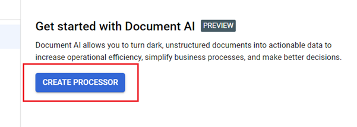
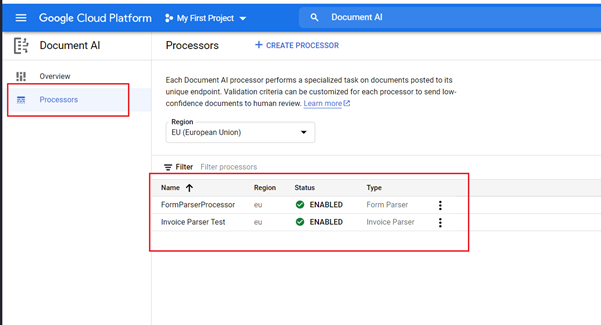
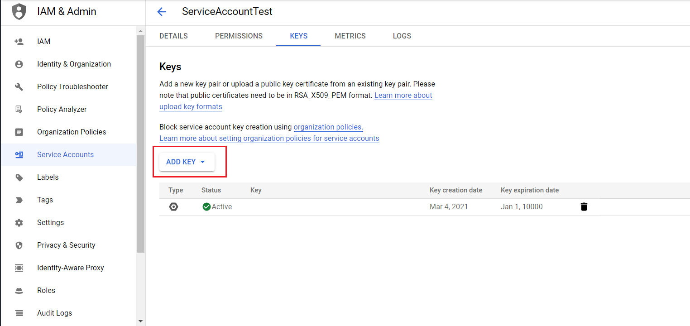
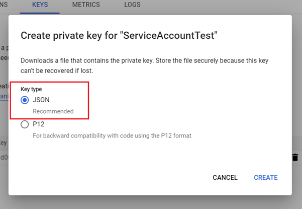
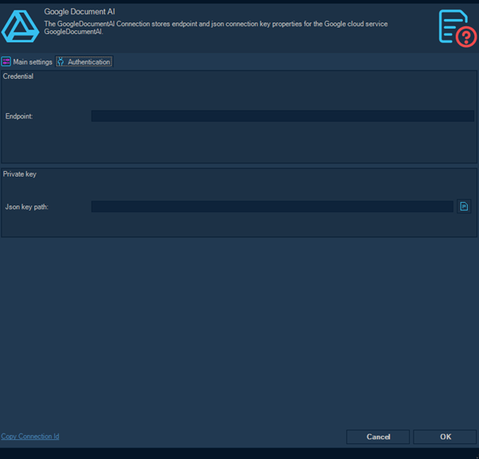

## Task Image - Scan Document (Cloud)

The Scan document (cloud) Task sends documents, such as invoices, receipts and business cards, to a cloud document service, and saves the fields that the service finds to Variables, to the Task output or to files.

The Task works with these services, each through its own Connection:

- Microsoft Azure Form Recognizer, through a [Microsoft Azure](../../connection-microsoft-azure) Connection whose _Connection type_ is "Form Recognizer"
- Google Document AI, through a Google Document AI Connection with the endpoint of a processor and a JSON key file

You need an account with one of these services to use this Task.

The ***Main settings***, ***Flow***, ***On error***, ***Conditions*** and ***TimeOut*** tabs are the same for every Task; see [Job - Tasks](../../job-tasks).

### How it works

1. The File filter finds the files to process.
2. For each file, the Server uploads the file to the service of the selected Connection.
3. The service extracts the fields and returns them.
4. The Task saves the field values to Variables, to the Task output or to files, as set for each field.

## Setting up Cloud services
 
 
### Azure
 
In the Microsoft Azure portal search for "Form Recognizer"

Click on “Form Recognizer” and create new Form Recognizer Service.
After creating Form Recognizer Service, select it from your Azure Dashboard and then select “Keys and Endpoint”:

Here you can find key and endpoint for creating new Visual Cron connection. Now in Visual Cron you can create new connection of type “Microsoft Azure”. In Microsoft Azure connection form select Connection type as “Form Recognizer”:

In Authentication tab you can paste your Endpoint and Key:

Then specify Name of connection and click OK. Now this connection is ready to be used in Scan Document (cloud) Task.
 
### Google
 
First in Google Cloud Platform search for “Document AI” and click on it:

Then create a new processor:

Then in Document AI dashboard you can select existing processor and copy endpoint from there:

After that you should create Google Service Account. Details on how to do that can be found here [https://cloud.google.com/iam/docs/creating-managing-service-accounts](https://cloud.google.com/iam/docs/creating-managing-service-accounts).

Then in KEYS tab of your service account you should create a new json key:

After that the json key should be downloaded to your PC. And now you can use endpoint and json key to create new VisualCron connection.

## Task settings

### File filter tab

The Task uses the [File filter](../../job-tasks-file-filter) to find the files to process. It processes every file that the filter finds.

### Scan properties tab

In the ***Scan properties*** tab you select the service and the document type, and set up the fields from a sample document.

- _Provider Connection_: the Connection of the service to use. Connections are set up in [Connections](../../global-connections)
- _Document type_: the type of document to scan. Shown only for an Azure Form Recognizer Connection: "Invoice", "Receipt" or "Business card". For a Google Document AI Connection, the processor of the Connection decides what is extracted
- _Scan_: open a sample document in the document viewer, then click _Scan_. The Client sends the sample document to the service and lists the fields that it finds in _Fields/Variables_
- _Fields/Variables_: the fields found in the sample document. Each row becomes a Variable, named after the field, when the Task runs

_Variable output settings_ is collapsed by default. Expand it to set how the selected field is saved:

- _Field separator_, _Text qualifier_ and _Line break_: the format of the value
- _Output to Task Variable_: adds the value to the Task result, as a Variable named after the field
- _Output to Job Variable_: sets a Job Variable with the name of the field. When a user runs the Job, the user needs permission to edit the Variables of the Job, or the Task fails
- _Output to file_: writes the value to the file in _File output settings_

_File output settings_:

- The Credential to use when writing the file
- _File path_: the full path and file name of the output file. Accepts Variables
- _Include BOM (if UTF8)_: writes a byte order mark when the Task writes UTF-8
- _Append to file_: adds the value to the end of the file instead of replacing it

### Output tab

The Task window has an extra ***Output*** tab for this Task. Its _Output settings_ control the output of all fields together:

- _Include field names_: writes a first line with the column names, `Name`, `Value` and `Confidence`, for each file
- _Field separator_, _Text qualifier_ and _Line break_: format each line
- _Output to standard output_: writes one line for each field, with its name, value and confidence as a percentage, to the Task output
- _Output to file_: writes the same lines to the file in its _File output settings_

:::warning

When _Append to file_ is unchecked, the Task replaces the output file each time it writes it. When the File filter finds several files, the Task writes the file once for each file, each time with the lines of all files processed so far; with _Append to file_ checked, the lines of each earlier file are therefore written again with each later file.

:::

### Output and errors

When the File filter finds no file, the Task fails with a file-not-found error. To change how the Task responds to errors, see [Task - On error](../../task-on-error).

:::warning

When the service does not return a field that is in _Fields/Variables_, the Task skips that field: its Variable is not set and nothing is written for it, and the Task reports success.

:::
