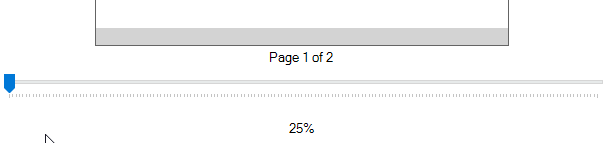
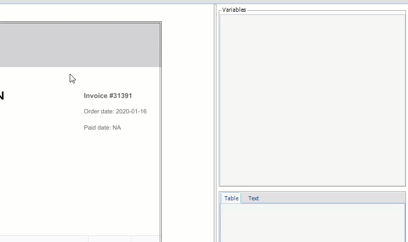
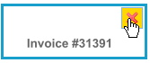
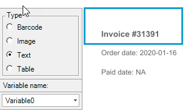
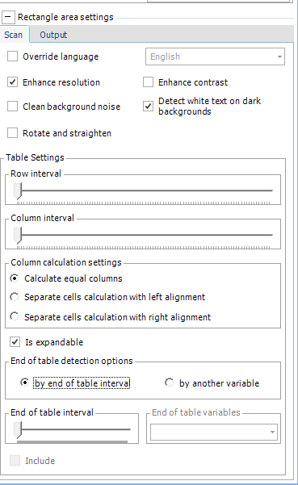
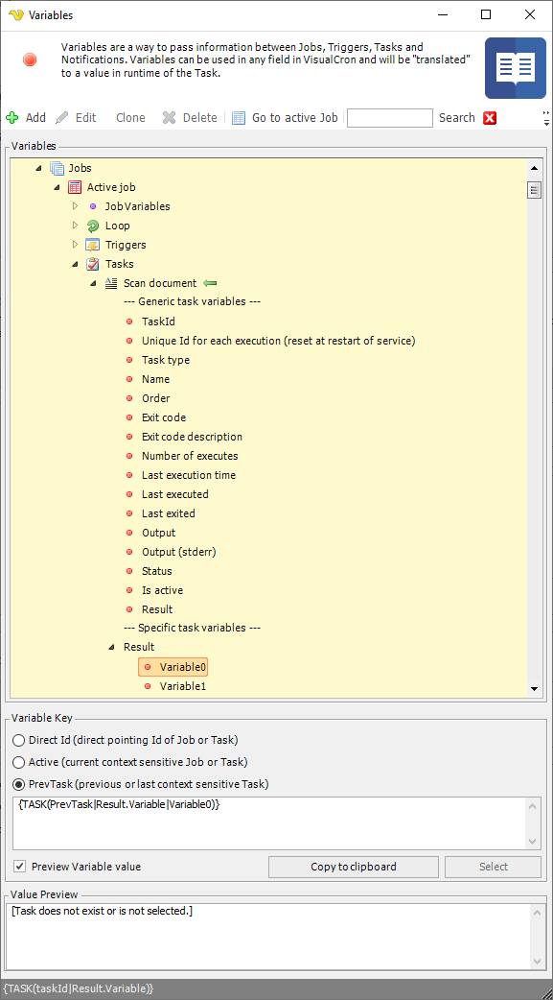

## Task Image - Scan Document (Local)

The Scan document (local) Task reads text, barcodes, tables and images from selected areas of documents, on the Server and without a cloud service. You mark the areas (rectangles) on a sample document. When the Task runs, it scans the same areas in each file it processes and saves the content to Variables, to the Task output or to files.

The ***Main settings***, ***Flow***, ***On error***, ***Conditions*** and ***TimeOut*** tabs are the same for every Task; see [Job - Tasks](../../job-tasks).

The Task opens these formats, by file extension:

- PDF (`.pdf`)
- Word (`.doc`, `.docx`)
- HTML (`.html`, `.htm`, `.mhtml`)
- TIFF, including multi-page files (`.tif`, `.tiff`)
- GIF (`.gif`)
- Any other file, such as JPG or PNG, is opened as an image

### File filter tab

The Task uses the [File filter](../../job-tasks-file-filter) to find the files to process. It processes every file that the filter finds, with the same rectangles. When the filter finds several files, the Task Variables of all files are collected in the same Task result, and each Job Variable keeps the value from the last file. To keep the results of each file apart, have the filter find one file per run: put the Task in a [loop](../../job-tasks-loop-functionality), or start the Job from a [File Trigger](../../event-trigger-file) that runs it once for each file.

### Scan properties tab

In the ***Scan properties*** tab you mark the areas (rectangles) to scan and set how their content is saved.

#### Open document/image

Click _Open document/image_ and select a sample file to work with. The file is loaded into the document area. For a multi-page document or image, click _Previous page_ and _Next page_ to change the page. The sample is used only to set up the rectangles.

#### Zoom slider

The zoom slider at the bottom of the document area zooms in and out, so that text is easier to see and select. The zoom level does not affect the scan.

#### Document area

The document area shows the loaded document. Drag with the left mouse button to move around the document.

To create a rectangle:

1. Point to the top left of the text.
2. Press and hold the right mouse button.
3. Drag to the lower right corner of the text.
4. Release the button.

The rectangle turns orange and shows a scan icon while VisualCron previews the scan. When the preview is done, the rectangle turns blue, a Variable is created and selected in the _Variables_ area, and the scan result is shown in the _Table_ and _Text_ tabs below the _Variables_ area.

To delete a rectangle, point to it and click its _Delete_ icon, or click the _Delete_ icon in the _Variables_ area.

When you select a rectangle, its scan type is shown on the left and the _Rectangle area settings_ on the right show its settings.

VisualCron detects the scan type when it scans, and you can select another type afterward:

- "Barcode": reads a barcode into a Variable
- "Image": saves the area as an image. The Variable holds the image as Base64 text
- "Text": reads the text, as displayed, into a Variable
- "Table": reads the text as a table, with comma-separated values, into a Variable

#### Preview of Variables

The preview shows the selected Variable in a _Table_ tab and a _Text_ tab. The _Table_ tab matters for the "Table" scan type, because it shows the result of the table settings. To help VisualCron split rows and columns, change the interval sliders in the table settings of the rectangle.

#### Language

The language setting helps VisualCron read the special characters of a language. The default is English. _General Language Settings_ sets the language for the document; _Override language_ on the ***Scan*** tab of a rectangle overrides it for that rectangle.

#### Rectangle area settings: Scan tab

These settings apply to the selected rectangle.

- _Override language_: uses another language than the general setting for this rectangle
- _Enhance resolution_: renders low-quality images at a higher DPI. It works faster and more accurately with high-resolution images, and helps with images scanned at under 250 DPI
- _Clean background noise_: removes background noise, dust, speckles and paper marks from printed text. It works even on creased, stained or damaged paper. It uses a lot of CPU or GPU
- _Rotate and straighten_: deskews and rotates the image so that it is straight and upright, without bending or perspective. It helps imperfect scans read accurately. It uses a lot of CPU or GPU
- _Enhance contrast_: increases the contrast of the image where needed, which usually makes text easier to read
- _Detect white text on dark backgrounds_: detects and adjusts white text on dark backgrounds, such as microfilm, negatives and some graphic designs

_Table Settings_ control how VisualCron reads a table:

- _Row interval_: the distance between rows within which a new line of text is still part of the previous row
- _Column interval_: the distance between cells within which new characters on a row are still part of the previous cell
- _Calculate equal columns_: the table has columns shared by all rows
- _Separate cells calculation with left alignment_: the table has no shared columns. Each row has its own cells, aligned to the left in the output and the table preview
- _Separate cells calculation with right alignment_: the table has no shared columns. Each row has its own cells, aligned to the right in the output and the table preview
- _Is expandable_: the end of the table is not fixed; it is found when the Task runs, by one of the _End of table detection options_
  - "by end of table interval": ends the table by _End of table interval_
  - "by another variable": ends the table at the text marked by another rectangle, selected in _End of table variables_
- _End of table interval_: used with "by end of table interval". When the distance from the previous line of text is greater than this interval, the previous line is the end of the table
- _Include_: used with "by another variable". Includes the text of the end-of-table rectangle in the table

#### Rectangle area settings: Output tab

The ***Output*** tab of the rectangle sets where its value goes when the Task runs. Select one:

- _Output to Task Variable_: adds the value to the Task result, as a Variable named after the rectangle
- _Output to Job Variable_: sets a Job Variable with the name of the rectangle. When a user runs the Job, the user needs permission to edit the Variables of the Job, or the Task fails
- _Output to file_: writes the value to the file in _File output settings_. An "Image" rectangle is written as an image file

_Field separator_, _Text qualifier_ and _Line break_ format the value, and _File output settings_ has the _File path_, _Include BOM (if UTF8)_ and _Append to file_ settings for _Output to file_.

### Output tab

The Task window has an extra ***Output*** tab for this Task. Its _Output settings_ control the output of all rectangles together.

.png)

- _Include field names_: writes a first line with the column names, `Name` and `Value`, for each file
- _Field separator_: the character between the name and the value. Default: "Tab"
- _Text qualifier_: the character written around the name and the value. Empty by default
- _Line break_: the line break after each line. Default: "CrLf"
- _Output to standard output_ (default): writes one line for each rectangle, with its name and value, to the Task output
- _Output to file_: writes the same lines to the file in _File output settings_

_File output settings_:

- The Credential to use when writing the file
- _File path_: the full path and file name of the output file. Accepts Variables
- _Include BOM (if UTF8)_: writes a byte order mark when the Task writes UTF-8
- _Append to file_: adds the output to the end of the file instead of replacing it

:::warning

When _Append to file_ is unchecked, the Task replaces the output file each time it writes it. When the File filter finds several files, the Task writes the file once for each file, each time with the lines of all files processed so far; with _Append to file_ checked, the lines of each earlier file are therefore written again with each later file.

:::

### Variables

The Task Variables are under the Result node of the Task in the Variables window:

### Output and errors

When the File filter finds no file, the Task fails with a file-not-found error. To change how the Task responds to errors, see [Task - On error](../../task-on-error).

:::warning

When a rectangle cannot be scanned, or the language data of a rectangle cannot be loaded, the Server writes the error to its log and the Task goes on, and the Task reports success.

:::
