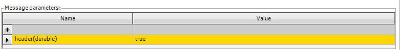

## Task Messaging - AMQP - Send Message

The AMQP - Send message Task sends a message to a queue on a message broker that supports AMQP, such as RabbitMQ or Azure Service Bus, using an AMQP Connection.

:::warning

This Task uses an AMQP Connection; see [Connection - AMQP](../../connection-amqp). _Disable Server Certificate Validation_ is selected by default on the Connection and applies to the whole Server, so the Server accepts any broker certificate, and with "Certificate" authentication the broker certificate is never checked. With _Schema_ "AMQP", the user name, the password and the messages are sent without encryption.

:::

The ***Main settings***, ***Flow***, ***On error***, ***Conditions*** and ***TimeOut*** tabs are the same for every Task; see [Job - Tasks](../../job-tasks).

:::note

The AMQP - Send message Task is part of the Advanced messaging feature of the license.

:::

### AMQP - Send message tab

#### Connection

- _Connection_: the AMQP Connection to the broker; see [Connection - AMQP](../../connection-amqp)

  Required: the Task cannot be saved without it.

#### Queue

- _Name_: the queue to send the message to

  Required. Click the refresh button next to _Name_ to list the queues of the Connection.

- _Durable_: the durability of the target terminus on the broker, as a whole number

  In AMQP 1.0, "0" means none, "1" means configuration and "2" means unsettled state.

- _Timeout_: the expiry timeout of the target terminus, as a whole number

  In AMQP 1.0, this is how long, in seconds, the broker keeps the terminus after the link closes.

  A value that is not a whole number is ignored.

- _Dynamic_: currently not saved with the Task, so the Task always runs with it cleared

When _Durable_ or _Timeout_ has a value, _Durable_ must hold a whole number of zero or more, or the Task fails. _Timeout_ therefore cannot be used without _Durable_. Variables are resolved in _Name_, _Durable_ and _Timeout_.

#### Message

The _Body (double click to edit)_ list holds the parts of the message body. Click _Add_, _Edit_ or _Delete_ to manage the parts, or double-click a part to edit it. _Refresh_ removes every part from the list.

In the _Add/Edit message value_ window:

- _Value type_: the AMQP type of the part, for example "String", "Symbol", "Boolean", "Int32", "Double", "Decimal", "DateTime", "Guid", "Byte[]", "List" or "Map"
- _Value_: the value of the part

  Variables are resolved when the Task runs. Click _Variables_ to look up a Variable.

- _Is null_: sends a null value; _Value_ is then unavailable

  A part whose value, after Variables are resolved, is the text "(Null)" is also sent as null, whatever its type.

- _Add/Edit Multi-Value_: builds the items of a "List", "Map" or "Byte[]" value

Enter "Byte[]" values as Base64. With comma-separated numbers, the Task currently adds a zero byte at the end of the array.

How the body is sent:

- With one part, the part is sent as an AMQP value, and a "List" part as an AMQP sequence

  A null part, from _Is null_ or from a value that cannot be read, means that the message is sent without a body.

- _As an array_: applies only when the body has exactly one part

  When selected, a "String" or "Byte[]" part is sent as a binary data section, with text in UTF-8. A "Symbol" part is sent the same way as a "String" part. Parts of other types are still sent as an AMQP value.

  The check box is shown only while the list holds exactly one part, and when a Task that has no part yet is opened.

- With two or more parts, all parts are sent as one AMQP sequence, and _As an array_ does not apply

  A null part is sent as a null entry in the sequence.

#### Message parameters

The _Message parameters_ grid adds properties to the message. Each row has a _Name_ and a _Value_. Enter the name as `<section>(<parameter>)`, for example `Header(Priority)`. Names are not case-sensitive, spaces in them are ignored, and Variables are resolved in names and values.

The sections are:

- `Header`: the parameters `Durable`, `Priority`, `Ttl`, `FirstAcquirer` and `DeliveryCount`
- `Properties`: the parameters `GroupId`, `CreationTime`, `AbsoluteExpiryTime`, `ContentEncoding`, `CorrelationId`, `ReplyTo`, `GroupSequence`, `Subject`, `UserId`, `MessageId`, `To` and `ReplyToGroupId`
- `ApplicationProperties`, `DeliveryAnnotations`, `MessageAnnotations` and `Footer`: any parameter name; the names are sent in lowercase

`Properties(ContentType)` is currently not applied. The Task sets the content type only from a parameter named `Properties(ContenType)`.

`Durable` and `FirstAcquirer` take "true" or "false". `Priority` takes a number from 0 to 255. `Ttl`, `DeliveryCount` and `GroupSequence` take whole numbers. `CreationTime` and `AbsoluteExpiryTime` take a date and time. `UserId` is sent as the UTF-8 bytes of the value, and `ContentEncoding` as an AMQP symbol. The other parameters are sent as text.

A parameter named `BodySection` replaces the message body with its value, sent as a UTF-8 data section.

For example, to send the message with durable delivery, add a `Header(Durable)` parameter with the value `true`:

### Output and errors

When the message is sent, the output of the Task is "Success". If the Connection cannot be found, _Durable_ is not valid, or the broker refuses the connection or the message, the Task fails.

:::warning

Some values are not sent as entered:

- A body value of a type such as "Int32", "Double", "Boolean", "DateTime" or "Guid" that cannot be read, for example "abc" as "Int32", is read as null without an error: with one part, the message is sent without a body; with two or more parts, the sequence holds a null entry; and the Task reports success
- With one body part, a "Byte[]" value that is not Base64 or comma-separated numbers, or a "List" or "Map" value that cannot be read, is left out: the error is written to standard error, the message is sent without a body, and the Task reports success. With two or more parts, the same value makes the Task fail
- A message parameter value that cannot be read, for example a `Header(Priority)` that is not a number, is skipped: the error is written to standard error, the message is still sent, and the Task reports success

:::
