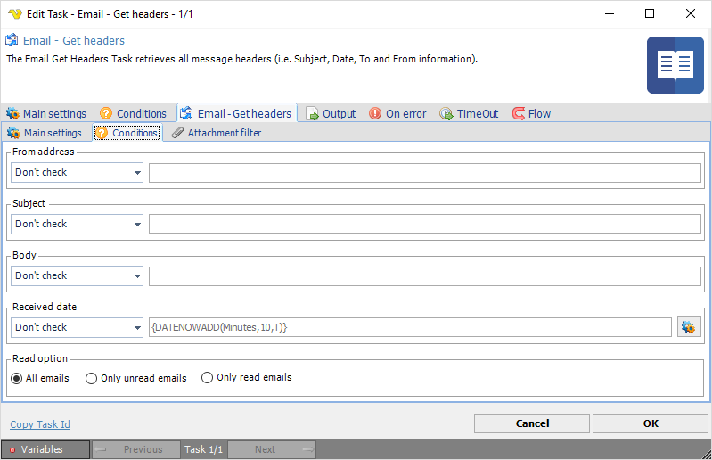
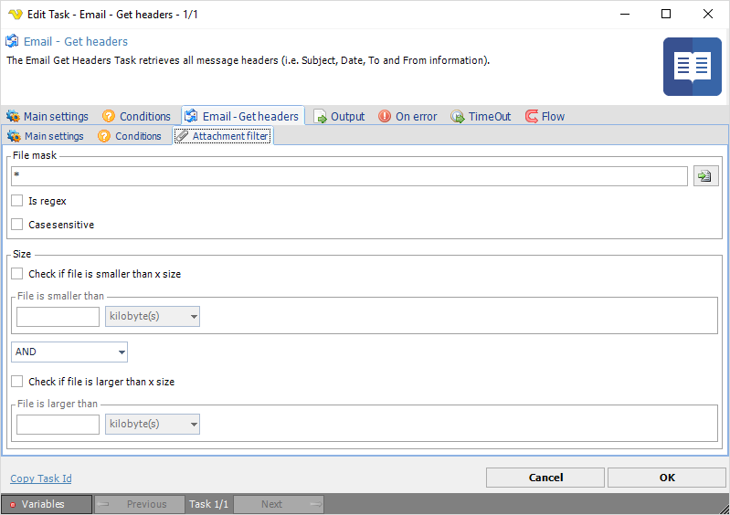

## Task Messaging - Email - Get Headers

The Email - Get headers Task lists the messages in a mail folder that match its conditions and attachment filter, using a POP3, IMAP4, Exchange EWS, Exchange WebDAV or Microsoft Graph API Connection. For each message it writes one line with the fields chosen on the ***Output*** tab, such as From, Subject and Received date.

The ***Main settings***, ***Flow***, ***On error***, ***Conditions*** and ***TimeOut*** tabs are the same for every Task; see [Job - Tasks](../../job-tasks).

### Email - Get headers: Main settings tab

- _Connection_: the Connection to the mailbox, of one of these types: [Connection - POP3](../../connection-pop3), [Connection - IMAP4](../../connection-imap4), [Connection - Exchange EWS](../../connection-exchange-ews), [Connection - Exchange WebDAV](../../connection-exchange-webdav) or [Connection - Microsoft Graph API](../../connection-microsoft-graph-api)
- _Mail folder_: the folder to read
  - _Use default folder_ (default): the default folder of the mailbox, the Inbox
  - _Use specified folder_: type the folder path, or click the folder button to choose it from the server. Choosing is not possible with POP3, and with POP3 the setting is ignored. If the folder does not exist, the Task fails with the error `Folder "<name>" not found`
  - _Is public folder_: select it when the specified folder is an Exchange public folder. It is applied with Exchange EWS and Microsoft Graph API Connections only
- _Decryption by..._: _Certificate_ is the certificate that decrypts encrypted messages; see [Global - Certificates](../../global-certificates). An encrypted message is skipped, with nothing in the output, when no certificate is selected or the certificate cannot decrypt it

### Email - Get headers: Conditions tab

A message is listed only when it matches every condition that is set.

- _From address_, _Subject_ and _Body_: each has a list and a value field. The list holds "Don't check" (default), "Equal (=)", "Not equal (!=)", "Contains (=%)" and "Not contains (!=%)"
- _Received date_: a list and a date value. The list holds "Don't check" (default), "Equal (=)", "Not equal (!=)", "Larger than (>)", "Larger than or equal (>=)", "Smaller than (<)" and "Smaller than or equal (<=)". "Larger than" means received after the date; "Smaller than" means received before it. The default value is `{DATENOWADD(Minutes,10,T)}`. With POP3, Exchange EWS and Microsoft Graph API Connections, "Equal (=)" matches only a message received at exactly that date and time, so it rarely matches. With IMAP4 and Exchange WebDAV Connections, "Smaller than (<)" also leaves out the messages received earlier on the same day as the date
- _Read option_: _All emails_ (default), _Only unread emails_ or _Only read emails_. It is not applied with POP3, which has no read state

With POP3, Exchange EWS and Microsoft Graph API Connections, VisualCron checks the conditions itself. "Contains (=%)" matches any part of the text, and case is ignored. _Body_ is compared with the text body and the HTML body of the message joined together. With a Microsoft Graph API Connection, "Equal (=)" on _Subject_ and _Body_ is case-sensitive, and on _Body_ it matches only a message whose HTML body is empty.

With IMAP4 and Exchange WebDAV Connections, the mail server runs the search, and how it compares text depends on the server. VisualCron checks "Equal (=)" on _Subject_ and _Body_ again, exactly and with case; for _Body_ it compares the text body only. These limits apply:

- "Not equal (!=)" on _Subject_ works as "Not contains (!=%)": a message is left out when its subject contains the value
- "Not equal (!=)" on _Body_ leaves out every message that contains the value in its header or body

:::warning

With IMAP4 and Exchange WebDAV Connections, every _From address_ condition acts as "Contains (=%)". "Not equal (!=)" and "Not contains (!=%)" list the messages from that address instead of leaving them out, and "Equal (=)" also lists longer addresses that contain the value. With POP3, Exchange EWS and Microsoft Graph API Connections, _From address_ is applied as set.

:::

### Email - Get headers: Attachment filter tab

When _File mask_ is not `*`, or a size check is selected, only messages with at least one matching attachment are listed; messages without attachments are left out.

- _File mask_: the attachment file names to match, for example `*.pdf`. Separate several masks with `;`. The default `*` matches every name. The browse button picks a file name from disk
- _Is regex_: _File mask_ is a regular expression
- _Case sensitive_: has no effect at present. The setting is not saved, and file names are always matched without regard to case
- _Check if file is smaller than x size_ and _Check if file is larger than x size_: each has a size value and a unit, "kilobyte(s)" by default. The list between them combines the two checks with "AND" (default) or "OR"

### Email - Get headers: Test tab

_Show filtered message headers_ runs the current settings on the Server and shows the result. _Number of lines in the result_ limits how many lines are shown.

### Output tab

- _Output to standard output_ (default) or _Output to file_: where the lines are written
- _Show mail headers_: the fields to write for each message. The default is From, Priority, Subject and Received date. ID and Index are the values that [Task Messaging - Email - Get Single Message](email-get-single-message) and [Task Messaging - Email - Delete Single Message](email-delete-single-message) use. Body is not offered on this Task
- _Include field names_: the first line holds the field names
- _Field separator_, _Text qualifier_ and _Line break_: how fields and lines are separated
- _File path_, _Append to file_ (selected by default), _Include BOM (if UTF8)_ (selected by default) and a Credential: used with _Output to file_. The file uses _Encoding_ from the Task window's ***Main settings*** tab

### Output and errors

- When no message matches, the output is empty, and the Task succeeds
- If a message cannot be downloaded from the server, the Task stops with an error
- If the Connection is missing, the Task fails with "Connection not found". If the specified folder does not exist, it fails with the error `Folder "<name>" not found` (the "No folder(s) found" cause on the ***On error*** tab)

:::warning

If a message is downloaded but cannot be processed, the error is written to the Server log, the message is left out of the output, the Task goes on with the next message, and the Task reports success.

An encrypted message that is skipped because no certificate is selected, or because the certificate cannot decrypt it, is left out of the output, and the Task reports success.

:::