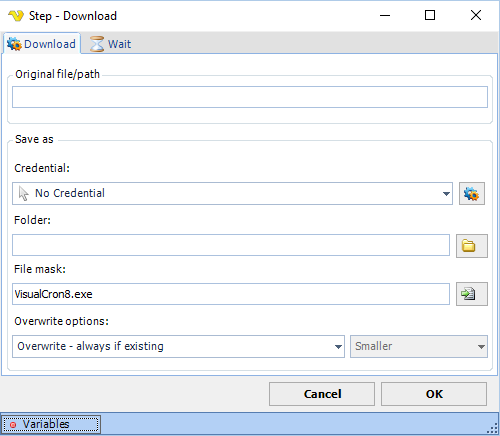

## Download Step

The Download action of the [Task Net - Web Macro](web-macro) saves a file that a web page offers for download. It is created automatically when a download starts while you record, usually after a click. The action window is titled _Action - Download_. For a worked example, see [Download By Search](download-by-search).

### Download tab

- _Original file/path_: the direct URL to download from; required when _Force download_ is selected
- _Force download_: when selected, the file is downloaded directly from the URL in _Original file/path_; when cleared, the ***Element*** tab becomes available and the download starts by clicking a web element

The _Save as_ group holds the following settings:

- _Credential_: if the folder is on a network resource, the Credential with access to it; see [Global - Credentials](../../global-credentials)
- _Folder_: required; the folder where the file is saved

  A new action is filled with the Downloads folder of the user running the Client. When the Task runs, the Server saves the file, so change the folder to one that exists on the Server. During _Test run_, the file is saved on the computer running the Client.

- _File mask_: required; the file name, or file mask, to save the file as

  A recorded action is filled with the file name the site offers; otherwise the default is "*".

- _Overwrite options_: what happens when a file with the same name already exists in the folder
  - "Overwrite - always if existing" (default): the existing file is replaced
  - "Overwrite - if destination size is": the existing file is replaced when its size matches the condition in the list next to _Overwrite options_
  - "Do not overwrite if existing": the file is not saved if one with the same name exists
- The list next to _Overwrite options_: the size condition, active only with "Overwrite - if destination size is"; "Same", "Smaller" (default), "Larger", "Smaller or larger" or "Different"

:::warning

By default, an existing file with the same name is replaced.

:::

### Element tab

Available when _Force download_ is cleared. Sets the web element that is clicked to start the download; see [Element Path](element-path). _Relative_, _By position_ and _By search_ are all available on this action. An element path is required when you click _OK_.

### Variable tab

- _Save local path to Variable_: when selected, the path of the saved file is written to the Variable set in the _Local download path Variable_ group; a Variable is then required

The _Local download path Variable_ group holds the following settings:

- _Job Variable_: selected by default; saves the path to the Job Variable selected in the list
- _User Variable_: saves the path to the User Variable selected in the list
- _Variable type_: "String" (default), "Int32" or "Double"

To reload a list of Variables, click the refresh icon next to it.

### Wait tab

Sets how long the action waits before it runs (_Wait before execute_) and after it runs (_Wait after execute_), in milliseconds. Both are "500" by default.

The step then waits until the download finishes, however long the site takes to start sending the file. To limit how long it can wait, use the Timeout tab setting on the task. After the download starts, the step fails if the browser reports no download activity for 2 minutes and the download is no longer in progress, or for 10 minutes while it is still in progress. A download that keeps reporting activity but transfers slowly is not cut off by these limits, so the Timeout tab setting is the only overall limit.
