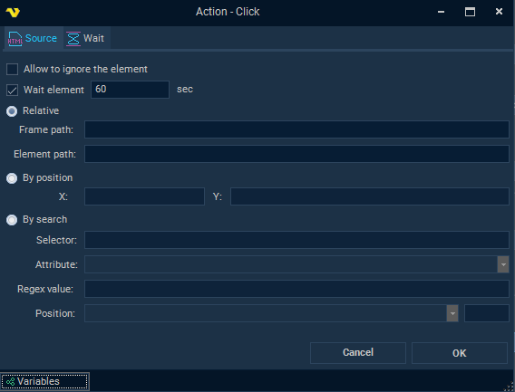
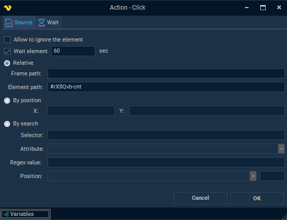
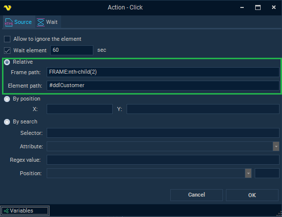
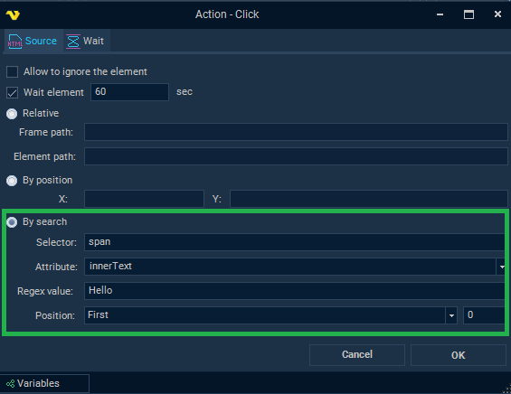
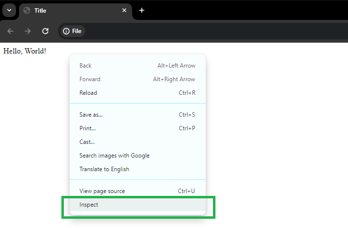
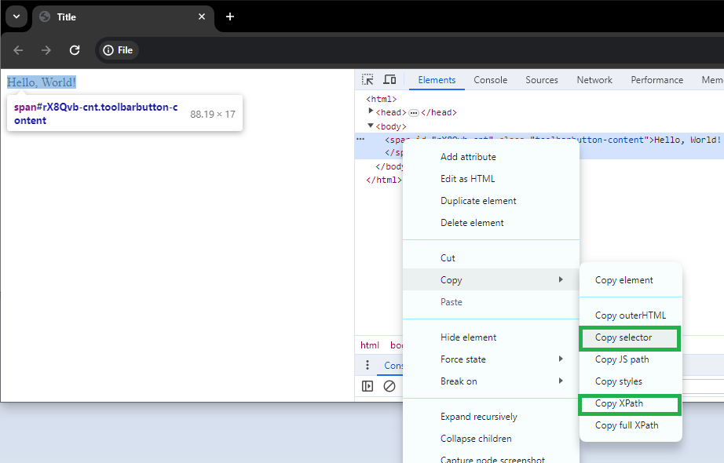

## Element Path

The settings windows of many actions in the [Task Net - Web Macro](web-macro) include a tab that sets the path to an HTML element. There are three ways to set it:

- _Relative_
- _By position_: available only on the Click, Download and Key Event actions
- _By search_



- _Allow to ignore the element_: cleared by default; when selected, a failure to find the element does not make the action fail, and the action is skipped instead
- _Wait element_: selected by default; when selected, the action waits for the element to appear in the page before it uses it, up to the timeout in seconds in the field next to it ("60" by default)

:::warning

With _Allow to ignore the element_ selected, the Task can succeed without this action's result, for example without the downloaded file or the extracted value. Use it only for elements that may be missing for a good reason, such as a cookie banner.

:::

### Relative mode

_Element path_ sets the path to the element. It can be a CSS selector or an XPath expression. A CSS selector alone is enough, but the full format of the path is:

```text
pathCss[%]pathHtml[%]pathXPath
```

- `pathCss` is a CSS selector
- `pathHtml` is an internal format for the path to the element
- `pathXPath` is an XPath expression
- `[%]` is the separator



The full path format is used in recording mode, for dependability. When you set up an action manually, the path does not need to be complete. When the action runs, the path is split at each `[%]` separator. The element is searched for first by the third part (`pathXPath`), if there is one. If it is not found, the second part (`pathHtml`) is used, and then the CSS selector (`pathCss`). If the path has no `[%]` separator, it is read as a CSS selector. To find an element by XPath only, put the XPath after two separators, for example:

```text
[%][%]/HTML/BODY/DIV[2]/FORM[1]/INPUT[1]
```
 
#### CSS selector examples

```html
<html>
 <head>
  <title>Title</title>
 </head>
 <body>
  <span id="rX8Qvb-cnt" class="toolbarbutton-content">Hello, World!</span>
 </body>
</html>
```

The example above has a `span` element. Each of these CSS selectors finds it:

| Selector type | Example |
|---|---|
| Class | `.toolbarbutton-content` |
| ID | `#rX8Qvb-cnt` |
| Type | `span` |
| Attribute | `span[id="rX8Qvb-cnt"]` |
| Child | `html > body > span` |

Each of these element paths finds it by XPath:

```text
[%][%]//*[@id="rX8Qvb-cnt"]
[%][%]/HTML/BODY/SPAN[1]
[%][%]//span[contains(., "Hello")]
```
 
#### Frame path

_Frame path_ sets the path to an inline frame, as a CSS selector. It is usually optional. Fill it in only when the element is inside an `<iframe>` tag.



### By position

Finds the element by its _X_ and _Y_ coordinates on the page. Available only on the Click, Download and Key Event actions. On the Download action, both coordinates are required when you click _OK_.
 
 
### By search

This mode finds elements with a CSS selector in _Selector_, which is passed to the JavaScript function `querySelectorAll`. The matching elements are then filtered: the value of the attribute in _Attribute_ (or the element property `innerHTML`, `outerHTML`, `innerText` or `outerText`) is matched against the regular expression in _Regex value_. Finally, _Position_ picks one element from the list: "First" is 0, "Last" is -1, and "Specific" takes another index.

On the Download action, _Selector_ is required when you click _OK_. Other actions save without it, so make sure it is filled in.



### Additional notes
 
When you set up a Click action manually, the fastest way to find the right CSS selector or XPath expression is the browser's inspector. The images below show the inspector in Google Chrome. Some selectors include quotes. In paths, use double quotes, not single quotes.




