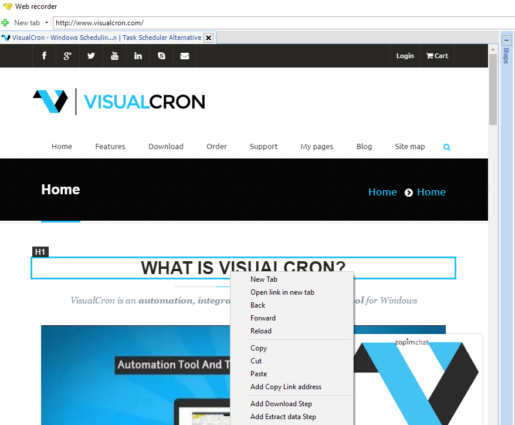
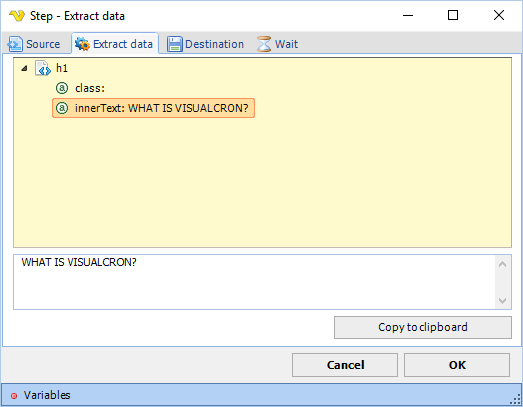
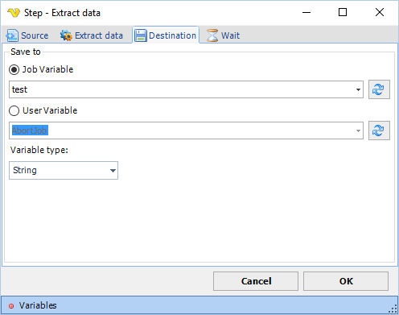

## Extract Data Step

The Extract Data action of the [Task Net - Web Macro](web-macro) reads an attribute value from a web page element and saves it to a Variable. The action window is titled _Action - Extract data_.

To add the action while recording, complete the following steps in the _Web recorder_ window:

1. Right-click the element.
2. Click _Add Extract Data action_.

### Source tab

Sets the web element to extract data from; see [Element Path](element-path).

### Extract data tab

Shows a tree of the element recorded for this action and its attributes. Select the attribute to extract; its value appears in the preview field on the right. To copy the value, click _Copy to clipboard_. An attribute must be selected before you can click _OK_.

### Destination tab

Sets the Variable that receives the value, in the _Save to_ group. A Variable is required. The value saved is the attribute selected on the ***Extract data*** tab.

- _Job Variable_: selected by default; saves the value to the Job Variable selected in the list
- _User Variable_: saves the value to the User Variable selected in the list
- _Variable type_: the data type used when the value is saved, "String" (default), "Int32" or "Double"

To reload a list of Variables, click the refresh icon next to it.

### Wait tab

Sets how long the action waits before it runs (_Wait before execute_) and after it runs (_Wait after execute_), in milliseconds. Both are "500" by default.
