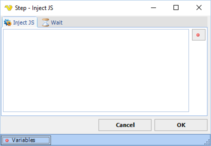

## Inject JS Step

The Inject JS action of the [Task Net - Web Macro](web-macro) runs JavaScript code on the current page. The action window is titled _Action - Inject JS_.

### Inject JS tab

Enter the JavaScript code to run in the script field. To add a Variable, click the Variables icon next to the field; the Variable is added at the end of the script. To see the available Variables, click _Variables_.

### Wait tab

Sets how long the action waits before it runs (_Wait before execute_) and after it runs (_Wait after execute_), in milliseconds. Both are "500" by default.
