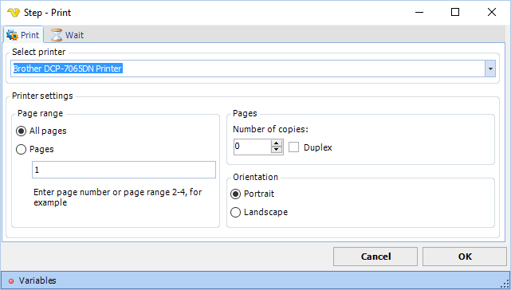

## Print Step

The Print action of the [Task Net - Web Macro](web-macro) prints the current page with the settings below. The action window is titled _Action - Print_.

### Print tab

- _Select printer_: the printer to use

  The list shows the printers installed on the Server, because the Server runs the action when the Task runs. If the printer saved in the action is no longer installed, it still shows in the list; select a printer that is installed. During _Test run_, the action runs on the computer running the Client.

- _Page range_: which pages are printed
  - _All pages_ (default): all pages
  - _Pages_: only the pages in the field next to it, as a page number or a page range, for example `2-4`; the field's default is "1"
- _Number of copies_: the number of copies to print, up to "1000"

  A new action shows "0". Set it to "1" or more.

- _Duplex_: cleared by default; when selected, prints on both sides of the page
- _Orientation_: _Portrait_ (default) or _Landscape_

### Wait tab

Sets how long the action waits before it runs (_Wait before execute_) and after it runs (_Wait after execute_), in milliseconds. Both are "500" by default.
